::: {custom-style="Title Header"}
МІНІСТЕРСТВО ОСВІТИ І НАУКИ УКРАЇНИ\
НАЦІОНАЛЬНИЙ УНІВЕРСИТЕТ “ЛЬВІВСЬКА ПОЛІТЕХНІКА”\
ІНСТИТУТ КОМП’ЮТЕРНИХ НАУК ТА ІНФОРМАЦІЙНИХ ТЕХНОЛОГІЙ
:::

::: {custom-style="Title Right"}
кафедра систем штучного інтелекту
:::

::: {custom-style="Title Center"}
{width=7cm}
:::

::: {custom-style="Title Center"}
\
**ЗВІТ**

про виконання лабораторної роботи № 2\
з курсу «Штучний інтелект та інноваційні інформаційні технології»\
на тему: «Побудова та аналіз моделей ШІ з використанням TensorFlow і PyTorch»\
\
\
:::

::: {custom-style="Title Signature"}
Виконав:\
*ст. групи КНСШ-13*\
*Каспрович Р. Б.*\
Перевірив:\
*доц. каф. СШІ, к.т.н.,*\
*Думин І. Б.*
:::

::: {custom-style="Title Center"}
\
\
ЛЬВІВ - 2026
:::

<!-- pagebreak -->

# Мета роботи

Опанувати практику створення й оптимізації моделей машинного навчання у **PyTorch**. Навчитися застосовувати різні архітектури, регуляризацію та методи покращення узагальнюючої здатності моделі. Виконати порівняльний аналіз результатів, а також порівняти реалізації у **TensorFlow** (лабораторна робота №1) і **PyTorch** (лабораторна робота №2).

*Примітка.* Відповідно до завдання, у лабораторній роботі №2 усі пункти виконано на PyTorch. Щоб порівняння фреймворків було коректним, використано той самий набір даних, той самий конвеєр препроцесингу, той самий поділ на вибірки, ті самі архітектури та гіперпараметри, що й у лабораторній роботі №1. Відрізняється лише фреймворк, у якому реалізовано й навчено мережі.

# Хід роботи

## Крок 1. Середовище та структура проєкту

Програмний код лабораторної роботи розміщено в репозиторії GitHub: https://github.com/Kasprovych/ai_labs.

- Python 3.13, **PyTorch 2.15** (CPU), scikit-learn 1.9, imbalanced-learn 0.14, pandas, matplotlib, seaborn.
- Запуск: `python main_lab2.py`. Весь конвеєр (EDA → препроцесинг → навчання 6 моделей → графіки → таблиці → порівняння з TensorFlow) виконується однією командою.
- **Відтворюваність:** seed `42` для Python, NumPy і PyTorch (`torch.manual_seed`) та детерміновані алгоритми (`torch.use_deterministic_algorithms(True)`). Seed встановлюється на старті та повторно перед кожним експериментом. Повторний запуск дає ідентичні метрики (перевірено двома прогонами).
- Модулі завантаження даних, EDA, препроцесингу, метрик і графіків спільні для обох лабораторних. Для PyTorch додано лише фреймворк-специфічні частини: побудову моделей і цикл навчання.

```text
main_lab2.py                          # оркестратор пайплайна ЛР2 (PyTorch)
src/models/torch_builder.py           # Baseline і Regularized архітектури на PyTorch
src/training/torch_trainer.py         # цикл навчання, підбір порогу, оцінка
src/comparison/framework_comparison.py # порівняння з результатами TensorFlow (ЛР1)
src/data/loader.py, preprocessor.py   # спільні з ЛР1: дані, split, scaling, SMOTE
src/eda/analyzer.py                   # спільний з ЛР1: EDA та графіки
src/training/evaluator.py, results.py # спільні метрики та DTO результатів
src/visualization/plots.py            # спільні графіки
artifacts/lab2/                       # графіки, моделі (.pt), лог і таблиці ЛР2
```

## Крок 2. Вибір набору даних

Обрано **Credit Card Fraud Detection** (Kaggle, ULB), як і в лабораторній роботі №1. Це бінарна класифікація з сильним дисбалансом класів.

Table: Таблиця 1. Характеристики набору даних Credit Card Fraud Detection

| Характеристика | Значення |
| :--- | :--- |
| Кількість транзакцій | 284 807 |
| Вхідні ознаки | 30: Time, Amount, V1-V28 (PCA-компоненти) |
| Клас 0 (легітимні) | 284 315 (99.827%) |
| Клас 1 (шахрайство) | 492 (0.173%) |
| Співвідношення класів | ≈ 1 : 578 |
| Пропущені значення | 0 |

Через такий дисбаланс **Accuracy неінформативна**: модель, яка завжди відповідає «0», отримує 99.83%. Тому основні метрики тут **Precision, Recall, F1-Score та PR-AUC**.

## Крок 3. Розвідувальний аналіз даних (EDA)

**3.1. Дисбаланс класів.** Розподіл класів показано в лінійному та логарифмічному масштабі. У лінійному шахрайський клас майже не видно.

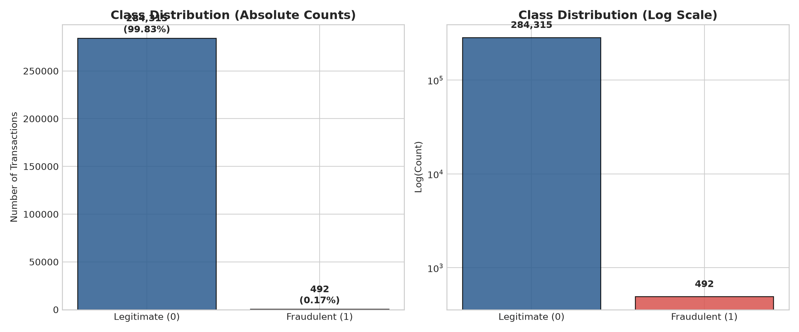{width=16cm}

**3.2. Розподіл усіх ознак.** Гістограми всіх 30 ознак з логарифмічною віссю частот і коефіцієнтом асиметрії (skew). Amount має сильну правосторонню асиметрію і викиди, тому для неї обрано RobustScaler. V1-V28 центровані біля нуля (результат PCA), але багато з них мають важкі хвости.

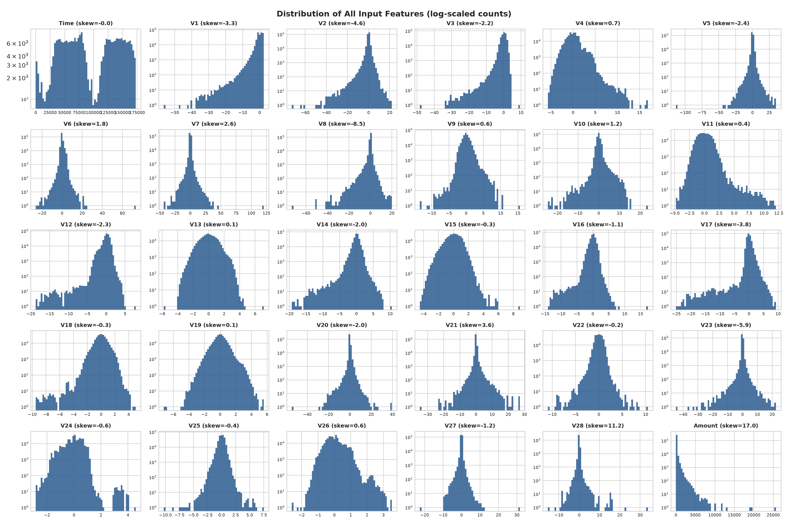{width=16cm}

**3.3. Розподіл найінформативніших ознак за класами (KDE).** Для V14, V17, V12 розподіл шахрайських транзакцій помітно зсунутий у від'ємний бік, для V4 у додатний. Саме ці ознаки найкраще розділяють класи.

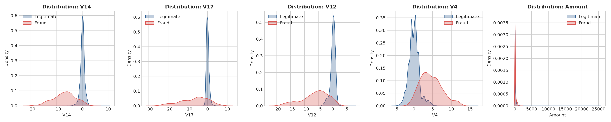{width=16cm}

**3.4. Кореляційний аналіз.** Кореляційна матриця Пірсона 31×31 і топ ознак, корельованих із Class. Ознаки V1-V28 між собою майже не корелюють, бо PCA-компоненти ортогональні. Найсильніша кореляція з цільовою змінною: V17, V14, V12 (від'ємна) та V11, V4 (додатна). За модулем кореляції не перевищують ~0.33, тобто залежність нелінійна і слабо виражена. Це аргумент на користь нейромережі замість лінійної моделі.

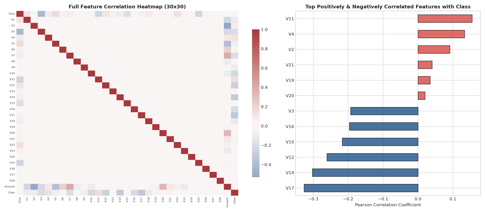{width=16cm}

## Крок 4. Попередня обробка даних

Використано той самий конвеєр, що й у лабораторній роботі №1 (модуль `src/data/preprocessor.py`), тому обидва фреймворки отримують побітово однакові вхідні масиви.

1. **Видалення дублікатів.** У датасеті 1 081 повністю ідентичний рядок. Без видалення той самий запис може потрапити і в train, і в test, що завищує метрики. Після дедуплікації лишилося 283 726 записів.
2. **Масштабування.** Time і Amount масштабуються через RobustScaler (медіана/IQR, стійкий до викидів). Scaler навчається **тільки на train**, до val/test застосовується лише `transform`, тож витоку даних немає.
3. **Балансування SMOTE.** Застосовано **тільки до train** з `sampling_strategy=0.2`: кількість шахрайських прикладів збільшено до 20% від легітимних. Val і test зберігають реальний розподіл.

Далі NumPy-масиви перетворюються на тензори PyTorch і подаються в модель через `DataLoader`:

```python
# src/training/torch_trainer.py — дані для PyTorch
generator = torch.Generator().manual_seed(self._config.random_seed)
train_loader = DataLoader(
    TensorDataset(torch.from_numpy(data.x_train), torch.from_numpy(data.y_train.astype(np.float32))),
    batch_size=self._config.batch_size,
    shuffle=True,
    generator=generator   # відтворюваний порядок батчів
)
```

## Крок 5. Train / Validation / Test split

Стратифікований поділ (`stratify=y`) у пропорції 70 / 15 / 15 з тим самим seed, що й у ЛР1. Тестова вибірка в обох лабораторних однакова.

Table: Таблиця 2. Розміри вибірок після стратифікованого поділу

| Вибірка | До SMOTE | Після SMOTE | Шахрайських |
| :--- | ---: | ---: | ---: |
| Train | 198 608 | 237 932 | 331 → 39 655 |
| Validation | 42 559 | — | 71 |
| Test | 42 559 | — | 71 |

*Примітка. У тестовій вибірці лише 71 шахрайська транзакція. Один правильно чи неправильно класифікований приклад змінює Recall на ≈1.4 п.п., і це треба враховувати, коли порівнюєш близькі результати, зокрема результати двох фреймворків.*

## Крок 6. Архітектури нейронних мереж

**Архітектура 1: базова feedforward мережа (Baseline FFN).** Два приховані шари, без регуляризації.

```text
Input(30) → Linear(64) → act → Linear(32) → act → Linear(1) → [sigmoid у loss]
```

**Архітектура 2: ускладнена мережа (Regularized).** Dropout, Batch Normalization та L2-регуляризація.

```text
Input(30) → [Linear(64, no bias) → BatchNorm1d → act → Dropout(0.3)]
          → [Linear(32, no bias) → BatchNorm1d → act → Dropout(0.3)]
          → Linear(1),  L2 = 1e-4 на ваги прихованих шарів
```

```python
# src/models/torch_builder.py — TorchRegularizedModelBuilder.build()
modules: List[nn.Module] = []
in_features = input_dim
for units in self._hidden_units:
    modules += [
        nn.Linear(in_features, units, bias=False),
        nn.BatchNorm1d(units, momentum=KERAS_BN_MOMENTUM, eps=KERAS_BN_EPSILON),
        make_activation(self._activation),
        nn.Dropout(self._dropout_rate),
    ]
    in_features = units
modules.append(nn.Linear(in_features, 1))
return FeedForwardNet(nn.Sequential(*modules), l2_factor=self._l2_factor)
```

У PyTorch немає аналога `kernel_regularizer` з Keras, тому L2-штраф реалізовано явно: мережа повертає його методом `regularization_loss()`, а цикл навчання додає до функції втрат. Параметр `weight_decay` оптимізатора Adam не є еквівалентом: він штрафує також параметри BatchNorm і зсуви та не входить у значення loss.

```python
# src/models/torch_builder.py — FeedForwardNet
def regularization_loss(self) -> torch.Tensor:
    """L2 penalty on hidden Linear kernels, identical to Keras kernel_regularizer=l2(factor)."""
    hidden = [m for m in self.layers if isinstance(m, nn.Linear)][:-1]
    if self._l2_factor == 0.0 or not hidden:
        return torch.zeros(())
    return self._l2_factor * sum(m.weight.pow(2).sum() for m in hidden)
```

**Узгодження з Keras.** Типові значення двох фреймворків відрізняються. Щоб різниця в результатах залежала від фреймворку, а не від прихованих гіперпараметрів, у PyTorch явно відтворено типові значення Keras:

Table: Таблиця 3. Типові значення Keras і PyTorch та прийняті налаштування

| Параметр | Keras (ЛР1) | PyTorch за замовчуванням | Прийнято в ЛР2 |
| :--- | :--- | :--- | :--- |
| Ініціалізація ваг | Glorot uniform, bias = 0 | Kaiming uniform | Xavier (Glorot) uniform, bias = 0 |
| BatchNorm momentum | 0.99 | 0.1 (інша формула: 1 − m) | 0.01 (≡ 0.99 у Keras) |
| BatchNorm epsilon | 1e-3 | 1e-5 | 1e-3 |
| LeakyReLU α | 0.3 | 0.01 | 0.3 |
| Adam epsilon | 1e-7 | 1e-8 | 1e-7 |
| Вихід / loss | sigmoid + binary_crossentropy | — | logits + BCEWithLogitsLoss |
| L2 | kernel_regularizer | немає (лише weight_decay) | явний штраф у loss |

Кількість параметрів моделей в обох фреймворках однакова: Baseline має 4 097 параметрів; Regularized має 4 193 параметри, що навчаються, і 192 статистики BatchNorm (running mean/var), які не навчаються (у Keras ті самі 4 385 параметрів).

## Крок 7. Функції активації

Кожну з двох архітектур навчено з усіма трьома активаціями, разом **6 експериментів** (як і в ЛР1):

Table: Таблиця 4. Досліджувані функції активації

| Активація | Формула | Реалізація в PyTorch |
| :--- | :--- | :--- |
| ReLU | max(0, x) | `nn.ReLU()` |
| LeakyReLU | max(αx, x), α = 0.3 | `nn.LeakyReLU(negative_slope=0.3)` |
| GELU | x·Φ(x) | `nn.GELU(approximate="none")` |

```python
# main_lab2.py — 2 архітектури × 3 активації
activations = ["relu", "leaky_relu", "gelu"]
model_builders: List[ITorchModelBuilder] = [
    *(TorchBaselineModelBuilder(activation=act, hidden_units=[64, 32]) for act in activations),
    *(TorchRegularizedModelBuilder(activation=act, hidden_units=[64, 32], dropout_rate=0.3, l2_factor=1e-4)
      for act in activations),
]
```

## Крок 8. Навчання з фіксованими гіперпараметрами

Для всіх 6 моделей гіперпараметри однакові та збігаються з ЛР1:

Table: Таблиця 5. Гіперпараметри навчання

| Параметр | Значення |
| :--- | :--- |
| Епохи | 15 |
| Optimizer | Adam |
| Learning rate | 0.001 |
| Batch size | 512 |
| Loss | Binary Cross-Entropy (BCEWithLogitsLoss) |
| Seed | 42 (перед кожним експериментом) |
| Пристрій | CPU |

На відміну від Keras, де навчання запускається одним викликом `model.fit()`, у PyTorch цикл навчання написано вручну: перемикання режимів `train()`/`eval()` (важливо для Dropout і BatchNorm), обнулення градієнтів, прямий прохід, обчислення loss, зворотне поширення і крок оптимізатора.

```python
# src/training/torch_trainer.py — одна епоха навчання
model.train()
for x_batch, y_batch in loader:
    optimizer.zero_grad()
    logits = model(x_batch)
    # як у Keras, loss навчання включає L2-штраф
    loss = criterion(logits, y_batch) + model.regularization_loss()
    loss.backward()
    optimizer.step()
```

```python
# src/training/torch_trainer.py — передбачення без градієнтів, у режимі eval
@torch.no_grad()
def _predict_logits(self, model: FeedForwardNet, x: np.ndarray) -> torch.Tensor:
    model.eval()
    x_tensor = torch.from_numpy(x).to(self._device)
    return torch.cat([model(batch) for batch in torch.split(x_tensor, self._config.batch_size)])
```

## Крок 9. Метрики якості

Оцінка проводилась на **незалежній тестовій вибірці** (42 559 транзакцій, 71 шахрайство). Через дисбаланс використано Precision, Recall, F1, ROC-AUC, PR-AUC (Average Precision) та матрицю помилок. Модуль метрик спільний з ЛР1.

**Поріг класифікації.** SMOTE змінює апріорну частку шахрайства з 0.17% до ~17%, тому ймовірності мережі зміщені вгору і стандартний поріг 0.5 дає забагато хибних тривог. Тому для кожної моделі додатково підібрано F1-оптимальний поріг на валідаційній вибірці. Test-вибірка в підборі не бере участі.

```python
# src/training/torch_trainer.py — поріг підбирається на val, оцінка на test
val_pred_proba = self.predict_proba(model, data.x_val)
tuned_threshold = MetricsEvaluator.find_best_f1_threshold(data.y_val, val_pred_proba)
test_pred_proba = self.predict_proba(model, data.x_test)
test_metrics_tuned = MetricsEvaluator.evaluate(builder.name, data.y_test, test_pred_proba,
                                               threshold=tuned_threshold)
```

Table: Таблиця 6. Тестові метрики PyTorch-моделей при порозі 0.5

| Модель | Precision | Recall | F1 | ROC-AUC | PR-AUC | TP | FP | FN |
| :--- | :---: | :---: | :---: | :---: | :---: | :---: | :---: | :---: |
| Baseline ReLU | **0.743** | 0.775 | **0.759** | 0.953 | **0.776** | 55 | **19** | 16 |
| Baseline LeakyReLU | 0.625 | 0.775 | 0.692 | 0.946 | 0.739 | 55 | 33 | 16 |
| Baseline GELU | 0.667 | 0.761 | 0.711 | 0.944 | 0.701 | 54 | 27 | 17 |
| Regularized ReLU | 0.644 | 0.817 | 0.721 | 0.951 | 0.733 | 58 | 32 | 13 |
| Regularized LeakyReLU | 0.536 | **0.831** | 0.652 | 0.956 | 0.694 | **59** | 51 | **12** |
| Regularized GELU | 0.518 | 0.803 | 0.630 | **0.960** | 0.741 | 57 | 53 | 14 |

Table: Таблиця 7. Тестові метрики PyTorch-моделей при F1-оптимальному порозі (підібраному на validation)

| Модель | Поріг | Precision | Recall | F1 | TP | FP | FN |
| :--- | :---: | :---: | :---: | :---: | :---: | :---: | :---: |
| Baseline ReLU | 0.886 | 0.848 | 0.704 | 0.769 | 50 | **9** | 21 |
| Baseline LeakyReLU | 0.805 | 0.750 | 0.718 | 0.734 | 51 | 17 | 20 |
| Baseline GELU | 0.978 | 0.853 | 0.732 | 0.788 | 52 | **9** | 19 |
| Regularized ReLU | 0.980 | **0.862** | **0.789** | **0.824** | **56** | **9** | **15** |
| Regularized LeakyReLU | 0.966 | 0.809 | 0.775 | 0.791 | 55 | 13 | 16 |
| Regularized GELU | 0.980 | 0.828 | 0.746 | 0.785 | 53 | 11 | 18 |

ROC-AUC і PR-AUC від порогу не залежать і збігаються з таблицею 6.

**Матриці помилок при порозі 0.5:**

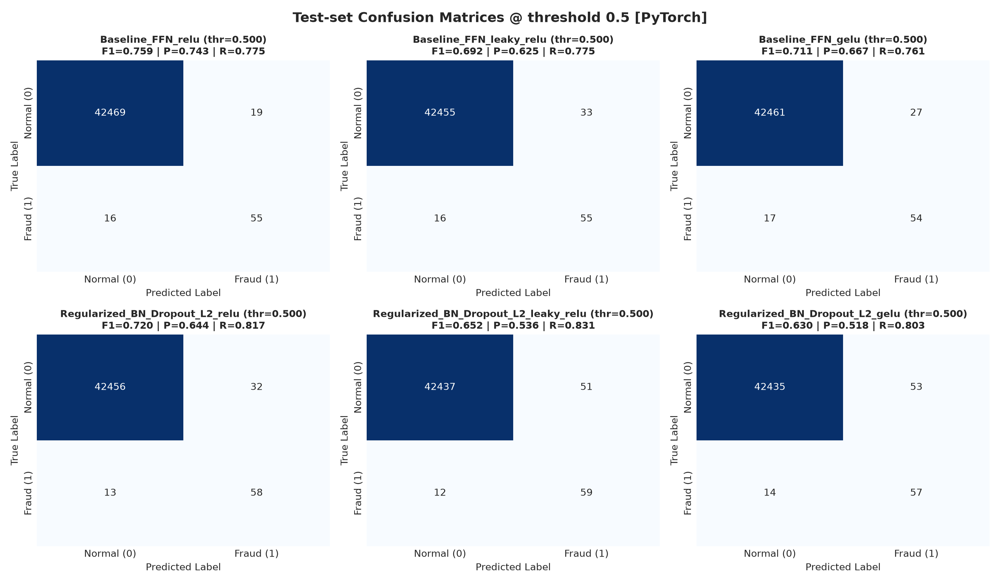{width=16cm}

**Матриці помилок при порозі, підібраному на validation** (за ними обрано найкращу модель; Regularized ReLU: 56 TP, 9 FP, 15 FN):

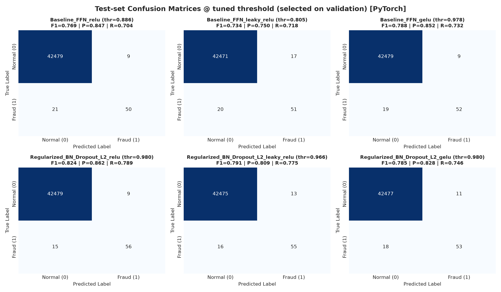{width=16cm}

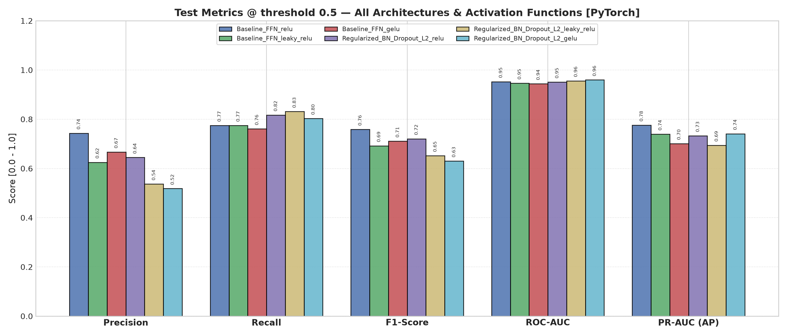{width=16cm}

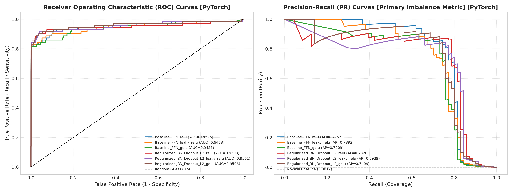{width=16cm}

## Крок 10. Навчальні криві

Окремий графік train/val для кожної моделі. Вертикальна лінія позначає епоху з мінімальним val loss.

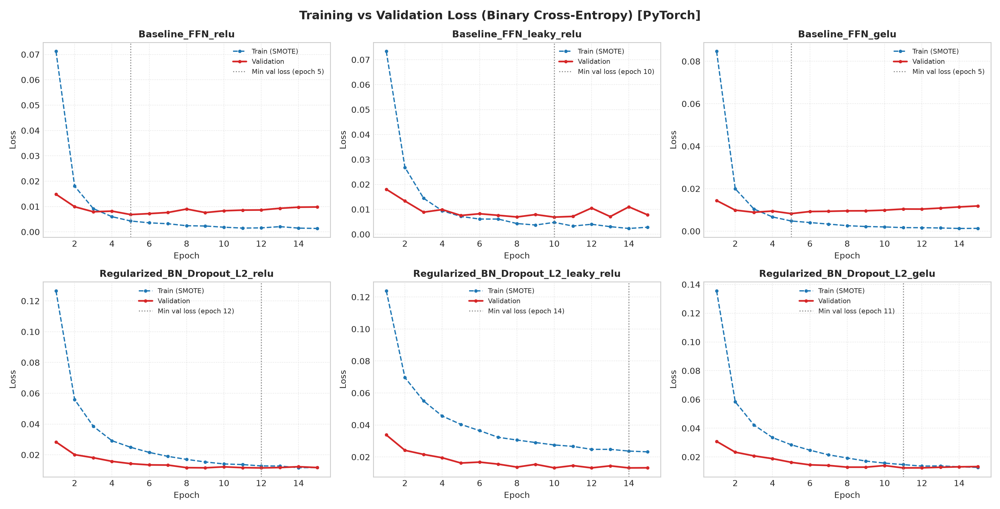{width=16cm}

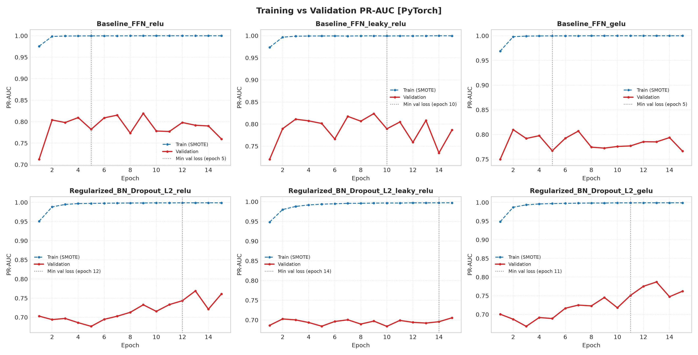{width=16cm}

Table: Таблиця 8. Діагностика пере- та недонавчання PyTorch-моделей

| Модель | Train loss (15 еп.) | Val loss (15 еп.) | Мін. val loss | Епоха мінімуму | Ріст val loss після мінімуму |
| :--- | :---: | :---: | :---: | :---: | :---: |
| Baseline ReLU | 0.0013 | 0.0098 | 0.0068 | 5 | **+44.0%** |
| Baseline LeakyReLU | 0.0028 | 0.0078 | 0.0069 | 10 | +13.1% |
| Baseline GELU | 0.0013 | 0.0119 | 0.0082 | 5 | **+44.0%** |
| Regularized ReLU | 0.0117 | 0.0117 | 0.0115 | 12 | +2.0% |
| Regularized LeakyReLU | 0.0232 | 0.0132 | 0.0132 | 14 | +0.5% |
| Regularized GELU | 0.0127 | 0.0133 | 0.0124 | 11 | +7.4% |

## Крок 11. Порівняння TensorFlow і PyTorch

Результати TensorFlow взято з артефактів лабораторної роботи №1 (`artifacts/metrics_summary.md`, `artifacts/run_output.txt`). Таблицю й графік порівняння програма будує автоматично (модуль `src/comparison/framework_comparison.py`).

Table: Таблиця 9. Тестові метрики TensorFlow (ЛР1) і PyTorch (ЛР2) при порозі, підібраному на validation

| Модель | F1 TF | F1 PT | ΔF1 | PR-AUC TF | PR-AUC PT | ROC-AUC TF | ROC-AUC PT | TP/FP/FN TF | TP/FP/FN PT |
| :--- | :---: | :---: | :---: | :---: | :---: | :---: | :---: | :---: | :---: |
| Baseline ReLU | 0.750 | 0.769 | +0.019 | 0.750 | 0.776 | 0.957 | 0.953 | 51/14/20 | 50/9/21 |
| Baseline LeakyReLU | 0.774 | 0.734 | −0.040 | 0.768 | 0.739 | 0.953 | 0.946 | 53/13/18 | 51/17/20 |
| Baseline GELU | 0.765 | 0.788 | +0.023 | 0.761 | 0.701 | 0.946 | 0.944 | 52/13/19 | 52/9/19 |
| Regularized ReLU | 0.779 | **0.824** | +0.044 | 0.759 | 0.733 | 0.959 | 0.951 | 53/12/18 | 56/9/15 |
| Regularized LeakyReLU | **0.797** | 0.791 | −0.006 | 0.705 | 0.694 | 0.957 | 0.956 | 55/12/16 | 55/13/16 |
| Regularized GELU | 0.776 | 0.785 | +0.009 | 0.767 | 0.741 | 0.958 | 0.960 | 52/11/19 | 53/11/18 |
| **Середнє** | 0.774 | 0.782 | +0.008 | 0.752 | 0.731 | 0.955 | 0.952 | | |

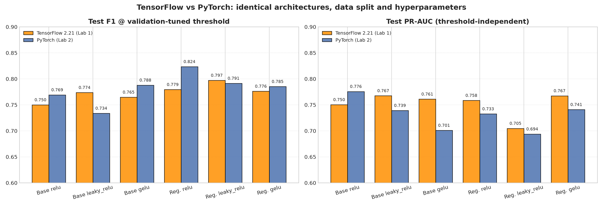{width=16cm}

Table: Таблиця 10. Порівняння базової та регуляризованої архітектури у двох фреймворках (середній F1 за трьома активаціями)

| Архітектура | TF, поріг 0.5 | PT, поріг 0.5 | TF, підібраний поріг | PT, підібраний поріг |
| :--- | :---: | :---: | :---: | :---: |
| Baseline FFN | 0.685 | 0.720 | 0.763 | 0.764 |
| Regularized (BN + Dropout + L2) | 0.650 | 0.667 | 0.784 | **0.800** |

Table: Таблиця 11. Час одного експерименту (навчання 15 епох, підбір порогу, оцінка), с

| Модель | TensorFlow 2.21 | PyTorch 2.15 |
| :--- | :---: | :---: |
| Baseline ReLU | 8 | 13 |
| Baseline LeakyReLU | 8 | 13 |
| Baseline GELU | 11 | 14 |
| Regularized ReLU | 12 | 21 |
| Regularized LeakyReLU | 12 | 22 |
| Regularized GELU | 15 | 23 |
| **Разом** | **66** | **106** |

Час виміряно однаково для обох фреймворків: від запису «Starting experiment» до збереження моделі в лозі (точність 1 с), на тому самому комп'ютері (Apple Silicon, CPU). У PyTorch-версії в цей час входить також обчислення PR-AUC і ROC-AUC через scikit-learn після кожної епохи.

## Крок 12. Скріншоти виконання програми

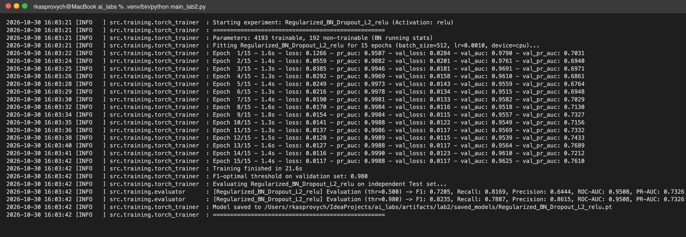{width=16cm}

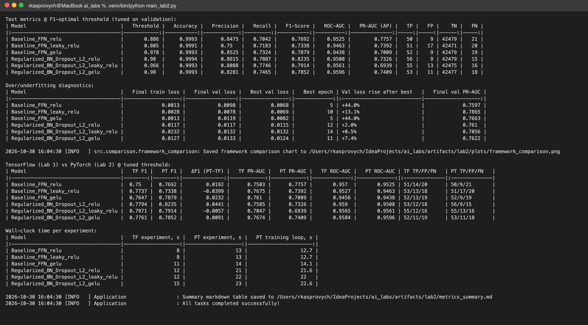{width=16cm}

Додатково наведено текстовий фрагмент логу (повний лог у `artifacts/lab2/run_output.txt`):

```text
[INFO] Initializing Laboratory Work #2 Deep Learning Pipeline (PyTorch 2.15.0)...
[INFO] Configuration loaded: Epochs=15, BatchSize=512, LearningRate=0.0010, Seed=42, Device=cpu
[INFO] Dataset ready: 284807 records, 30 features. Class balance: 0=284315, 1=492 (0.173% fraud)
[INFO] Removed 1081 duplicate rows (284807 -> 283726)
[INFO] Dataset split completed: Train=198608, Val=42559, Test=42559 (Stratified)
[INFO] SMOTE applied: original 198608 samples -> resampled 237932 samples (positives: 39655)
[INFO] Configured 6 distinct model experiments for training.
...
[INFO] Starting experiment: Regularized_BN_Dropout_L2_relu (Activation: relu)
[INFO] Parameters: 4193 trainable, 192 non-trainable (BN running stats)
[INFO] Training finished in 21.6s
[INFO] F1-optimal threshold on validation set: 0.980
[INFO] [Regularized_BN_Dropout_L2_relu] Evaluation (thr=0.980) -> F1: 0.8235, Recall: 0.7887,
       Precision: 0.8615, ROC-AUC: 0.9508, PR-AUC: 0.7326 (TP=56, FP=9, FN=15)
...
[INFO] All tasks completed successfully!
```

# Аналіз результатів

## 1. Перенавчання та недонавчання

- **Базова мережа перенавчається і в PyTorch.** У ReLU і GELU train loss падає до 0.0013, а val loss досягає мінімуму на 5-й епосі і далі росте на 44%. Це той самий характер, що й у TensorFlow (мінімум на 5–6 епосі, ріст на 32–46%). Отже, перенавчання є властивістю архітектури і даних, а не фреймворку. Без регуляризації варто зупиняти навчання на 5-й епосі (early stopping).
- **Регуляризація прибирає перенавчання.** У регуляризованих моделях train і val loss майже збігаються (0.0117 / 0.0117 для ReLU), а ріст val loss після мінімуму становить лише 0.5–7.4% (у TensorFlow 0–11%). Те, що train loss вищий за val loss, не є помилкою: Dropout активний лише під час навчання, до train loss додається L2-штраф, а train після SMOTE містить ~17% складних позитивних прикладів.
- **Ознаки недонавчання.** Regularized LeakyReLU має найвищий train loss (0.0232) і мінімум val loss на 14-й епосі, тобто за 15 епох модель ще не зійшлася. Це повторює результат ЛР1. Baseline LeakyReLU у PyTorch вже почала перенавчатися (+13% після 10-ї епохи), тоді як у TensorFlow мінімум припав на 15-ту епоху. LeakyReLU-мережі збігаються повільніше, і точка початку перенавчання залежить від випадкової ініціалізації.
- **Розрив PR-AUC train ≈ 1.0 проти val ≈ 0.70–0.79** пояснюється різною часткою позитивних прикладів (17% на train після SMOTE проти 0.17% на val), а не лише перенавчанням.

## 2. Базова чи регуляризована архітектура

- **При порозі 0.5** найкращий F1 знову має Baseline ReLU (0.759), бо вона дає найменше хибних тривог (19 FP). Регуляризовані моделі знаходять більше шахрайств (Recall 0.80–0.83), але мають 32–53 FP.
- **Після підбору порогу** регуляризовані моделі кращі: середній F1 **0.800 проти 0.764** у базових (у TensorFlow 0.784 проти 0.763). Найкраща PyTorch-модель, **Regularized ReLU, має F1 = 0.824** (Precision 0.862, Recall 0.789, 56 з 71 шахрайства знайдено при 9 FP). Це найкращий результат серед усіх 12 моделей обох лабораторних.
- Висновок ЛР1 підтверджено в іншому фреймворку: для цієї задачі регуляризація (BN + Dropout + L2) разом із підбором порогу працює краще, а оцінка лише при порозі 0.5 вводить в оману.

## 3. Порівняння функцій активації

Table: Таблиця 12. F1-Score PyTorch-моделей при порозі 0.5 та при підібраному порозі

| Активація | F1 Baseline (thr 0.5 → tuned) | F1 Regularized (thr 0.5 → tuned) |
| :--- | :---: | :---: |
| ReLU | 0.759 → 0.769 | 0.721 → **0.824** |
| LeakyReLU | 0.692 → 0.734 | 0.652 → 0.791 |
| GELU | 0.711 → **0.788** | 0.630 → 0.785 |

- У PyTorch найкращою виявилася **ReLU** у регуляризованій мережі та **GELU** у базовій. У TensorFlow найкращою була LeakyReLU в обох архітектурах. Тобто **рейтинг активацій між фреймворками не відтворився**.
- Це підтверджує застереження з ЛР1: різниця між активаціями (0.01–0.05 F1, тобто 1–4 транзакції з 71) порівнянна з різницею, яку дає сама зміна фреймворку при однаковій архітектурі (до 0.044 F1). Отже, вона в межах шуму одного запуску, і жодна з трьох активацій не має доведеної переваги для цієї задачі.
- Стабільні закономірності для обох фреймворків: LeakyReLU збігається повільніше; Regularized LeakyReLU має найнижчий PR-AUC (0.705 у TF, 0.694 у PT); GELU у базовій мережі перенавчається найсильніше.

## 4. Порівняння TensorFlow і PyTorch

**Якість.** За однакових даних, архітектур і гіперпараметрів фреймворки дали статистично нерозрізненні результати: середній F1 0.774 (TF) проти 0.782 (PT), середній ROC-AUC 0.955 проти 0.952, середній PR-AUC 0.752 проти 0.731. Різниця в окремих моделях (від −0.040 до +0.044 F1) відповідає 1–3 транзакціям з 71. Причина розбіжностей не в «точності» фреймворку, а в різних генераторах випадкових чисел: однаковий seed 42 у TensorFlow і PyTorch дає різні початкові ваги, порядок батчів і маски Dropout, тобто це фактично два різні запуски. Додатково PR-AUC під час навчання в Keras обчислюється інтерполяцією по 200 порогах, а в ЛР2 через `average_precision_score` (на тестових метриках це не впливає, там в обох випадках scikit-learn).

**Швидкість.** На CPU TensorFlow швидший приблизно в 1.6 раза (66 с проти 106 с на 6 експериментів). `model.fit` у Keras компілює крок навчання в граф (tf.function), а PyTorch виконує цикл у eager-режимі з накладними витратами Python на кожен батч (465 батчів за епоху). Частину часу PyTorch-версії займає також обчислення метрик scikit-learn після кожної епохи. Для мережі на ~4 тис. параметрів ці накладні витрати домінують; для великих моделей на GPU різниця зазвичай незначна.

Table: Таблиця 13. Переваги та недоліки реалізацій у двох фреймворках

| Критерій | TensorFlow / Keras (ЛР1) | PyTorch (ЛР2) |
| :--- | :--- | :--- |
| Обсяг коду | менше: `compile()` + `fit()`, вбудовані метрики й історія | більше: цикл навчання, валідація, історія метрик пишуться вручну |
| Контроль і прозорість | цикл прихований у `fit()`, кастомізація через callbacks | повний контроль кожного кроку, легко змінити loss, логування, порядок дій |
| Регуляризація L2 | вбудована (`kernel_regularizer`) | реалізується вручну (`weight_decay` не еквівалентний) |
| Режими train / eval | перемикаються автоматично | треба явно викликати `model.train()` / `model.eval()` і `torch.no_grad()` — легко помилитися |
| Налагодження | складніше через графове виконання | простіше: eager-режим, звичайний Python-дебагер |
| Відтворюваність | `set_random_seed` | `manual_seed` + `use_deterministic_algorithms` + seed для `DataLoader` |
| Швидкість (CPU, мала мережа) | швидше (≈1.6×) | повільніше через eager-цикл |
| Збереження моделі | `.keras` (архітектура + ваги) | `state_dict` (`.pt`, лише ваги; архітектуру відтворює код) |
| Типові значення | glorot, BN momentum 0.99, LeakyReLU α = 0.3 | kaiming, BN momentum 0.1, LeakyReLU α = 0.01 — для коректного порівняння їх довелося узгодити |

## 5. Що працює краще для цієї задачі

1. **Підбір порогу на validation** знову дав найбільший приріст: F1 +0.01…+0.16 для кожної моделі в обох фреймворках. Після SMOTE це обов'язковий крок.
2. **Регуляризація (BN + Dropout + L2)** усуває перенавчання, яке у базовій мережі починається після 5-ї епохи, і дає найкращий середній F1 в обох фреймворках.
3. **Вибір активації** не має стабільного впливу: найкраща активація змінилася при зміні фреймворку.
4. **Вибір фреймворку** не впливає на якість моделі при коректно узгоджених налаштуваннях. Він впливає на зручність розробки та швидкість.

# Висновки

1. Усі пункти завдання лабораторної роботи №2 виконано на PyTorch 2.15: EDA, препроцесинг (дедуплікація, RobustScaler, SMOTE), стратифікований split 70/15/15, дві архітектури (базова FFN і мережа з BatchNorm + Dropout + L2), порівняння трьох функцій активації (ReLU, LeakyReLU, GELU) для кожної архітектури, навчання 15 епох з фіксованими Adam і lr = 0.001, метрики для незбалансованих даних і навчальні криві.
2. Найкращий результат на тестовій вибірці показала **Regularized ReLU (PyTorch) з порогом, підібраним на validation: F1 = 0.824, Precision = 0.862, Recall = 0.789, ROC-AUC = 0.951** (56 з 71 шахрайства при 9 хибних тривогах). Найкраща модель TensorFlow (Regularized LeakyReLU) мала F1 = 0.797.
3. Регуляризована архітектура краща за базову в обох фреймворках (середній F1 0.800 проти 0.764 у PyTorch, 0.784 проти 0.763 у TensorFlow). Базова мережа перенавчається після 5-ї епохи (val loss +44%), регуляризована ні.
4. TensorFlow і PyTorch при однакових даних, архітектурах і гіперпараметрах дають однакову якість у межах шуму (середній F1 0.774 проти 0.782, ROC-AUC 0.955 проти 0.952). Розбіжності окремих моделей (до 0.044 F1, 1–3 транзакції) пояснюються різними генераторами випадкових чисел. Для коректного порівняння довелося явно узгодити типові значення, які у фреймворках різні (ініціалізація ваг, momentum і epsilon BatchNorm, нахил LeakyReLU, epsilon Adam, реалізація L2).
5. TensorFlow/Keras дає компактніший код і на CPU працює швидше (≈1.6×) для такої малої мережі. PyTorch вимагає більше коду (власний цикл навчання, ручний L2-штраф, явні режими train/eval), але дає повний контроль над навчанням і простіше налагодження.
6. Перевага однієї активації над іншими не підтвердилася: у TensorFlow найкращою була LeakyReLU, у PyTorch ReLU (регуляризована мережа) і GELU (базова). Різниця між активаціями порівнянна з різницею між двома запусками, тому для строгого висновку потрібні кілька запусків з різними seed.
