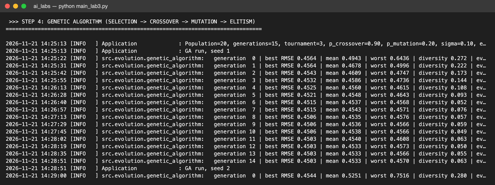
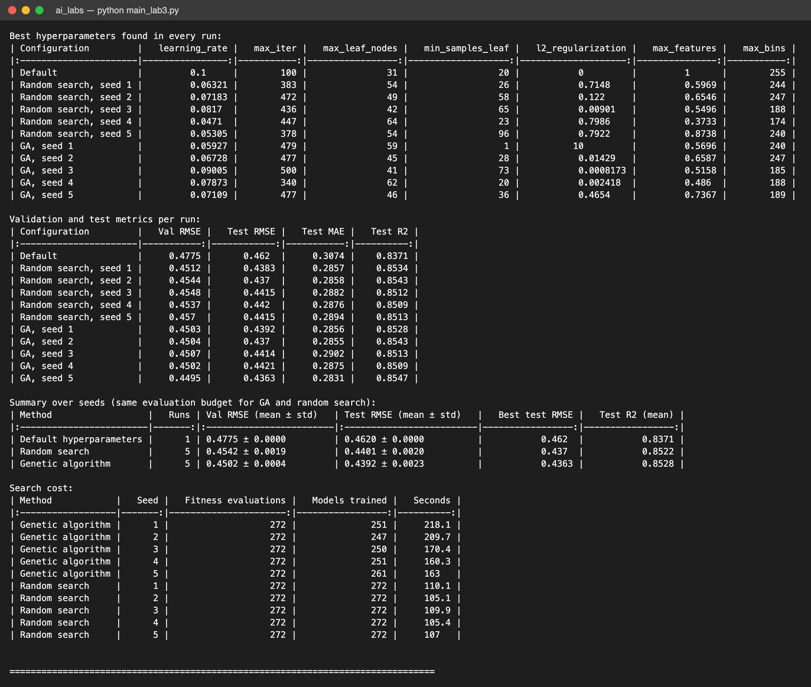
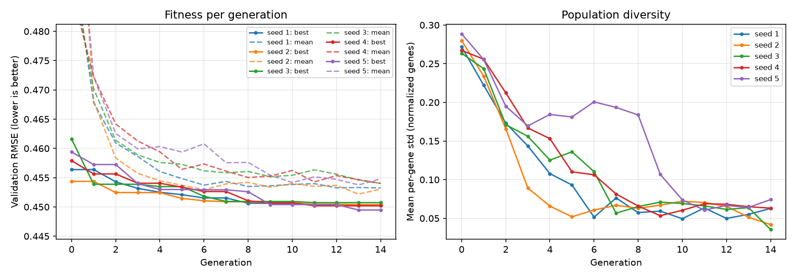
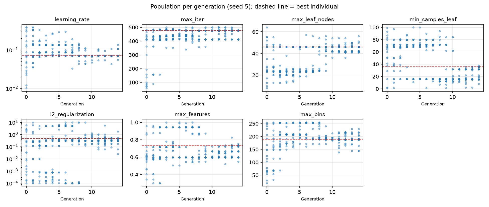
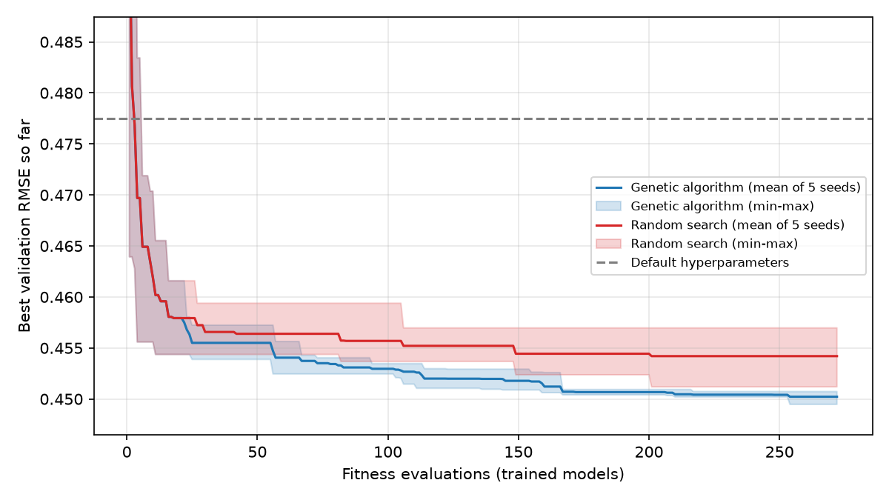
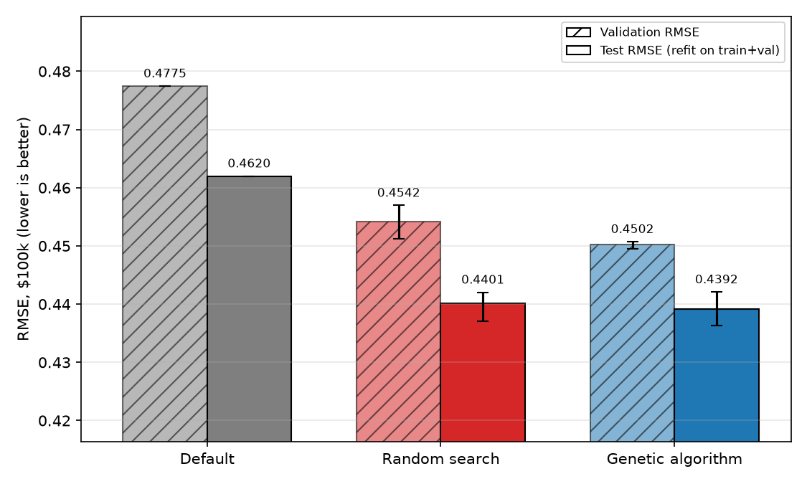

::: {custom-style="Title Header"}
МІНІСТЕРСТВО ОСВІТИ І НАУКИ УКРАЇНИ\
НАЦІОНАЛЬНИЙ УНІВЕРСИТЕТ “ЛЬВІВСЬКА ПОЛІТЕХНІКА”\
ІНСТИТУТ КОМП’ЮТЕРНИХ НАУК ТА ІНФОРМАЦІЙНИХ ТЕХНОЛОГІЙ
:::

::: {custom-style="Title Right"}
кафедра систем штучного інтелекту
:::

::: {custom-style="Title Center"}
{width=7cm}
:::

::: {custom-style="Title Center"}
\
**ЗВІТ**

про виконання лабораторної роботи № 3\
з курсу «Штучний інтелект та інноваційні інформаційні технології»\
на тему: «Використання еволюційних алгоритмів»\
\
\
:::

::: {custom-style="Title Signature"}
Виконав:\
*ст. групи КНСШ-13*\
*Каспрович Р. Б.*\
Перевірив:\
*доц. каф. СШІ, к.т.н.,*\
*Думин І. Б.*
:::

::: {custom-style="Title Center"}
\
\
ЛЬВІВ - 2026
:::

<!-- pagebreak -->

# Мета роботи

Ознайомитись із принципами еволюційних алгоритмів як одного з напрямів штучного інтелекту. Отримати практичні навички використання еволюційних алгоритмів для розв'язання оптимізаційних задач.

Обрано **варіант 1**: власна програмна реалізація генетичного алгоритму для підбору гіперпараметрів моделі машинного навчання. Фітнес-функція — якість моделі на валідаційній вибірці.

# Хід роботи

## Крок 1. Середовище та структура проєкту

Програмний код розміщено в репозиторії GitHub: https://github.com/Kasprovych/ai_labs.

- Python 3.12, scikit-learn 1.9.1, NumPy 2.5, pandas 3.1, matplotlib 3.11. Апаратна платформа: Apple M1 Pro, 16 ГБ.
- Запуск: `python main_lab3.py`. Увесь експеримент (дані → базова модель → 5 запусків ГА → 5 запусків випадкового пошуку → фінальна оцінка на тесті → графіки й таблиці) виконується однією командою. Консольний вивід дублюється у `artifacts/lab3/run_output.txt`.
- Генетичний алгоритм реалізовано **самостійно**, без готових бібліотек (DEAP, PyGAD тощо), щоб кожен оператор був явним і перевірюваним. Оператори покрито модульними тестами (`tests/test_lab3_evolution.py`, 12 тестів).
- **Відтворюваність:** кожен запуск ГА отримує власний генератор `numpy.random.default_rng(seed)`, а модель має фіксований `random_state=42`. Тому фітнес-функція детермінована, і повторний запуск дає ідентичні результати.

```text
main_lab3.py                       # оркестратор: лише послідовність кроків
src/config/lab3_config.py          # усі параметри: простір пошуку, ГА, поділ даних, seed
src/evolution/search_space.py      # гени [0, 1] <-> реальні гіперпараметри (декодування)
src/evolution/operators.py         # оператори: турнірний відбір, однорідне схрещування, гаусова мутація
src/evolution/fitness.py           # фітнес = -RMSE на валідації, кеш оцінених розв'язків
src/evolution/genetic_algorithm.py # цикл ГА з елітизмом; базовий метод — випадковий пошук
src/evolution/evaluation.py        # одноразова фінальна оцінка на тестовій вибірці
src/evolution/plots.py             # графіки збіжності, різноманітності, порівняння
```

## Крок 2. Предметна область, модель і дані

**Задача** — прогнозування медіанної вартості житла (регресія). **Набір даних** — California Housing (перепис США 1990 р.; завантажується кодом через `sklearn.datasets.fetch_california_housing`, без ручних кроків): 20 640 районів, 8 числових ознак (медіанний дохід, вік забудови, середня кількість кімнат і спалень, населення, середня заселеність, широта, довгота). Цільова змінна — медіанна вартість будинку в сотнях тисяч доларів.

**Модель** — `HistGradientBoostingRegressor` (гістограмний градієнтний бустинг дерев рішень). Вибір обґрунтовано так:

- це одна з найточніших моделей для табличних даних, і її якість суттєво залежить від гіперпараметрів, тож задача оптимізації змістовна;
- модель має **різнотипні** гіперпараметри: дійсні в логарифмічній шкалі (`learning_rate`, `l2_regularization`), дійсні в лінійній (`max_features`) і цілі (`max_iter`, `max_leaf_nodes`, `min_samples_leaf`, `max_bins`). Це добре демонструє, як генетичний алгоритм працює зі змішаним простором пошуку;
- одне навчання на ~12 тис. рядків триває менше секунди, тому за кілька хвилин вдається виконати сотні оцінювань фітнес-функції.

**Поділ даних:** 60 % train (12 384), 20 % validation (4 128), 20 % test (4 128), `random_state=42`. Train використовується для навчання моделей під час пошуку, validation — для обчислення фітнесу, test — **лише один раз** наприкінці, для підсумкової оцінки знайдених гіперпараметрів. Якби фітнес рахувався на тесті, алгоритм «підганяв» би гіперпараметри під тестову вибірку, і підсумкова оцінка була б завищеною. Масштабування ознак не застосовується: дерева рішень інваріантні до монотонних перетворень ознак, тож на даних нічого не «навчається» до поділу і витоку немає.

## Крок 3. Простір пошуку і кодування розв'язків

Особина (хромосома) — вектор із 7 генів, кожен ген — дійсне число в діапазоні [0, 1]. Перед навчанням моделі ген декодується в реальне значення гіперпараметра (табл. 1). Для параметрів, що діють мультиплікативно, використано логарифмічну шкалу: рівномірний крок гена відповідає множенню значення (0,01 → 0,1 → 1), а не додаванню. Цілі параметри округлюються після декодування. Нормалізація генів дозволяє застосовувати однакові оператори до всіх гіперпараметрів незалежно від їхнього типу й масштабу.

Table: Таблиця 1. Простір пошуку гіперпараметрів

| Ген | Гіперпараметр | Тип | Діапазон | За замовчуванням | Зміст |
| :---: | :--- | :--- | :--- | :---: | :--- |
| 0 | learning_rate | дійсний | [0.01; 0.5], лог. шкала | 0.1 | крок бустингу |
| 1 | max_iter | цілий | [50; 500] | 100 | кількість дерев |
| 2 | max_leaf_nodes | цілий | [4; 64] | 31 | складність дерева |
| 3 | min_samples_leaf | цілий | [1; 100] | 20 | мінімум прикладів у листку |
| 4 | l2_regularization | дійсний | [0.0001; 10], лог. шкала | 0 | L2-штраф листків |
| 5 | max_features | дійсний | [0.3; 1.0] | 1.0 | частка ознак для розбиття |
| 6 | max_bins | цілий | [16; 255] | 255 | кількість бінів гістограми |

```python
# src/evolution/search_space.py — декодування гена в значення гіперпараметра
def decode(self, gene: float) -> HyperparameterValue:
    gene = min(max(gene, 0.0), 1.0)
    if self.log_scale:
        value = math.exp(math.log(self.low) + gene * (math.log(self.high) - math.log(self.low)))
    else:
        value = self.low + gene * (self.high - self.low)
    if self.kind is ParameterKind.INT:
        return int(round(value))
    return float(value)
```

## Крок 4. Фітнес-функція

Фітнес = −RMSE (корінь середньоквадратичної помилки) моделі на валідаційній вибірці. Знак мінус потрібен, бо алгоритм максимізує фітнес, а RMSE — це помилка, яку треба зменшувати. RMSE обрано, бо він вимірюється в тих самих одиницях, що й ціль (сотні тисяч доларів), і сильніше штрафує великі помилки.

Результати кешуються за декодованими значеннями гіперпараметрів: різні геноми після округлення можуть давати однакові моделі, а елітні особини переходять у наступне покоління без змін. Повторне навчання таких моделей було б марною тратою часу.

```python
# src/evolution/fitness.py — фітнес-функція з кешем
def validation_rmse(self, genome: np.ndarray) -> float:
    hyperparameters = self._search_space.decode(genome)
    key = tuple(round(v, 10) if isinstance(v, float) else v for v in hyperparameters.values())
    if key not in self._cache:
        model = self.build_model(hyperparameters).fit(self._data.x_train, self._data.y_train)
        self._cache[key] = float(root_mean_squared_error(self._data.y_val, model.predict(self._data.x_val)))
    return self._cache[key]

def evaluate(self, genome: np.ndarray) -> float:
    return -self.validation_rmse(genome)
```

## Крок 5. Генетичний алгоритм: оператори та параметри

Реалізовано класичний поколіннєвий генетичний алгоритм з елітизмом. Одне покоління виконується так:

1. **Оцінювання** — для кожної особини обчислюється фітнес.
2. **Елітизм** — дві найкращі особини копіюються в наступне покоління без змін. Так найкращий знайдений розв'язок ніколи не втрачається.
3. **Відбір** (турнірний) — з популяції випадково обираються 3 особини, батьком стає найкраща з них. Процедура повторюється для другого батька.
4. **Схрещування** (однорідне) — з імовірністю 0.9 кожен ген дитини береться від першого або другого батька з імовірністю 0.5; друга дитина отримує протилежний вибір. З імовірністю 0.1 діти є копіями батьків.
5. **Мутація** (гаусова) — кожен ген дитини з імовірністю 0.2 отримує випадковий зсув N(0; 0.1) і обрізається до [0, 1].
6. Кроки 3–5 повторюються, доки нова популяція не заповниться.

```python
# src/evolution/genetic_algorithm.py — одне покоління
ranked = sorted(range(len(population)), key=lambda i: fitness[i], reverse=True)
next_population = [population[i].copy() for i in ranked[:config.elite_count]]   # елітизм
next_fitness = [fitness[i] for i in ranked[:config.elite_count]]
while len(next_population) < config.population_size:
    parent_a = self._selection.select(population, fitness, rng)                  # турнір
    parent_b = self._selection.select(population, fitness, rng)
    for child in self._crossover.recombine(parent_a, parent_b, rng):             # схрещування
        if len(next_population) < config.population_size:
            child = self._mutation.mutate(child, rng)                            # мутація
            next_population.append(child)
            next_fitness.append(evaluate(child))
```

Вибір операторів і параметрів обґрунтовано в табл. 2.

Table: Таблиця 2. Параметри генетичного алгоритму та їх обґрунтування

| Параметр | Значення | Обґрунтування |
| :--- | :---: | :--- |
| Розмір популяції | 20 | для 7 генів достатньо для різноманітності; кожна особина — навчання моделі |
| Кількість поколінь | 15 | за графіками збіжності покращення після 10–13 поколінь стають мізерними |
| Бюджет оцінювань | 272 | 20 + 14 × (20 − 2 еліти); той самий бюджет отримує випадковий пошук |
| Відбір | турнірний, k = 3 | тиск відбору не залежить від масштабу фітнесу (RMSE особин відрізняються в 3-му знаку, рулетка була б майже випадковою); малий турнір зберігає різноманітність |
| Схрещування | однорідне, p = 0.9 | гени-гіперпараметри не мають природного порядку, тож одно- чи двоточкове схрещування штучно «зчеплювало» б сусідні гени |
| Мутація | гаусова, p = 0.2 на ген, σ = 0.1 | у середньому мутує ~1.4 гена з 7; малі кроки часті (уточнення), великі рідкісні (вихід з локального оптимуму) |
| Елітизм | 2 особини | найкращий фітнес не погіршується; більше еліт зменшило б різноманітність |
| Незалежні запуски | 5 seed (1–5) | один запуск міг бути просто вдалим; 5 повторів показують стабільність |

## Крок 6. Базові методи для порівняння

Щоб оцінити, що саме дає еволюційний алгоритм, результати порівнюються з двома базовими варіантами:

- **Гіперпараметри за замовчуванням** scikit-learn (без жодного підбору).
- **Випадковий пошук** з **тим самим бюджетом** — 272 випадкові конфігурації з того самого простору пошуку, також 5 запусків. Це чесний конкурент: він показує, скільки дає саме еволюція (відбір, схрещування, мутація), а не просто перебір великої кількості конфігурацій.

## Крок 7. Фінальна оцінка на тестовій вибірці

Найкращі гіперпараметри кожного запуску оцінюються один раз на тестовій вибірці. Після того як гіперпараметри зафіксовано, модель перенавчається на train + validation (16 512 рядків): валідаційні дані більше не потрібні для вибору і можуть покращити модель. Додатково наводиться валідаційний RMSE моделі, навченої лише на train (саме його оптимізував пошук).

# Результати виконання програми

## Хід виконання

На рис. 1 показано фрагмент реального виводу програми: еволюція одного запуску ГА покоління за поколінням. Для кожного покоління видно найкращий, середній і найгірший RMSE популяції, різноманітність і кількість витрачених оцінювань.

{width=16cm}

На рис. 2 показано підсумкові таблиці, які програма виводить наприкінці.

{width=16cm}

## Збіжність і різноманітність популяції

На рис. 3 (ліворуч) показано найкращий (суцільні лінії) і середній (пунктир) валідаційний RMSE популяції для кожного з 5 запусків. У поколінні 0 середній RMSE популяції випадкових особин великий (0.51 для seed 5), бо випадкові конфігурації бувають дуже поганими (найгірша особина — 0.74). Уже за 2–3 покоління середнє падає до ~0.46: відбір швидко відсіює невдалі області простору. Найкращий RMSE монотонно зменшується (наслідок елітизму) і після 9–13 поколінь виходить на плато ~0.450.

Праворуч показано різноманітність популяції: середнє стандартне відхилення генів. Вона зменшується з ~0.27–0.29 до ~0.04–0.07. Популяція збирається навколо перспективної області, але не вироджується повністю в одну точку: мутація підтримує залишкову різноманітність, тому алгоритм продовжує уточнювати розв'язок (наприклад, seed 5 покращився ще в поколінні 13).

{width=16cm}

Таблиця 3 ілюструє ті самі процеси чисельно для найкращого запуску (seed 5).

Table: Таблиця 3. Покоління найкращого запуску ГА (seed 5), валідаційний RMSE

| Покоління | Найкращий | Середній | Найгірший | Різноманітність | Оцінювань |
| :---: | :---: | :---: | :---: | :---: | :---: |
| 0 | 0.4594 | 0.5140 | 0.7422 | 0.289 | 20 |
| 1 | 0.4572 | 0.4722 | 0.5104 | 0.255 | 38 |
| 3 | 0.4540 | 0.4599 | 0.4709 | 0.170 | 74 |
| 5 | 0.4530 | 0.4594 | 0.4792 | 0.181 | 110 |
| 9 | 0.4504 | 0.4554 | 0.4597 | 0.107 | 182 |
| 11 | 0.4504 | 0.4551 | 0.4626 | 0.061 | 218 |
| 13 | 0.4495 | 0.4538 | 0.4573 | 0.064 | 254 |
| 14 | 0.4495 | 0.4548 | 0.4591 | 0.074 | 272 |

## Як еволюціонують гіперпараметри

На рис. 4 кожна точка — значення гіперпараметра однієї особини в певному поколінні (seed 5), пунктир — значення найкращої особини. Видно, як алгоритм «знаходить» вигідні області:

- `max_iter` швидко зміщується до верхньої межі (400–500 дерев): більше дерев з помірним кроком дає кращу якість;
- `learning_rate` стискається до вузького діапазону ~0.05–0.1, хоча початкова популяція розкидана по всьому інтервалу 0.01–0.5;
- `max_features` збирається в межах 0.6–0.75: випадковий вибір частини ознак для кожного розбиття працює як регуляризація;
- для `min_samples_leaf` і `l2_regularization` популяція довго зберігає кілька кластерів. Ці параметри слабо впливають на якість, тож тиск відбору на них малий.

{width=16cm}

## Порівняння з випадковим пошуком

Рис. 5 показує найкращий знайдений валідаційний RMSE залежно від кількості витрачених оцінювань (середнє і мінімум–максимум по 5 запусках). Перші ~20 оцінювань ГА — це випадкова початкова популяція, тому до цього моменту криві практично збігаються. Після цього ГА стабільно випереджає випадковий пошук: через ~110 оцінювань середній результат ГА (≈0.452) уже кращий за підсумковий результат випадкового пошуку після всіх 272 оцінювань (0.4542). Важливо й те, що смуга розкиду ГА наприкінці дуже вузька, а у випадкового пошуку широка: результат випадкового пошуку значно більше залежить від везіння.

{width=16cm}

Table: Таблиця 4. Підсумок за 5 запусками (однаковий бюджет — 272 оцінювання)

| Метод | Val RMSE (середнє ± std) | Test RMSE (середнє ± std) | Найкращий test RMSE | Test R² (середнє) |
| :--- | :---: | :---: | :---: | :---: |
| Гіперпараметри за замовчуванням | 0.4775 | 0.4620 | 0.4620 | 0.8371 |
| Випадковий пошук | 0.4542 ± 0.0019 | 0.4401 ± 0.0020 | 0.4370 | 0.8522 |
| Генетичний алгоритм | **0.4502 ± 0.0004** | **0.4392 ± 0.0023** | **0.4363** | **0.8528** |

{width=14cm}

Аналіз табл. 4 і рис. 6:

1. **Підбір гіперпараметрів суттєво покращує модель.** ГА зменшив тестовий RMSE з 0.4620 до 0.4392 у середньому (−4.9 %), а R² зріс з 0.837 до 0.853. У грошовому вимірі середня помилка прогнозу зменшилась приблизно з 46 200 до 43 900 доларів.
2. **На валідаційній вибірці, яку алгоритм оптимізував, ГА явно кращий за випадковий пошук:** 0.4502 проти 0.4542, і в 5 разів стабільніший (std 0.0004 проти 0.0019). Найгірший запуск ГА (0.4507) кращий за найкращий запуск випадкового пошуку (0.4512).
3. **На тестовій вибірці перевага ГА над випадковим пошуком мінімальна:** 0.4392 проти 0.4401, а різниця менша за розкид між запусками (std ~0.002). Тобто частина переваги на валідації — це «підгонка» під конкретну валідаційну вибірку (4 128 рядків). Чим ретельніше оптимізатор шукає, тим сильніше він використовує випадкові особливості валідаційних даних. Чесний висновок: обидва методи пошуку значно кращі за значення за замовчуванням, а між собою на нових даних вони майже рівні. ГА гарантує стабільний результат за однакового бюджету, але не дає суттєвого виграшу в узагальненні.

Знайдені гіперпараметри (табл. 5) різняться між запусками, але мають спільні риси: багато дерев (340–500), `learning_rate` 0.06–0.09, `max_leaf_nodes` 41–62, `max_features` 0.49–0.74. Те, що різні набори дають майже однаковий RMSE, означає, що поверхня фітнесу поблизу оптимуму пласка: якість визначають кілька ключових параметрів, а решта мало на неї впливає. У запуску seed 1 два гени дійшли до меж діапазону (`min_samples_leaf` = 1, `l2_regularization` = 10). Межі все ж обмежують пошук, але сильна L2-регуляризація при цьому компенсує мінімальний розмір листка.

Table: Таблиця 5. Найкращі гіперпараметри, знайдені ГА в кожному запуску

| Запуск | learning_rate | max_iter | max_leaf_nodes | min_samples_leaf | l2_reg. | max_features | max_bins | Test RMSE |
| :--- | :---: | :---: | :---: | :---: | :---: | :---: | :---: | :---: |
| seed 1 | 0.0593 | 479 | 59 | 1 | 10 | 0.570 | 240 | 0.4392 |
| seed 2 | 0.0673 | 477 | 45 | 28 | 0.0143 | 0.659 | 247 | 0.4370 |
| seed 3 | 0.0901 | 500 | 41 | 73 | 0.0008 | 0.516 | 185 | 0.4414 |
| seed 4 | 0.0787 | 340 | 62 | 20 | 0.0024 | 0.486 | 188 | 0.4421 |
| seed 5 | 0.0711 | 477 | 46 | 36 | 0.4654 | 0.737 | 189 | 0.4363 |

**Вартість пошуку.** Кожен запуск ГА витратив 272 оцінювання фітнесу, але навчив лише 247–261 модель: решту дав кеш (еліти та повторні конфігурації). Проте за часом запуск ГА триває довше, ніж запуск випадкового пошуку. На Apple M1 Pro запуск ГА тривав 160–218 с, а запуск випадкового пошуку — 105–110 с. Причина: ГА швидко переходить до великих моделей (400–500 дерев), кожна з яких навчається довше, а випадковий пошук рівномірно перебирає і малі, швидкі моделі. Отже, «однаковий бюджет» за кількістю оцінювань не означає однакового часу: за той самий час випадковий пошук встиг би перевірити приблизно в 1.7 раза більше конфігурацій. Повний експеримент (5 запусків ГА + 5 запусків випадкового пошуку) триває ~25 хв.

# Висновки

1. Реалізовано генетичний алгоритм для підбору семи гіперпараметрів моделі `HistGradientBoostingRegressor` у задачі прогнозування вартості житла (California Housing). Алгоритм містить усі необхідні етапи: кодування розв'язків нормалізованими генами, оцінювання пристосованості (−RMSE на валідації), турнірний відбір, однорідне схрещування, гаусову мутацію та елітизм, який зберігає найкращі розв'язки для наступної ітерації. Оператори реалізовано самостійно і перевірено модульними тестами.
2. ГА знайшов гіперпараметри, які зменшили тестовий RMSE з 0.4620 (значення за замовчуванням) до 0.4392 у середньому за 5 запусками (найкращий — 0.4363); R² зріс з 0.837 до 0.853.
3. За однакового бюджету (272 оцінювання) ГА перевершив випадковий пошук на валідаційній вибірці (0.4502 ± 0.0004 проти 0.4542 ± 0.0019) і виявився значно стабільнішим. Через ~110 оцінювань ГА вже досягає якості, якої випадковий пошук не досягає за весь бюджет.
4. На тестовій вибірці перевага ГА над випадковим пошуком мала (0.4392 проти 0.4401) і не перевищує розкиду між запусками. Інтенсивна оптимізація частково підлаштовується під конкретну валідаційну вибірку. Для надійнішої оцінки фітнес варто рахувати крос-валідацією (ціною в k разів більшої кількості навчань).
5. Динаміка популяції підтверджує теорію: відбір швидко відсіює невдалі області (середній RMSE 0.51 → 0.46 за 2–3 покоління), різноманітність поступово зменшується (0.29 → ~0.06), а мутація не дає популяції виродитися і дозволяє уточнювати розв'язок до останніх поколінь.
6. Еволюційні алгоритми доцільні для підбору гіперпараметрів, коли простір пошуку змішаний (цілі, дійсні, логарифмічні параметри), фітнес-функція недиференційовна і дорога, а потрібен стабільний результат за обмеженого бюджету. Для малих просторів і дешевих моделей випадковий пошук дає співмірну якість на нових даних і простіший у реалізації.
