::: {custom-style="Title Header"}
МІНІСТЕРСТВО ОСВІТИ І НАУКИ УКРАЇНИ\
НАЦІОНАЛЬНИЙ УНІВЕРСИТЕТ “ЛЬВІВСЬКА ПОЛІТЕХНІКА”\
ІНСТИТУТ КОМП’ЮТЕРНИХ НАУК ТА ІНФОРМАЦІЙНИХ ТЕХНОЛОГІЙ
:::

::: {custom-style="Title Right"}
кафедра систем штучного інтелекту
:::

::: {custom-style="Title Center"}
{width=7cm}
:::

::: {custom-style="Title Center"}
\
**ЗВІТ**

про виконання лабораторної роботи № 4\
з курсу «Штучний інтелект та інноваційні інформаційні технології»\
на тему: «Розробка Retrieval-Augmented Generation (RAG) системи»\
\
\
:::

::: {custom-style="Title Signature"}
Виконав:\
*ст. групи КНСШ-13*\
*Каспрович Р. Б.*\
Перевірив:\
*доц. каф. СШІ, к.т.н.,*\
*Думин І. Б.*
:::

::: {custom-style="Title Center"}
\
\
ЛЬВІВ - 2026
:::

<!-- pagebreak -->

# Мета роботи

Ознайомитися з архітектурою RAG. Інтегрувати LLM із зовнішнім джерелом даних. Оцінити якість відповідей агента та провести аналіз.

**RAG** (Retrieval-Augmented Generation, генерація, доповнена пошуком) — архітектура, у якій велика мовна модель (LLM) відповідає не лише «з пам'яті», тобто зі знань, закладених у її ваги під час навчання, а й на основі документів, знайдених у зовнішній базі знань саме під конкретний запит. Це зменшує кількість вигаданих відповідей (галюцинацій), дозволяє працювати з даними, яких модель не бачила під час навчання, і дає змогу вказати джерело кожного твердження.

У роботі побудовано повністю локальну RAG-систему (без платних API та ключів доступу), яка відповідає українською мовою на запитання про штучний інтелект за добіркою статей української Вікіпедії.

# Хід роботи

## Крок 1. Середовище, встановлення бібліотек і структура проєкту

Програмний код розміщено в репозиторії GitHub: https://github.com/Kasprovych/ai_labs.

**Апаратна платформа:** Apple MacBook Pro, процесор Apple M1 Pro, 16 ГБ уніфікованої пам'яті (спільної для CPU і GPU), macOS. Окремої відеокарти NVIDIA немає, тому для запуску LLM обрано фреймворк Apple **MLX**, який виконує обчислення на вбудованому GPU чипа M1 (детальніше — у кроці 7).

**Встановлення середовища.** Віртуальне середовище Python створено менеджером пакетів `uv`, який ізолює залежності проєкту від системного Python (аналог окремого classpath для кожного Java-проєкту):

```bash
# 1. Віртуальне середовище з Python 3.12 у каталозі .venv
uv venv --python 3.12 .venv

# 2. Бібліотеки (повний перелік з версіями — requirements.txt)
uv pip install --python .venv/bin/python -r requirements.txt

# 3. Pandoc для збирання звіту (Homebrew — менеджер пакетів macOS)
brew install pandoc

# 4. Завантаження й перевірка локальних моделей (крок 7)
.venv/bin/python main_lab4.py setup
```

Table: Таблиця 1. Основні бібліотеки та їх призначення

| Бібліотека | Версія | Призначення в системі |
| :--- | :---: | :--- |
| requests | 2.34 | завантаження статей через MediaWiki API |
| sentence-transformers | 6.3 | обчислення векторних представлень (ембедингів) і крос-енкодер для ре-ранжування |
| transformers, torch | 5.23, 2.15 | рушій, на якому працюють моделі sentence-transformers |
| chromadb | 1.5.9 | векторна база даних з HNSW-індексом |
| mlx, mlx-lm | 0.32.4, 0.32.2 | запуск квантизованої LLM на GPU Apple Silicon |
| huggingface-hub | 2.4 | завантаження моделей з Hugging Face Hub і їх кешування |
| pandas, matplotlib | 3.1, 3.11 | таблиці результатів і графіки |
| pytest | 9.2 | модульні тести (22 тести для ЛР4) |

**Структура коду.** Кожен етап RAG-конвеєра — окремий клас з однією відповідальністю за інтерфейсом (`ABC`), а залежності передаються через конструктор. Тому, наприклад, LLM чи векторну базу можна замінити, не змінюючи решту коду, а в тестах замість справжніх моделей використовуються прості «фейкові» реалізації.

```text
main_lab4.py                  # оркестратор: режими full (усі кроки), chat (діалог), setup (встановлення моделей)
src/config/lab4_config.py     # усі параметри: корпус, чанкінг, моделі, top-k, конфігурації для оцінювання
src/rag/corpus.py             # крок 2: завантаження статей Вікіпедії та кеш на диску
src/rag/preprocessing.py      # крок 3: очищення тексту, поділ на чанки з перекриттям
src/rag/embeddings.py         # крок 4: модель вбудовувань (E5)
src/rag/vector_store.py       # крок 5: векторна база ChromaDB
src/rag/retriever.py          # кроки 6, 10: пошук top-k, ранжування (косинусна подібність / крос-енкодер)
src/rag/model_setup.py        # крок 7: встановлення і перевірка моделей
src/rag/llm.py                # крок 7: інтерфейс LLM і реалізація на MLX
src/rag/prompts.py            # усі промпти в одному місці
src/rag/pipeline.py           # крок 8: RAG-пайплайн
src/rag/memory.py             # крок 9: історія діалогу
src/rag/evaluation.py         # крок 11: контрольні запитання, метрики, LLM-суддя
src/rag/experiments.py        # крок 11: експерименти з різними параметрами
src/rag/factory.py            # збирання системи з компонентів (патерн Factory)
data/lab4/eval_questions.json # 16 контрольних запитань з еталонними відповідями
```

Загальна схема системи (рис. 1) складається з двох частин. **Індексація** виконується один раз: документи → очищення → чанки → вектори → векторна база. **Відповідь на запит** виконується щоразу: запит (переписаний з урахуванням історії) → вектор запиту → top-k найближчих чанків → ранжування → контекст → промпт → LLM → відповідь із посиланнями на джерела → збереження в історію.

```text
ІНДЕКСАЦІЯ (один раз)
  Вікіпедія -> очищення -> чанки (200 слів, перекриття 40) -> E5: вектор 384
            -> ChromaDB (HNSW, косинусна відстань)

ВІДПОВІДЬ НА ЗАПИТ (щоразу)
  запит -> переписування з урахуванням історії -> E5: вектор запиту
        -> top-k за косинусом -> [крос-енкодер] -> контекст [1]..[k]
        -> промпт -> Gemma 3 4B (MLX) -> відповідь з посиланнями [1][2]
        -> збереження в історію діалогу (JSON)
```

*Рис. 1. Архітектура розробленої RAG-системи*

## Крок 2. Вибір і завантаження корпусу документів

**Корпус** — 40 статей української Вікіпедії з тематики штучного інтелекту: загальні поняття (штучний інтелект, машинне навчання, кероване й некероване навчання, навчання з підкріпленням), нейронні мережі та їх архітектури (перцептрон, зворотне поширення помилки, згорткові та рекурентні мережі, LSTM, автокодувальники, GAN, механізм уваги, трансформер, BERT), великі мовні моделі (ChatGPT, GPT-4, інженерія запитів, галюцинації), суміжні методи (SVM, дерева рішень, випадковий ліс, генетичні й еволюційні алгоритми, нечітка логіка, експертні системи) та історія (тест Тюрінга, Алан Тюрінг, Deep Blue, AlphaGo). Разом — **101 739 слів**.

Обґрунтування вибору:

- тематика збігається з курсом, тому відповіді системи можна перевірити за власними знаннями та за текстом статей;
- корпус українською мовою — це перевірка, чи справляються з українським текстом модель вбудовувань і невелика локальна LLM, а не лише англомовні системи;
- Вікіпедія має відкриту ліцензію (CC BY-SA) і програмний доступ через API, тож корпус завантажується кодом, без ручних кроків;
- статті мають структуру (розділи), яку можна використати для метаданих і для поділу на фрагменти.

**Завантаження.** Статті отримано через MediaWiki API з розширенням TextExtracts (`prop=extracts&explaintext=1`): воно повертає вже очищений від вікі-розмітки простий текст, а заголовки розділів позначено як `== Назва ==`. Для кожної статті зберігається також ідентифікатор ревізії. Кожна стаття кешується у файлі `data/lab4/corpus/<назва>.json`, тому наступні запуски працюють без мережі й завжди з тією самою версією тексту, що робить експерименти відтворюваними. Вікіпедія обмежує частоту анонімних запитів (код 429 Too Many Requests), тому між запитами є пауза в 1 с, а при помилці 429 запит повторюється з наростаючою затримкою.

```python
# src/rag/corpus.py — запит однієї статті
params = {"action": "query", "format": "json", "redirects": 1, "titles": title,
          "prop": "extracts|revisions|info", "explaintext": 1, "rvprop": "ids", "inprop": "url"}
for attempt in range(1, MAX_DOWNLOAD_ATTEMPTS + 1):
    response = requests.get(api_url, params=params, headers={"User-Agent": self._config.user_agent}, timeout=60)
    if response.status_code != 429:          # 429 = Too Many Requests: зачекати й повторити
        break
    time.sleep(RETRY_DELAY_SECONDS * attempt)
```

## Крок 3. Попередня обробка даних

### 3.1. Очищення тексту від шумів

Простий текст із Вікіпедії все ще містить «шум», який погіршує пошук або марно займає місце в контексті LLM. Клас `TextCleaner` виконує такі перетворення:

1. **Видалення знаків наголосу.** Вікіпедія ставить наголос у назвах статей: «Генети́чний алгори́тм». Знак наголосу — окремий символ Unicode (U+0301), тож для програми «Генети́чний» і «Генетичний» — різні слова. Без очищення запит, написаний без наголосу, гірше збігався б із текстом.
2. **Видалення службових розділів:** «Примітки», «Див. також», «Посилання», «Література», «Джерела» тощо. Це переліки посилань і бібліографія, які не містять знань, але схожі за лексикою на будь-який запит.
3. **Видалення залишків формул** (фрагменти LaTeX `{\displaystyle ...}`) і рядків, у яких літери становлять менше половини символів (рядки з цифр і математичних знаків).
4. **Нормалізація пробілів** (зокрема нерозривних) і Unicode (NFC).

Після очищення лишилося **93 564 слова з 101 739**: 8.0 % тексту видалено як шум.

### 3.2. Поділ на фрагменти (чанки) з перекриттям

LLM не може прочитати весь корпус за один запит, а модель вбудовувань приймає щонайбільше 512 токенів. Тому текст ділиться на фрагменти-чанки, кожен з яких окремо перетворюється на вектор і може бути знайдений. Клас `WordChunker` реалізує такий алгоритм:

- текст кожного розділу статті ділиться на речення, а речення жадібно додаються до поточного чанка, доки його розмір не перевищить ліміт (**200 слів**). Чанк ніколи не обриває речення посередині, тому залишається зрозумілим для LLM;
- кожен наступний чанк починається з останніх речень попереднього, загальним обсягом до **40 слів (20 %)**. Це **перекриття**: факт, що потрапив на межу двох чанків, з великою ймовірністю повністю лишається хоча б в одному з них. Якщо останні речення довгі й цілими реченнями набирається менше половини бюджету, перекриття береться пословно (останні 40 слів, можливо з середини речення). Інакше в багатьох парах чанків перекриття не було б зовсім: це виявлено під час незалежної перевірки коду, і після виправлення фактичне перекриття виміряно для кожного індексу (табл. 2);
- чанки не перетинають межі розділів верхнього рівня, тому кожен чанк описує одну підтему. Назва статті та розділу зберігаються як метадані й додаються на початок тексту перед векторизацією («Генетичний алгоритм. Історія. ...»), щоб вектор відображав і тему фрагмента;
- дуже короткий «хвіст» розділу (менше 20 слів) приєднується до попереднього чанка, щоб не утворювати порожніх фрагментів. Розділ, який цілком коротший за 20 слів, відкидається. Таких розділів у корпусі 6 (71 слово, наприклад «Згорткова нейронна мережа — У популярній культурі»).

```python
# src/rag/preprocessing.py — ядро алгоритму чанкінгу з перекриттям
for sentence in self._sentences(text, size):
    sentence_words = len(sentence.split())
    if current and current_words + sentence_words > size:
        chunks.append(current)                                    # чанк заповнено
        current = self._overlap_tail(current, min(overlap, size - sentence_words))  # перекриття
        current_words = sum(len(s.split()) for s in current)
        fresh_words = 0
    current.append(sentence)
    current_words += sentence_words
    fresh_words += sentence_words
```

**Вибір розміру чанка.** Завдання пропонує 500–1000 слів, але для обраної моделі вбудовувань це забагато: її вхід обмежено 512 токенами, а українське слово в середньому займає ~2 токени. Чанк у 500 слів (~1000 токенів) модель просто обрізала б, і друга половина тексту не впливала б на вектор. Щоб перевірити це експериментально, побудовано три індекси (табл. 2, рис. 2): уже при 400 словах **52.9 % чанків** довші за ліміт моделі. Базовим обрано розмір **200 слів** (лише 1 % чанків трохи перевищують ліміт), а 100 і 400 слів порівнюються в кроці 11.

Table: Таблиця 2. Статистика індексів для різних розмірів чанків

| Розмір / перекриття, слів | Чанків | Середня довжина, слів | Фактичне перекриття, слів | Пар без перекриття | Середня довжина, токенів | Довші за 512 токенів |
| :---: | :---: | :---: | :---: | :---: | :---: | :---: |
| 100 / 20 | 1 334 | 84.3 | 17.6 | 0.4 % | 187.3 | 0 % |
| **200 / 40** | **672** | **159.8** | **33.3** | **0 %** | **340.1** | **1.0 %** |
| 400 / 80 | 399 | 258.9 | 68.6 | 0 % | 541.7 | 52.9 % |

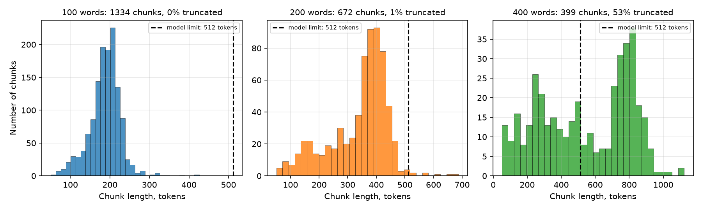{width=16cm}

Середня довжина чанка менша за ліміт (160 слів при ліміті 200), бо чанки не розривають речень і розділів: короткі розділи дають короткі чанки. Фактичне перекриття (33 слова з 40 для базового індексу) дещо менше за задане, бо перевага надається цілим реченням, але без перекриття не лишилося жодної пари сусідніх чанків базового індексу.

## Крок 4. Вибір бібліотеки та моделі для вбудовувань

**Векторне представлення (ембединг)** — це перетворення тексту на вектор чисел фіксованої довжини, у якому близькі за змістом тексти мають близькі вектори. Саме це дозволяє шукати не за збігом слів, а за змістом: запит «Хто придумав LSTM?» знаходить фрагмент «...запропонована 1997 року Зеппом Хохрайтером...», хоча спільних слів у них майже немає.

**Бібліотека:** `sentence-transformers` — стандартна бібліотека для обчислення вбудовувань речень, яка завантажує моделі з Hugging Face Hub однією командою.

**Модель:** `intfloat/multilingual-e5-small`. Обґрунтування:

- **багатомовна**, навчена зокрема на українських текстах; суто англомовні моделі (наприклад, `all-MiniLM-L6-v2`) погано працюють з українською;
- навчена саме для пошуку (пари «запит — релевантний фрагмент»), а не лише для порівняння речень;
- компактна: 118 млн параметрів, 0.48 ГБ, вектор розмірності 384. Увесь корпус векторизується за кілька секунд;
- альтернатива `bge-m3` якісніша й має ліміт 8192 токени, але вона в 5 разів більша і повільніша. Для корпусу з ~100 тис. слів вистачає меншої моделі.

Моделі сімейства E5 навчено з префіксами ролей: запит подається як `"query: ..."`, фрагмент документа — як `"passage: ..."`. Без префіксів якість пошуку помітно падає. Вектори нормалізуються до одиничної довжини, тому скалярний добуток двох векторів дорівнює їх косинусній подібності.

```python
# src/rag/embeddings.py
def embed_passages(self, texts: Sequence[str]) -> np.ndarray:
    return self._model.encode([f"passage: {text}" for text in texts], batch_size=EMBEDDING_BATCH_SIZE,
                              normalize_embeddings=True, show_progress_bar=False)

def embed_query(self, text: str) -> np.ndarray:
    return self._model.encode(f"query: {text}", normalize_embeddings=True, show_progress_bar=False)
```

## Крок 5. Побудова векторних представлень і збереження у векторній базі

**Векторна база:** ChromaDB у режимі `PersistentClient`, тобто вбудована база, що зберігається у файлах `data/lab4/chroma_db/` і не потребує окремого сервера. Для кожного чанка зберігаються ідентифікатор (`Назва статті#номер`), вектор, текст і метадані (назва статті, розділ, URL). Для пошуку ChromaDB будує індекс **HNSW** (Hierarchical Navigable Small World): багаторівневий граф, у якому кожен вектор з'єднано з найближчими сусідами. Пошук проходить графом від грубого рівня до точного і знаходить найближчі вектори приблизно (approximate nearest neighbours), але за логарифмічний, а не лінійний час. Колекцію налаштовано на косинусну відстань (`"hnsw:space": "cosine"`).

Для кожного розміру чанків створюється окрема колекція (`chunks_200w_40o` тощо), яка зберігається на диску. Тому корпус не векторизується повторно при кожному запуску.

```python
# src/rag/vector_store.py — нова колекція з косинусною відстанню і відбитком вмісту
self._collection = self._client.create_collection(
    name=self._name, metadata={"hnsw:space": "cosine", FINGERPRINT_KEY: fingerprint})
...
self._collection.add(
    ids=[chunk.chunk_id for chunk in batch],
    embeddings=embeddings[start:start + ADD_BATCH_SIZE].tolist(),
    documents=[chunk.text for chunk in batch],
    metadatas=[{"title": chunk.document_title, "section": chunk.section, "url": chunk.url} for chunk in batch])
```

Усі три індекси разом містять 2 405 векторів (1 334 + 672 + 399). Векторизація корпусу займає секунди. Щоб не використати застарілий індекс, разом із колекцією зберігається **відбиток вмісту** (хеш SHA-256 від назви моделі вбудовувань і текстів усіх чанків). Індекс береться з диска лише тоді, коли відбиток збігається, інакше перебудовується. У фінальному прогоні всі три індекси взято з диска (рис. 5), бо корпус і правила обробки не змінювалися.

## Крок 6. Реалізація пошуку: запит → top-k найближчих чанків

Пошук виконує клас `Retriever`: запит перетворюється на вектор (з префіксом `query:`), ChromaDB повертає `k` найближчих чанків, а косинусна відстань перетворюється на подібність: `similarity = 1 − distance`. Результат — список пар (чанк, оцінка релевантності), відсортований за спаданням оцінки.

```python
# src/rag/retriever.py
def retrieve(self, query: str) -> List[RetrievedChunk]:
    fetch_k = max(self._config.fetch_k, self._config.top_k) if self._config.use_reranker else self._config.top_k
    candidates = self._store.search(self._embedder.embed_query(query), top_k=fetch_k)
    return self._ranker.rerank(query, candidates)[:self._config.top_k]
```

На рис. 6 (розділ результатів) показано пошук для запиту «Хто і коли запропонував тест Тюрінга?». Усі 5 знайдених чанків стосуються тесту Тюрінга і взяті з двох статей («Тест Тюрінга» і «Алан Тюрінг»). Проте першим став фрагмент про аргумент «Китайської кімнати», який лише згадує тест. Оцінки п'яти чанків майже однакові (0.880–0.893), тобто бі-енкодер погано розрізняє, який фрагмент відповідає точно. Саме тут допомагає ре-ранжування (крок 10).

## Крок 7. Вибір і встановлення LLM

### 7.1. Вибір моделі

Ключова вимога — модель має працювати **локально** на ноутбуці з 16 ГБ пам'яті, без платних API. Тоді система не залежить від зовнішніх сервісів і не передає дані третім сторонам, а результати відтворювані. Додаткові вимоги: прийнятна якість української мови та вміння дотримуватися інструкцій (відповідати лише за контекстом, ставити посилання, чесно відмовлятися відповідати).

Обрано **Google Gemma 3 4B Instruct** у 4-бітній QAT-версії, конвертованій для MLX (`mlx-community/gemma-3-4b-it-qat-4bit`). Модель має 4 млрд параметрів, підтримує 140+ мов, контекстне вікно — 128 тис. токенів, розповсюджується за ліцензією Gemma Terms of Use. Як альтернативу для порівняння встановлено **Alibaba Qwen2.5 3B Instruct** (4-біт, ліцензія Qwen Research License), яка займає менше пам'яті.

Перед основним експериментом проведено пробний (пілотний) запуск обох моделей на кількох запитаннях. Qwen2.5-3B частіше відповідала граматично неправильною українською мовою і гірше дотримувалася інструкцій: у пілоті вона вигадала відповідь на запитання поза корпусом, хоча знайдені фрагменти не стосувалися теми. Gemma 3 4B відповідала грамотніше й коректно відмовлялася. Тому основною обрано Gemma 3, а Qwen2.5 лишилася в основному експерименті як конфігурація I для кількісного порівняння.

### 7.2. Як працює запуск моделі: MLX і квантизація

- **MLX** — фреймворк машинного навчання від Apple для чипів Apple Silicon (M1–M4). Він використовує **уніфіковану пам'ять**: CPU і GPU працюють з тими самими даними без копіювання, тож модель обчислюється на вбудованому GPU чипа M1 Pro. Бібліотека `mlx-lm` надає функції `load` (завантажити модель і токенізатор) і `generate` (згенерувати текст).
- **Квантизація** — зберігання ваг меншою кількістю бітів. У звичайному форматі bfloat16 кожен параметр займає 16 біт, і модель з 4 млрд параметрів важила б ~8 ГБ. У 4-бітному форматі ваги займають у ~4 рази менше місця (2.8 ГБ разом із токенізатором і частиною шарів у вищій точності), а генерація пришвидшується, бо швидкість LLM обмежена передусім пропускною здатністю пам'яті. **QAT** (Quantization-Aware Training) означає, що Google донавчила модель з урахуванням майбутнього квантування. Тому 4-бітна версія втрачає менше якості, ніж при простому округленні готових ваг.

### 7.3. Встановлення (завантаження) моделей

Моделі завантажуються з **Hugging Face Hub** — публічного репозиторію моделей машинного навчання. Модель — це набір файлів: ваги (`model.safetensors`), токенізатор (`tokenizer.json`), конфігурація архітектури (`config.json`) і шаблон чату (`chat_template.json`). Функція `snapshot_download` бібліотеки `huggingface_hub` завантажує ці файли в локальний кеш `~/.cache/huggingface/hub/`. Наступні звернення до моделі беруть файли з кешу, а повторний виклик лише перевіряє, чи файли актуальні. Реєстрація й токен доступу для цих моделей не потрібні.

Для встановлення створено окремий режим програми `python main_lab4.py setup` (модуль `src/rag/model_setup.py`). Він:

1. показує апаратну платформу і пристрій MLX (має бути GPU);
2. завантажує всі чотири моделі системи (вбудовування, крос-енкодер, основна й альтернативна LLM) і виводить шлях та розмір кожної;
3. виконує перевірку роботи (smoke test): векторизує тестовий запит і генерує коротку відповідь LLM.

```python
# src/rag/model_setup.py — встановлення однієї моделі
local_path = Path(snapshot_download(model_id, allow_patterns=list(INFERENCE_FILE_PATTERNS)))
files = [path for path in local_path.rglob("*") if path.is_file()]
size_gb = sum(path.stat().st_size for path in files) / 1024 ** 3
```

`allow_patterns` обмежує завантаження файлами, потрібними для інференсу. Деякі репозиторії містять ще й версії моделі в інших форматах (ONNX, OpenVINO), які зайняли б зайві гігабайти.

Table: Таблиця 3. Встановлені моделі

| Роль | Модель (Hugging Face) | Розмір | Де виконується |
| :--- | :--- | :---: | :--- |
| Вбудовування | intfloat/multilingual-e5-small | 0.48 ГБ | GPU (PyTorch, MPS) |
| Ре-ранжування | BAAI/bge-reranker-v2-m3 | 2.14 ГБ | GPU (PyTorch, MPS) |
| LLM (основна) | mlx-community/gemma-3-4b-it-qat-4bit | 2.83 ГБ | GPU (MLX) |
| LLM (альтернативна) | mlx-community/Qwen2.5-3B-Instruct-4bit | 1.63 ГБ | GPU (MLX) |

Моделі вбудовувань і ре-ранжування працюють через PyTorch, який на Mac автоматично використовує GPU через бекенд MPS (Metal Performance Shaders). LLM працює через MLX. Разом моделі займають на диску 7.1 ГБ. Вивід режиму встановлення показано на рис. 3. Його отримано повторним запуском, коли моделі вже були в кеші, тому час «завантаження» близький до нуля: функція лише перевірила наявність файлів. Під час першого запуску файли завантажувалися з мережі. Перевірка показала: вектор запиту має 384 числа й одиничну довжину, а LLM завантажується в пам'ять за ~3 с і генерує відповідь українською мовою.

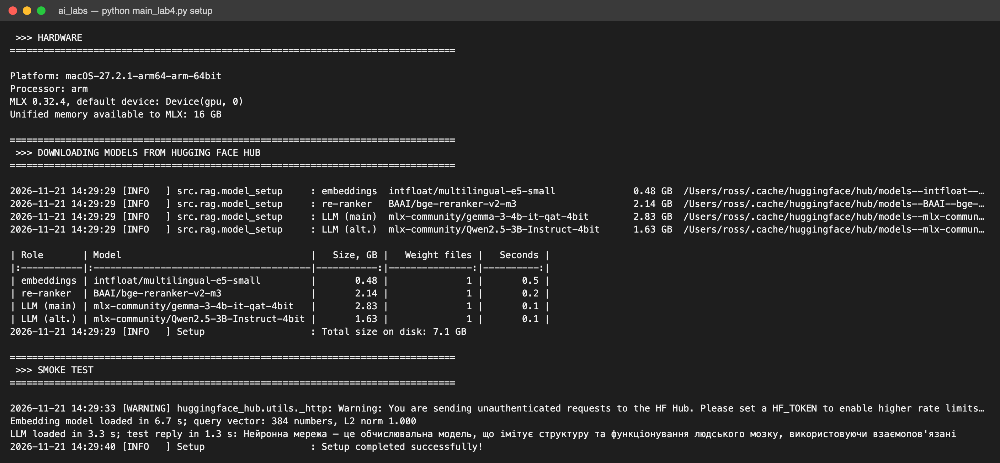{width=16cm}

### 7.4. Виклик LLM у коді

Модель-інструкція навчена на діалогах у певному форматі зі спеціальними токенами для ролей (system, user, assistant). Ці токени відрізняються в різних моделях. Тому список повідомлень перетворюється на текст промпта **шаблоном чату** (chat template), що зберігається разом із моделлю. Завдяки цьому той самий код працює і з Gemma, і з Qwen.

```python
# src/rag/llm.py — локальна LLM на MLX
def __init__(self, model_name: str, temperature: float) -> None:
    from mlx_lm import load
    from mlx_lm.sample_utils import make_sampler
    self._model, self._tokenizer = load(model_name)        # бере файли з кешу Hugging Face
    self._sampler = make_sampler(temp=temperature)

def generate(self, messages: Sequence[ChatMessage], max_tokens: int) -> str:
    from mlx_lm import generate
    prompt = self._tokenizer.apply_chat_template(
        [{"role": m.role, "content": m.content} for m in messages], add_generation_prompt=True, tokenize=False)
    return generate(self._model, self._tokenizer, prompt=prompt, max_tokens=max_tokens,
                    sampler=self._sampler, verbose=False).strip()
```

Параметри генерації: **temperature = 0** (жадібне декодування: щоразу обирається найімовірніший токен, тож на той самий промпт модель завжди дає ту саму відповідь, і порівняння конфігурацій чесне) і **максимум 350 токенів** у відповіді.

## Крок 8. RAG-пайплайн: запит → пошук → об'єднання контексту → генерація

Клас `RagPipeline` реалізує повний цикл:

1. **Запит користувача** (за наявності історії діалогу він спершу переписується в самодостатню форму, див. крок 9).
2. **Пошук релевантних документів** — top-k чанків (базово k = 3).
3. **Об'єднання контексту** — знайдені чанки нумеруються і з'єднуються в один блок, для кожного вказано статтю і розділ:

```text
[1] Стаття «Тест Тюрінга», розділ «Історія»:
<текст чанка>

[2] Стаття «Алан Тюрінг», розділ «Наукові досягнення та відкриття»:
<текст чанка>
```

4. **Генерація відповіді** — LLM отримує системну інструкцію, історію діалогу і повідомлення «Контекст + Запитання».

Системна інструкція (`src/rag/prompts.py`) вимагає: використовувати лише факти з контексту; якщо відповіді немає — дослівно відповісти «У наданих документах немає відповіді на це запитання.»; відповідати українською, 2–5 реченнями; після тверджень вказувати номери фрагментів-джерел у квадратних дужках. Посилання дозволяють перевірити, з якого фрагмента взято кожне твердження.

Для порівняння реалізовано режим **без пошуку** (`retriever=None`): LLM отримує лише запитання і відповідає зі своєї «пам'яті». Це базова лінія, яка показує, що саме додає RAG.

## Крок 9. Зберігання історії діалогу

Клас `ConversationMemory` зберігає всі обміни «запитання — переписане запитання — відповідь — джерела» і після кожного кроку записує повну історію у JSON-файл (`artifacts/lab4/dialogue_history.json`, а для інтерактивного чату — `chat_history.json`). Після перезапуску програми історія відновлюється з файлу. У промпт LLM потрапляють лише **3 останні обміни** (ковзне вікно), тож розмір промпта обмежений, а старі обміни лишаються на диску.

Історія використовується двічі:

1. **Переписування уточнювального запитання.** У запитанні «Хто вважається його засновником?» немає слів, за якими можна знайти потрібний фрагмент: незрозуміло, чий засновник. Тому перед пошуком LLM окремим запитом переписує його з урахуванням історії в самодостатню форму: «Хто вважається засновником генетичних алгоритмів?». Пошук виконується саме за переписаним запитанням.
2. **Історія в промпті генерації** — попередні обміни додаються як повідомлення user/assistant, щоб відповідь узгоджувалася з попередньою розмовою.

```python
# src/rag/pipeline.py
def ask(self, question: str) -> RagAnswer:
    history = self._memory.recent_turns
    standalone = self._condense(question, history) if history else question     # переписування
    retrieved = tuple(self._retriever.retrieve(standalone)) if self._retriever else ()
    answer = self._llm.generate(self._build_messages(question, retrieved, history), self._max_answer_tokens)
    sources = tuple(dict.fromkeys(item.chunk.document_title for item in retrieved))
    self._memory.add(DialogueTurn(question=question, standalone_question=standalone, answer=answer, sources=sources))
```

Крім демонстраційного діалогу, реалізовано інтерактивний режим `python main_lab4.py chat` з командами `/history` (показати історію), `/clear` (очистити) і `/exit`.

## Крок 10. Ранжування результатів за релевантністю

Реалізовано два способи ранжування за спільним інтерфейсом `IReranker`:

1. **Косинусна подібність** (`CosineRanker`) між вектором запиту і вектором чанка. Модель вбудовувань (*бі-енкодер*) кодує запит і фрагмент **окремо**, тому порівняння дуже швидке, але модель ніколи не «читає» їх разом.
2. **Крос-енкодер** (`CrossEncoderReranker`, модель `BAAI/bge-reranker-v2-m3`, багатомовна, 568 млн параметрів). Він отримує пару «запит + фрагмент» **разом** і передбачає оцінку релевантності від 0 до 1. Це точніше, бо модель бачить взаємодію слів запиту і фрагмента, але в сотні разів повільніше. Тому застосовується двоетапна схема: векторна база швидко повертає 20 кандидатів, крос-енкодер переоцінює лише їх, і в контекст ідуть top-k найкращих за новою оцінкою.

Порівняння двох способів на одному запиті показано на рис. 9, а кількісно — у кроці 11.

## Крок 11. Оцінка якості роботи системи

### 11.1. Набір контрольних запитань

Складено **16 контрольних запитань** (`data/lab4/eval_questions.json`): 14 з відповіддю в корпусі та 2 без неї. Для кожного вручну, за текстом статей і до основного експерименту, підготовлено:

- **еталонну відповідь**;
- **докази** — регулярні вирази для фрагментів тексту, які містять відповідь (щоб автоматично перевірити, чи знайшов пошук потрібний чанк);
- **ключові факти** — регулярні вирази для тверджень, які має містити повна відповідь (імена, дати, числа, терміни).

Набір запитань і правила оцінювання остаточно сформовано після двох пробних прогонів. Зміни були такі:

- шаблони ключових фактів доповнено варіантами написання правильних відповідей: «Шмідгубер/Шмідхубер» (дві транслітерації прізвища Schmidhuber), «перехресне затверджування/затвердження»;
- початкове запитання поза корпусом («Скільки параметрів має Llama 3 і хто її розробив?») виявилося некоректним: корпус згадує модель «LLaMa-3.1-405B», тож частину відповіді можна вивести. Його замінено двома запитаннями, відповіді на які в корпусі гарантовано немає (перевірено пошуком по текстах). Одне з них, про Нобелівську премію 2024 року, LLM може знати «з пам'яті», тож воно перевіряє, чи модель тримається контексту;
- за порадою незалежного рев'ю розрізнено повну відмову (відповідь складається лише з фрази про відсутність відповіді) і часткову (частину запитання система відповіла, від решти відмовилася).

Ці правки виправляють помилки розмітки однаково для всіх конфігурацій. Після них основний експеримент запущено повністю заново, і всі наведені нижче числа отримано саме в цьому прогоні.

Запитання різнотипні: фактичні (хто, коли, скільки — Q01–Q07, Q11, Q12), визначення (Q08–Q10), порівняння (Q13), **складене запитання з двох статей** (Q14: GAN і нечітка логіка) і **запитання без відповіді в корпусі** (Q15 — про моделі компанії Mistral AI, Q16 — про Нобелівську премію з фізики 2024 року). Останні перевіряють, чи система чесно відмовляється, а не вигадує відповідь.

### 11.2. Критерії та метрики

Завдання вимагає оцінити **точність**, **повноту** й **узгодженість** відповідей. Використано два незалежні способи:

1. **LLM-суддя** (LLM-as-a-judge): модель отримує запитання, еталонну відповідь і відповідь системи та ставить три оцінки від 1 до 5 — accuracy (точність), completeness (повнота), coherence (узгодженість). Критерії шкали прописано у промпті. Суддею виступає та сама Gemma 3 4B при temperature = 0.
2. **Об'єктивні метрики за правилами** (не залежать від думки моделі):
   - **покриття ключових фактів** — частка ключових фактів еталона, присутніх у відповіді (об'єктивна повнота й точність). Для запитань без відповіді (Q15, Q16) правильна поведінка — відмова, яка не містить вигаданих фактів. Для кожного такого запитання задано «маркери вигадки»: назви моделей і кількість параметрів для Q15, імена лауреатів для Q16;
   - **Hit@k** — частка запитань, для яких хоча б один із перших k знайдених чанків містить доказ; **MRR** (mean reciprocal rank) — середнє значення 1/(позиція першого релевантного чанка);
   - **докази в контексті** — частка необхідних доказів, присутніх у переданому LLM контексті (важливо для складених запитань);
   - кількість **хибних відмов** (система повністю відмовилася відповідати, хоча відповідь є в корпусі), **часткових відмов** і правильних відповідей на запитання без відповіді;
   - **час** пошуку та генерації.

### 11.3. Конфігурації системи

Система запускалася з різними параметрами за схемою «один фактор за раз» відносно базової конфігурації B (табл. 4).

Table: Таблиця 4. Досліджені конфігурації системи

| Конфігурація | Чанк, слів | top-k | Ранжування | LLM | Що перевіряє |
| :--- | :---: | :---: | :--- | :--- | :--- |
| A | — | — | — | Gemma 3 4B | LLM без RAG (базова лінія) |
| **B (базова)** | **200** | **3** | **косинус** | **Gemma 3 4B** | — |
| C | 200 | 1 | косинус | Gemma 3 4B | менше контексту |
| D | 200 | 5 | косинус | Gemma 3 4B | більше контексту |
| E | 100 | 3 | косинус | Gemma 3 4B | дрібніші чанки |
| F | 400 | 3 | косинус | Gemma 3 4B | більші чанки |
| G | 200 | 3 | крос-енкодер | Gemma 3 4B | ре-ранжування |
| H | 100 | 5 | крос-енкодер | Gemma 3 4B | дрібні чанки + ре-ранжування |
| I | 200 | 3 | косинус | Qwen2.5 3B | інша LLM |

Окремо, без LLM, якість пошуку виміряно для всіх 6 комбінацій «розмір чанка × спосіб ранжування». Загалом оцінено 9 × 16 = 144 відповіді.

**Обмеження вибірки.** 14 запитань з відповіддю — це невелика вибірка: одне запитання змінює Hit@1 на 0.07, а середнє покриття фактів — приблизно на 0.07 (для відповіді, що втратила всі факти). Тому різниці між конфігураціями в кілька сотих слід трактувати як тенденції, а не як доведену перевагу.

# Результати виконання програми

Повний прогін (`python main_lab4.py`) виконує всі кроки послідовно, його вивід зберігається в `artifacts/lab4/run_output.txt`. Скріншоти нижче — фрагменти цього виводу.

## Очищення, чанкінг та індексація

На рис. 4 показано результат очищення (зник знак наголосу в «Шту́чний інтеле́кт») і приклад чанка. Перекриття видно наочно: останні два речення чанка `Штучний інтелект#1` («Немає і точного критерію досягнення комп'ютером «розумності»...») дослівно повторюються на початку чанка `Штучний інтелект#2`.

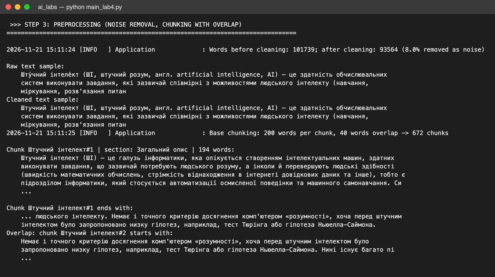{width=16cm}

На рис. 5 — статистика трьох векторних індексів (праві колонки обрізано, повністю — у табл. 2). У фінальному прогоні індекси взято з диска, бо відбиток вмісту збігся.

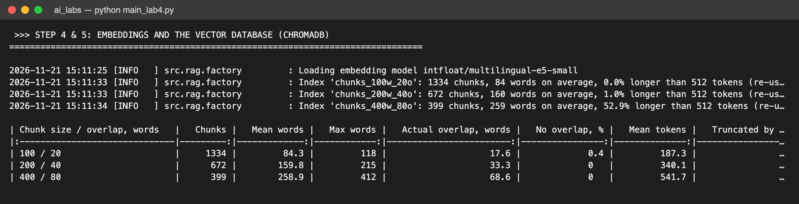{width=16cm}

## Пошук і відповідь RAG

На рис. 6 показано пошук top-5 чанків, відповідь RAG-системи і, для порівняння, відповідь тієї самої LLM без пошуку.

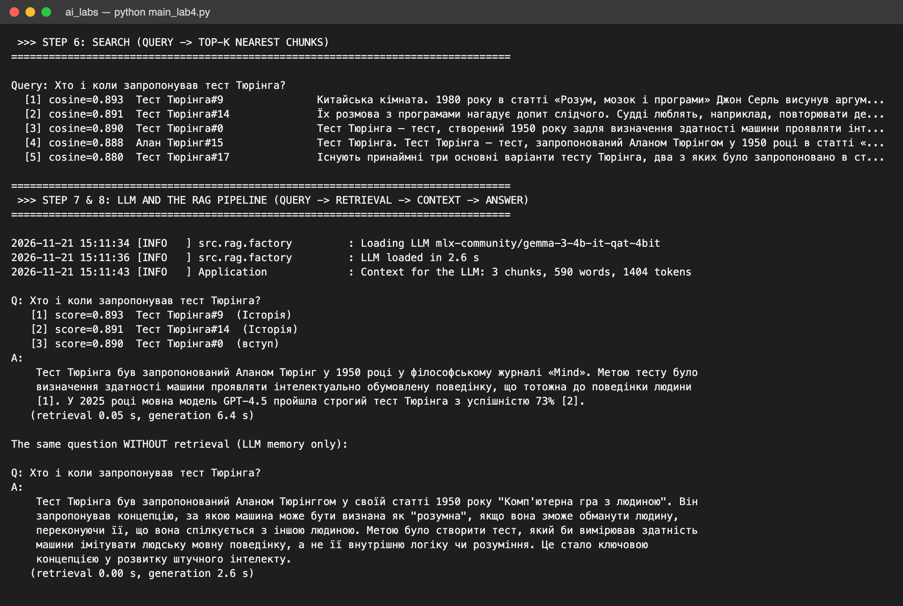{width=16cm}

З контекстом (3 чанки, 590 слів, 1 404 токени) модель правильно називає автора, рік і журнал «Mind», а для кожного твердження вказує джерело ([1], [2]). Без контексту модель теж називає Тюрінга і 1950 рік, бо це загальновідомо, але **вигадує назву статті**: «Комп'ютерна гра з людиною» замість «Обчислювальні машини та розум». Водночас видно і недолік RAG-відповіді: у неї потрапило речення про GPT-4.5, яке є в одному з фрагментів, але не стосується запитання. Генерація займає 6.4 с з контекстом і 2.6 с без нього, а векторний пошук — 0.05 с.

## Діалог з історією

На рис. 7 показано діалог із чотирьох запитань, де кожне наступне посилається на попереднє («його засновником», «в ньому», «він»).

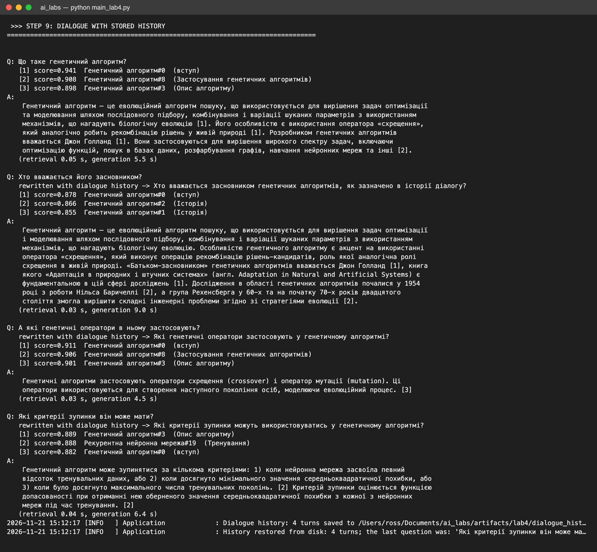{width=16cm}

Що видно на рис. 7:

- **Переписування запитань працює:** «А які генетичні оператори в ньому застосовують?» → «Які генетичні оператори застосовують у генетичному алгоритмі?», «Які критерії зупинки він може мати?» → «Які критерії зупинки можуть використовуватись у генетичному алгоритмі?». Завдяки цьому пошук щоразу знаходить фрагменти статті «Генетичний алгоритм», хоча в самих запитаннях назви алгоритму немає. Відповіді на друге й третє запитання правильні: засновник — Джон Голланд, оператори — схрещення та мутація.
- **Мала модель не завжди виконує інструкцію буквально:** у другому переписаному запитанні лишився зайвий хвіст «як зазначено в історії діалогу», хоча промпт прямо це забороняє. На пошук це не вплинуло.
- **Галюцинація від нерелевантного контексту:** на четверте запитання пошук повернув другим фрагмент статті «Рекурентна нейронна мережа» про критерії зупинки навчання мереж. Модель переказала саме його і приписала генетичному алгоритму критерії з нейронних мереж («коли нейронна мережа засвоїла певний відсоток тренувальних даних»). Правильні критерії (знайдено оптимум, вичерпано кількість поколінь або час) є в першому фрагменті, але модель їх не використала. Це головний ризик RAG: LLM довіряє будь-якому наданому контексту, тому якість відповіді обмежена точністю пошуку.

Після діалогу історію (4 обміни з джерелами) збережено у `artifacts/lab4/dialogue_history.json` і успішно відновлено з диска.

На рис. 8 показано інтерактивний режим чату (вивід збережено в `artifacts/lab4/chat_session.txt`). Запитання «А скільки параметрів має її великий варіант?» переписано в «Скільки параметрів має BERT LARGE?», система правильно відповіла (BERT-BASE — 110 млн, BERT-LARGE — 340 млн), а команда `/history` вивела збережену історію з джерелами.

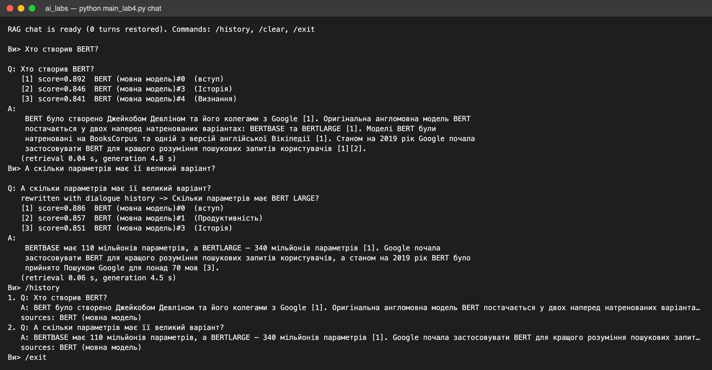{width=16cm}

## Ранжування

На рис. 9 порівняно два способи ранжування для запиту «Які методики допомагають уникати перенавчання моделі?». За косинусною подібністю оцінки п'яти фрагментів майже однакові (0.866–0.897), а на 4-му місці опинився фрагмент про рекурентні мережі, що не стосується запитання. Крос-енкодер чітко розділяє релевантне і нерелевантне: 0.999 і 0.997 для двох фрагментів статті «Перенавчання», 0.956 для фрагмента про штучне розширення даних як спосіб боротьби з перенавчанням, і далі різке падіння до 0.767 та 0.685. Також він підняв фрагмент про регуляризацію зі статті про згорткові мережі.

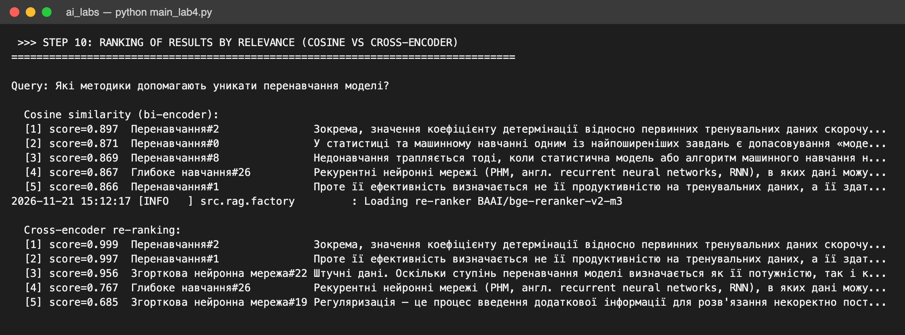{width=16cm}

## Якість пошуку

На рис. 10 показано, як програма вимірює якість пошуку для всіх комбінацій розміру чанка і способу ранжування, а підсумок наведено в табл. 5 і на рис. 11.

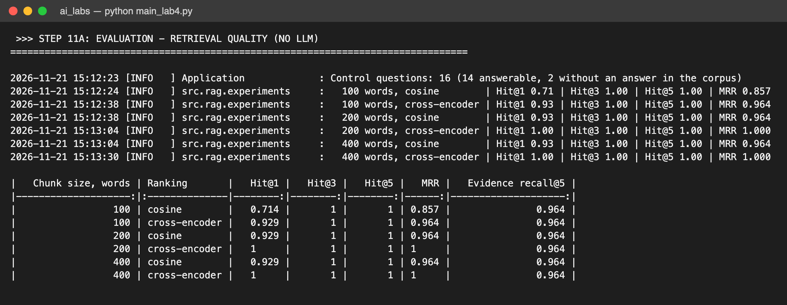{width=16cm}

Table: Таблиця 5. Якість пошуку на 14 запитаннях з відповіддю (без участі LLM)

| Чанк, слів | Ранжування | Hit@1 | Hit@3 | Hit@5 | MRR | Докази в top-5 |
| :---: | :--- | :---: | :---: | :---: | :---: | :---: |
| 100 | косинус | 0.714 | 1.000 | 1.000 | 0.857 | 0.964 |
| 100 | крос-енкодер | 0.929 | 1.000 | 1.000 | 0.964 | 0.964 |
| 200 | косинус | 0.929 | 1.000 | 1.000 | 0.964 | 0.964 |
| 200 | крос-енкодер | **1.000** | 1.000 | 1.000 | **1.000** | 0.964 |
| 400 | косинус | 0.929 | 1.000 | 1.000 | 0.964 | 0.964 |
| 400 | крос-енкодер | **1.000** | 1.000 | 1.000 | **1.000** | 0.964 |

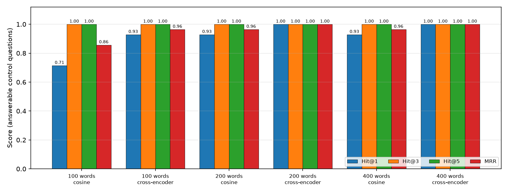{width=16cm}

Аналіз табл. 5 і рис. 11:

- Hit@3 = 1.0 в усіх конфігураціях: релевантний фрагмент завжди потрапляє в трійку найкращих. Набір запитань виявився «легким» для пошуку, бо майже кожне запитання містить характерні назви (Deep Blue, BERT, LSTM), які однозначно вказують на статтю. Тому метрики пошуку насичуються, і різниця між конфігураціями видна лише на Hit@1 і MRR. На 14 запитаннях Hit@1 = 0.714 / 0.929 / 1.0 означає 10 / 13 / 14 запитань.
- **Дрібні чанки (100 слів)** з косинусною подібністю найгірші (Hit@1 = 0.714): короткий фрагмент часто містить лише частину контексту, і за вектором ближчим виявляється сусідній фрагмент. Чанки по 200 і 400 слів дали однаковий результат (0.929), але чанки по 400 слів наполовину обрізаються моделлю вбудовувань (табл. 2).
- **Крос-енкодер** покращив Hit@1 для всіх розмірів чанків: 0.714 → 0.929, 0.929 → 1.0, 0.929 → 1.0. Тобто він виправляє саме ті випадки, коли бі-енкодер ставить релевантний фрагмент другим чи третім.
- «Докази в top-5» менші за 1, бо для складеного запитання Q14 (GAN і нечітка логіка) у top-5 потрапляють фрагменти лише про GAN. Один вектор запиту про дві різні теми «тяжіє» до однієї з них.
- Hit@k зараховується, якщо фрагмент містить хоча б один із доказів. Для доказів-імен («Хохрайтер», «Лі Седол») це поблажливо: фрагмент може згадувати ім'я без потрібного факту. Тому поруч наведено частку знайдених доказів.

## Якість відповідей для різних параметрів

Table: Таблиця 6. Якість відповідей для різних конфігурацій (16 запитань; ключові факти — по 14 запитаннях з відповіддю)

| Конфігурація | Точність (1–5) | Повнота (1–5) | Узгодженість (1–5) | Ключові факти | Хибні / часткові відмови | Без відповіді: правильно | Час, с |
| :--- | :---: | :---: | :---: | :---: | :---: | :---: | :---: |
| A: без RAG | 4.25 | 4.19 | 4.69 | 0.58 | 0 / 0 | 0 з 2 | 3.2 |
| B: 200, k=3, косинус | 4.94 | 4.88 | 4.88 | **0.95** | 0 / 0 | 2 з 2 | 6.3 |
| C: 200, k=1 | 4.94 | 4.62 | 4.88 | 0.84 | 1 / 2 | 2 з 2 | 3.7 |
| D: 200, k=5 | **5.00** | **5.00** | **5.00** | **0.95** | 0 / 0 | 2 з 2 | 7.5 |
| E: 100, k=3 | 4.94 | 4.88 | 4.94 | 0.94 | 0 / 0 | 2 з 2 | 4.9 |
| F: 400, k=3 | 5.00 | 4.88 | 4.94 | **0.95** | 0 / 0 | 2 з 2 | 7.0 |
| G: 200, k=3, крос-енкодер | 4.94 | 4.88 | 4.94 | 0.93 | 0 / 0 | 2 з 2 | 9.9 |
| H: 100, k=5, крос-енкодер | 4.94 | 4.88 | 4.94 | 0.94 | 0 / 0 | 2 з 2 | 7.6 |
| I: як B, Qwen2.5 3B | 4.69 | 4.62 | 4.62 | 0.89 | 1 / 0 | 2 з 2 | 4.8 |

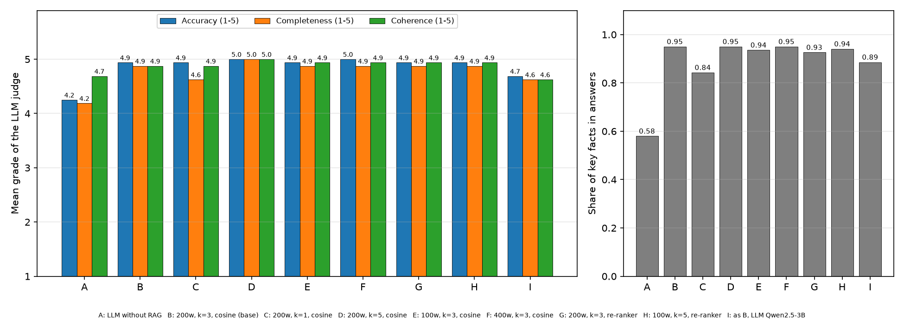{width=16cm}

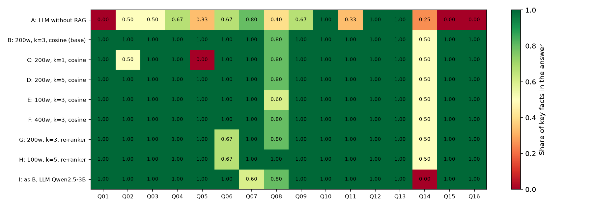{width=16cm}

Аналіз:

1. **RAG суттєво підвищує фактичну точність.** Без пошуку (A) відповіді містять 58 % ключових фактів, з RAG (B) — 95 %. Рис. 13 показує, як саме помиляється LLM без контексту: вона впевнено вигадує імена. Батьком генетичних алгоритмів названо «Джона Холта» замість Джона Голланда (Q01), авторами LSTM — неіснуючих «Себастьяна Гудмана, Юнь Чена та Ромена Тао» (Q05), автором GAN — «Джима Корнеліуса» (Q14), а лауреатами Нобелівської премії 2024 року — «Йена Лекуна, Джеффері Хінтона та Шорі Стенлі Чен» (Q16; насправді премію отримали Джон Гопфілд і Джеффрі Хінтон). Модель помиляється й у числах: «200 позицій за секунду» замість 200 млн (Q02). Без пошуку модель відповіла на обидва запитання поза корпусом із власної пам'яті, а **всі 8 RAG-конфігурацій чесно відмовилися** відповідати на них.
2. **Кількість фрагментів (top-k).** k = 1 (C) — замало: покриття фактів упало до 0.84. На Q05 знайдений фрагмент не містив відповіді, і система повністю відмовилася (хибна відмова). На Q14 вона відповіла лише про GAN. На Q13 спершу написала «немає відповіді», а потім усе ж відповіла: модель плутається, коли контексту замало. k = 5 (D) отримав максимальні оцінки судді (5.0 за всіма критеріями), але за покриттям фактів не кращий за k = 3 (0.95), а генерація повільніша (7.2 с проти 5.9 с) через довший промпт. Отже, k = 3 — розумний компроміс.
3. **Розмір чанка** на якість відповідей майже не вплинув (0.94–0.95). Великі чанки (F) збільшують промпт і час генерації, а чанки по 100 слів гірші за якістю пошуку (табл. 5). Розмір 200 слів — оптимальний компроміс.
4. **Ре-ранжування крос-енкодером** (G, H) покращило порядок фрагментів (табл. 5), але не покриття фактів у відповідях (0.93–0.94 проти 0.95). Причина: на цьому наборі запитань потрібний фрагмент і так потрапляє в top-3 (Hit@3 = 1.0), тож зміна порядку всередині трійки на відповідь майже не впливає. Водночас ре-ранжування додає 1.8–3.6 с на кожен запит (рис. 14). Для цього корпусу воно не виправдовує свою ціну. Ре-ранжування корисне, коли потрібний фрагмент опиняється за межами top-k, а таких запитів у наборі не було.
5. **Вибір LLM.** На тому самому контексті Qwen2.5 3B (I) гірша за Gemma 3 4B (B): 0.89 проти 0.95 фактів, нижчі оцінки узгодженості (4.62 проти 4.88), граматичні та лексичні помилки в українській мові («рахунком був 4:1 в свою підсвітку», «зазначає відхилення з тренувальних даних як існуючі відхилення зібратих даних», «12 головних» замість «12 голів уваги»). На складене запитання Q14 вона повністю відмовилася відповідати, хоча половина відповіді в контексті була. Різниця за фактами зумовлена переважно цим одним запитанням, тож висновок про перевагу Gemma — це тенденція, а не статистично доведений факт.
6. **Найскладніше — складене запитання Q14** (дві теми з двох статей): жодна конфігурація не дала повної відповіді (максимум 0.5). Пошук знаходить лише фрагменти про GAN, а модель у кількох конфігураціях (D, F, H) **змішала факти** й приписала нечіткій логіці авторів ідеї змагального навчання. Це галюцинація, спричинена нерелевантним контекстом. Типове рішення — розкладати складене запитання на підзапитання і шукати для кожного окремо.

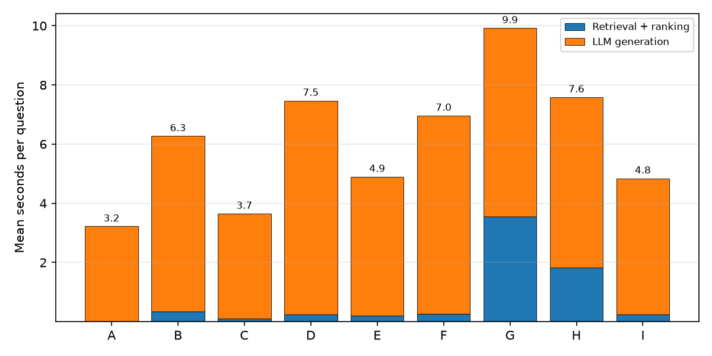{width=14cm}

Час відповіді (рис. 14) визначає передусім генерація LLM: 3–7 с залежно від довжини контексту. Векторний пошук займає соті–десяті частки секунди, а крос-енкодер додає 1.8–3.6 с. Середні значення трохи завищені першим запитом кожної конфігурації. Наприклад, у B перший пошук тривав 1.65 с проти 0.05–0.45 с для решти, ймовірно через прогрів GPU і завантаження моделі. Усі 144 відповіді разом з оцінюванням згенеровано за 19.4 хв.

**Обмеження методики оцінювання.** LLM-суддя виявився поблажливим. Більшість відповідей RAG отримали 5/5/5, а явно хибні відповіді без RAG часто теж мали високі оцінки: «Джон Холт» (Q01) — 4/5/5, вигадані лауреати Нобелівської премії (Q16) і відповідь про Mistral із пам'яті (Q15) — 5/5/5, хоча інструкція вимагала ставити за такі відповіді 1. Суддя непослідовний і на RAG-відповідях: хибну відмову C/Q05 (0 ключових фактів) оцінено на 5/5/5, відповідь D/Q14 зі змішаними фактами — теж на 5/5/5, а коректно сформульовану відмову Qwen (I/Q14) — на 1/1/1, включно з узгодженістю. Причин дві. По-перше, суддя — та сама невелика модель, що генерує відповіді. По-друге, вона оцінює і власні відповіді, і відповіді Qwen, тож можлива упередженість на користь «своїх». Тому основною метрикою в роботі є **об'єктивне покриття ключових фактів**, а оцінки судді — допоміжною (сирий вивід судді для кожної відповіді збережено в `eval_answers.json`). Для надійнішої оцінки потрібен сильніший незалежний суддя або оцінювання людиною. Крім того, ключові факти перевіряються регулярними виразами, тож правильна відповідь іншими словами може бути зарахована неповністю. Наприклад, для Q08 опис перенавчання як «запам'ятовування тренувальних даних» не збігається з шаблоном «шум або випадкова похибка».

На рис. 15 показано фрагмент підсумкової таблиці, яку програма виводить наприкінці (праві колонки обрізано, повністю таблиця наведена в табл. 6). Загальні результати збережено в `artifacts/lab4/metrics_summary.md`, усі 144 відповіді з оцінками — в `artifacts/lab4/eval_answers.json`.

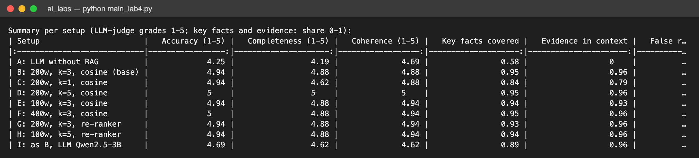{width=16cm}

# Висновки

1. Розроблено повністю локальну RAG-систему українською мовою: корпус із 40 статей української Вікіпедії про штучний інтелект (101 739 слів) → очищення від шумів (видалено 8 % тексту) → поділ на чанки по 200 слів з перекриттям (672 чанки) → вектори моделі multilingual-e5-small (384 виміри) → векторна база ChromaDB з HNSW-індексом → пошук top-k за косинусною подібністю з опційним ре-ранжуванням крос-енкодером → генерація відповіді з посиланнями на джерела локальною LLM Gemma 3 4B. Реалізовано зберігання історії діалогу з переписуванням уточнювальних запитань та інтерактивний режим чату.
2. Усі моделі (7.1 ГБ) встановлено з Hugging Face Hub і запущено на ноутбуці Apple M1 Pro без платних API. LLM у 4-бітній квантизації працює на GPU через фреймворк MLX, завантажується за ~3 с і генерує відповідь за 3–7 с.
3. Розмір чанка має відповідати вхідному ліміту моделі вбудовувань: при 400 словах 52.9 % чанків перевищують ліміт у 512 токенів і обрізаються. Найкращу якість пошуку на контрольному наборі дали чанки по 200 слів з ре-ранжуванням крос-енкодером (Hit@1 = 1.0, MRR = 1.0). Чанки по 100 слів з косинусною подібністю найгірші (Hit@1 = 0.714).
4. RAG різко підвищує фактичну точність: частка ключових фактів у відповідях зросла з 0.58 (LLM без пошуку) до 0.95 у базовій конфігурації. LLM без пошуку вигадувала імена, назви й числа та відповідала на запитання поза корпусом із пам'яті, а всі RAG-конфігурації на такі запитання чесно відмовлялися.
5. Вплив параметрів (з урахуванням малої вибірки — 14 запитань з відповіддю): замало контексту (k = 1) знижує покриття фактів до 0.84 і призводить до хибних відмов; збільшення k з 3 до 5 і розмір чанка 100–400 слів на якість відповідей майже не впливають, але змінюють час генерації; ре-ранжування покращує порядок фрагментів, але на цьому корпусі не підвищує якість відповідей і додає ~2–4 с на запит; Gemma 3 4B на тому самому контексті відповідає точніше й грамотніше, ніж Qwen2.5 3B.
6. Слабкі місця системи: складені запитання про кілька тем (пошук знаходить лише одну тему, і модель може змішати факти), перенесення у відповідь фактів із нерелевантних фрагментів контексту, а також поблажливість LLM-судді, що оцінює власні відповіді. Напрями покращення: розкладання складених запитань на підзапитання, гібридний пошук (векторний + лексичний BM25), поріг релевантності для фрагментів контексту, більша LLM і незалежний суддя.
