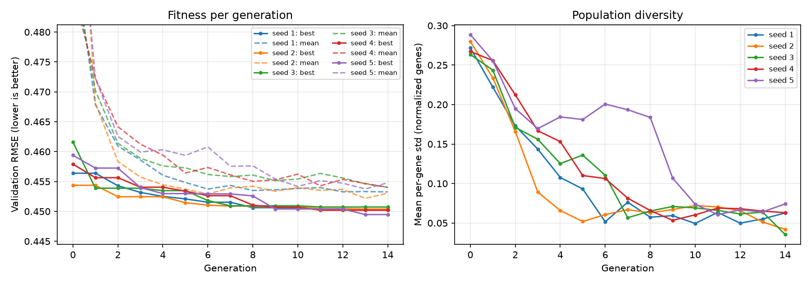
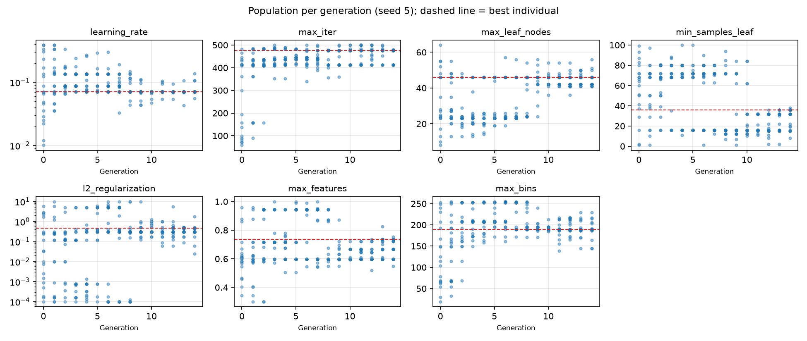
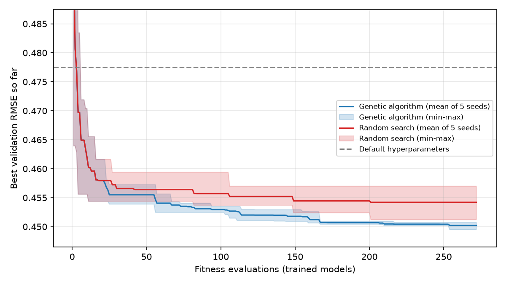
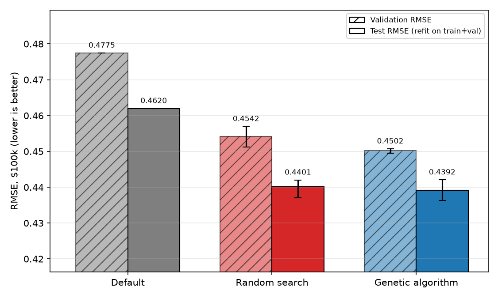

# ЛР №3 — генетичний алгоритм підбирає налаштування моделі: конспект

## 1. Коротко

Ми написали власний генетичний алгоритм (ГА) і доручили йому підібрати 7 налаштувань
(гіперпараметрів) моделі градієнтного бустингу `HistGradientBoostingRegressor`. Модель прогнозує
медіанну ціну житла в районі Каліфорнії за 8 ознаками (датасет California Housing, 20 640 рядків,
поділ 60/20/20). Якість кожної конфігурації ГА оцінює як помилку RMSE на validation-вибірці. Test
відкриваємо лише один раз, наприкінці. Порівнювали з двома суперниками: значеннями за замовчуванням
і випадковим пошуком (random search), який мав той самий бюджет у 272 оцінювання. Кожен метод
запускали з 5 seed. Результат на test: за замовчуванням RMSE 0.4620, випадковий пошук 0.4401 ± 0.0020,
ГА 0.4392 ± 0.0023, тобто ГА зменшив помилку на 4.9 % відносно значень за замовчуванням. На validation
ГА явно кращий за випадковий пошук (0.4502 ± 0.0004 проти 0.4542 ± 0.0019). На test ця перевага
майже зникає, і нижче розберемо чому.

## 2. Навіщо це взагалі

У будь-якої моделі машинного навчання є «ручки», які людина виставляє *до* навчання: скільки дерев
будувати, наскільки великі ці дерева, наскільки обережно робити кожен крок. Сама модель їх не
вчить. Від цих ручок помітно залежить якість: на наших даних значення «з коробки» дають помилку
близько $46 200 на будинок, а підібрані — близько $43 900.

Підбирати руками довго й необ'єктивно, а повний перебір неможливий: 7 ручок, частина з них дійсні
числа, і кожна спроба означає навчити модель (близько секунди). Тож нам потрібен оптимізатор, який
за обмежену кількість спроб знайде добру комбінацію. Звичний градієнтний спуск тут не підходить:
залежність «налаштування → помилка» не має формули й похідної, а частина параметрів цілі числа.
Еволюційні алгоритми працюють саме з такими «чорними скриньками»: їм достатньо вміти оцінити
кандидата.

Ідея знайома з ЛР1: там ти підбирав поріг класифікації на validation і лише потім дивився на test.
Тут те саме, тільки підбираємо не одне число, а сім, і робимо це розумнішим пошуком, а не простим перебором.

## 3. Словник

ЛР1–2 мали лише звіти, без конспектів, тому базові терміни (train/validation/test, перенавчання)
коротко пояснено й тут.

| Термін | Пояснення | Аналогія |
|---|---|---|
| Гіперпараметр (hyperparameter) | Налаштування моделі, яке задають до навчання (кількість дерев, крок). На відміну від *параметрів* (розбиття всередині дерев), модель його не вчить. | Аргумент конструктора, на противагу внутрішньому стану, який об'єкт набуває під час роботи. |
| Train / validation / test | Три непересічні частини даних. На train модель навчається, на validation ми обираємо налаштування, а test — «запечатаний конверт» для чесної фінальної оцінки. | Train — підручник, validation — пробні контрольні, test — іспит із невідомими задачами. |
| Регресія (regression) | Задача прогнозування числа (ціни), а не класу. ЛР1–2 розв'язували класифікацію (шахрайство так/ні). | — |
| Дерево рішень (decision tree) | Модель у вигляді ланцюжка `if` за ознаками, наприклад «дохід > 5 → широта < 34 → ...», у листку стоїть прогноз. | Вкладені `if/else`, побудовані автоматично з даних. |
| Градієнтний бустинг (gradient boosting) | Послідовність малих дерев, у якій кожне наступне виправляє помилки суми попередніх. `learning_rate` визначає, яку частку виправлення беремо на кожному кроці. | Колектив редакторів: кожен править те, що пропустили попередні, але обережно. |
| Гістограмний бустинг (histogram-based) | Перед навчанням значення кожної ознаки розкладають на `max_bins` кошиків. Так пошук розбиття стає набагато швидшим. | Округлення до сотень перед групуванням. |
| RMSE (root mean squared error) | Корінь із середнього квадрата помилки. Вимірюється в одиницях цілі, тут у $100k, тож 0.44 ≈ $44 000. Великі промахи штрафує сильніше, ніж малі. | — |
| MAE (mean absolute error) | Середній модуль помилки, менш чутливий до великих промахів. | — |
| R² (коефіцієнт детермінації) | Частка розкиду цін, яку пояснює модель: 1 — ідеально, 0 — не краще за прогноз «завжди середня ціна». | — |
| Особина, геном (individual, genome / chromosome) | Один кандидат-розв'язок: вектор із 7 генів у [0, 1]. | Об'єкт-кандидат. |
| Ген (gene) | Одне число геному, яке кодує один гіперпараметр. | Поле об'єкта. |
| Генотип → фенотип (genotype → phenotype) | Геном у [0, 1] перетворюють (*декодують*) на справжні значення гіперпараметрів. | DTO → доменний об'єкт через маппер. |
| Популяція, покоління (population, generation) | Набір із 20 особин, які живуть одночасно. Покоління — один крок еволюції. | Ітерація циклу, що працює над колекцією. |
| Фітнес (fitness) | Число «наскільки особина хороша», яке алгоритм **максимізує**. У нас це −RMSE на validation. | Метод `score()` для `Comparator`. |
| Відбір (selection) | Спосіб обрати батьків, щоб кращі мали більше шансів. | — |
| Тиск відбору (selection pressure) | Наскільки сильно відбір віддає перевагу найкращим. Сильний тиск дає швидку збіжність, але популяція втрачає різноманітність і може застрягти. | — |
| Турнірний відбір (tournament selection) | Беремо k = 3 випадкові особини, батьком стає найкраща з них. | Плей-оф із трьох учасників. |
| Рулетка (roulette-wheel selection) | Імовірність стати батьком пропорційна фітнесу. У нас **не** використовується (чому — див. §4.5 і §7). | Лотерея, де кожен квиток коштує одиницю фітнесу. |
| Схрещування (crossover, recombination) | З двох батьків будуємо дітей, змішуючи гени. | — |
| Однорідне схрещування (uniform crossover) | Кожен ген дитина бере від батька A або B з імовірністю 0.5. | Підкидання монетки для кожного поля. |
| Мутація (mutation) | Невелика випадкова зміна генів дитини. Без неї популяція не вийде за межі того, що вже є в генах. | — |
| Гаусова мутація (Gaussian mutation) | До гена додаємо шум із нормального розподілу N(0, σ): малі зсуви часто, великі рідко. | `gene += random.nextGaussian() * sigma`. |
| Елітизм (elitism) | Кілька найкращих особин переходять у наступне покоління без змін. | — |
| Різноманітність (diversity) | Наскільки розкидана популяція. У коді це середнє за генами стандартне відхилення (std); 0 означає, що всі особини однакові. | — |
| Випадковий пошук (random search) | 272 незалежні випадкові конфігурації, з яких беремо найкращу. Базова лінія. | — |
| Бюджет оцінювань (evaluation budget) | Скільки разів дозволено обчислити фітнес. Однаковий бюджет робить порівняння методів чесним. | — |
| Seed | Початкове значення генератора випадкових чисел. Той самий seed дає той самий запуск. | `new Random(42)`. |
| Перенавчання на validation (overfitting to validation) | Якщо дуже ретельно оптимізувати під одну validation-вибірку, можна підігнатися під її випадкові особливості, і на нових даних виграш зменшиться. | Натаскати учня на конкретні пробні контрольні. |

## 4. Як це зроблено — крок за кроком

`main_lab3.py` — це лише оркестратор. Кроки йдуть у тому самому порядку, що й банери `Step N` у
лозі `artifacts/lab3/run_output.txt`. Усі числа експерименту зібрано в одному місці:
`src/config/lab3_config.py`.

### 4.0. Обгортка запуску: `main()`

- **Що:** створює конфігурацію, дублює весь консольний вивід у файл і обмежує модель одним потоком.
- **Навіщо:** лог `run_output.txt` — це доказ запуску для звіту. Один потік вибрано, бо на ~12 тис.
  рядків керування потоками OpenMP (бібліотека паралельних обчислень усередині моделі) коштує більше, ніж дає (так сказано в коментарі в коді, автор
  вимірював на M1 Pro).
- **Як:** `main_lab3.py:153-160`:

```python
def main() -> None:
    config = Lab3Config()
    with mirrored_stdout(config.paths.artifacts_dir / "run_output.txt"):
        setup_logging()
        with threadpool_limits(limits=config.model_threads, user_api="openmp"):
            run(config)
```

`with` — аналог try-with-resources. `mirrored_stdout` (`src/utils/console.py:26-36`) підміняє
`sys.stdout` об'єктом `Tee`, який пише одразу в консоль і у файл. Це те саме, що `System.setOut(...)`
у Java, із відновленням у `finally`. `Tee` не наслідує жодного інтерфейсу, у нього просто є методи
`write` і `flush`. Python перевіряє наявність методів, а не тип («качина типізація»).

### 4.1. Крок 1 — дані і поділ train / validation / test

- **Що:** завантажує California Housing (перепис США 1990 р.): 20 640 районів, 8 числових ознак
  (`MedInc` — медіанний дохід, `HouseAge`, `AveRooms`, `AveBedrms`, `Population`, `AveOccup`,
  `Latitude`, `Longitude`). Ціль — медіанна вартість будинку в $100 000. Дані ділить на
  train = 12 384, val = 4 128, test = 4 128 (числа з `run_output.txt`).
- **Навіщо:** три вибірки, бо в нас дві різні задачі. Validation потрібна, щоб **обирати**
  гіперпараметри, test — щоб чесно **оцінити** вибране. Якби фітнес рахувався на test, ГА
  підганяв би налаштування під іспит, і фінальна цифра була б завищена.
- **Як:** два послідовні `train_test_split` (`src/evolution/housing_data.py:51-54`): спершу 20 %
  відкладаємо на test, потім 25 % решти йде у validation (0.25 × 0.8 = 0.2 від усього):

```python
x_rest, x_test, y_rest, y_test = train_test_split(
    features, target, test_size=self._config.test_size, random_state=self._config.random_seed)
x_train, x_val, y_train, y_val = train_test_split(
    x_rest, y_rest, test_size=self._config.val_size_of_rest, random_state=self._config.random_seed)
```

Функція повертає кортеж із чотирьох масивів, і Python одразу розкладає його в чотири змінні. У Java
для цього знадобився б record-контейнер. `random_state=42` фіксує перемішування, тож поділ завжди
однаковий.

- **Чому без масштабування:** у ЛР1 ти масштабував ознаки (`RobustScaler`). Деревам це не потрібно:
  розбиття «дохід > 5» працює однаково, хоч у доларах, хоч у тисячах. Тому до поділу на даних нічого
  не навчається і витоку немає (`housing_data.py:40-41`).
- **Чому без стратифікації:** ціль — неперервне число, класів немає, тому `stratify` з ЛР1–2 тут не
  застосовується.

### 4.2. Крок 2 — простір пошуку: як закодувати гіперпараметри в гени

- **Що:** описує 7 гіперпараметрів, які підбираємо, з діапазонами (`src/config/lab3_config.py:13-34`):

| Ген | Гіперпараметр | Тип | Діапазон | За замовч. | Що робить |
|---|---|---|---|---|---|
| 0 | `learning_rate` | float | [0.01, 0.5], лог. | 0.1 | частка виправлення на кожному кроці бустингу |
| 1 | `max_iter` | int | [50, 500] | 100 | кількість дерев |
| 2 | `max_leaf_nodes` | int | [4, 64] | 31 | максимум листків у дереві (складність) |
| 3 | `min_samples_leaf` | int | [1, 100] | 20 | мінімум прикладів у листку (згладжування) |
| 4 | `l2_regularization` | float | [0.0001, 10], лог. | 0 | штраф за великі значення в листках |
| 5 | `max_features` | float | [0.3, 1] | 1 | частка ознак, які розглядають для кожного розбиття |
| 6 | `max_bins` | int | [16, 255] | 255 | кількість кошиків гістограми |

- **Навіщо нормалізувати гени в [0, 1]:** гіперпараметри різнотипні (цілі, дійсні, у різних
  масштабах). Якщо кожен ген — просто число від 0 до 1, то мутація «додай шум σ = 0.1» означає
  одне й те саме для всіх: 10 % діапазону. Інакше довелося б писати окрему мутацію для кожного типу.
- **Як:** декодування одного гена (`src/evolution/search_space.py:34-43`):

```python
def decode(self, gene: float) -> HyperparameterValue:
    gene = min(max(gene, 0.0), 1.0)
    if self.log_scale:
        value = math.exp(math.log(self.low) + gene * (math.log(self.high) - math.log(self.low)))
    else:
        value = self.low + gene * (self.high - self.low)
    if self.kind is ParameterKind.INT:
        return int(round(value))
    return float(value)
```

На пальцях. Для `max_iter` (лінійна шкала) ген 0.5 дає 50 + 0.5 · 450 = 275 дерев. Для
`learning_rate` (логарифмічна шкала) той самий ген 0.5 дає √(0.01 · 0.5) ≈ 0.071, тобто середнє
*геометричне*. Лінійна шкала дала б 0.255. Логарифмічну шкалу беруть, бо для кроку важить *у скільки
разів* він змінився: різниця між 0.01 і 0.02 така ж суттєва, як між 0.25 і 0.5. На лінійній шкалі
96 % випадкових генів давали б крок понад 0.03, і малі кроки майже не досліджувалися б.
Цікаво, що всі знайдені ГА кроки лежать у межах 0.059–0.090, тобто поблизу середини логарифмічної шкали.

`is ParameterKind.INT` порівнює enum за ідентичністю, як `==` для enum у Java. Цілі параметри
округлюються, тому кілька різних генів дають одне й те саме значення. Це знадобиться в кеші (§4.4).

Увесь геном декодується dict comprehension (`search_space.py:69`):

```python
return {spec.name: spec.decode(float(gene)) for spec, gene in zip(self.specs, genome)}
```

`zip` іде двома послідовностями паралельно, як цикл `for (int i...)` з `specs.get(i)` і `genome[i]`.
Результат — `Map<String, Number>`.

### 4.3. Крок 3 — базова лінія: значення за замовчуванням

- **Що:** навчає модель із типовими значеннями scikit-learn (`main_lab3.py:29-30`, `61-64`).
- **Навіщо:** без точки відліку не скажеш, чи пошук узагалі щось дав.
- **Що вийшло:** val RMSE 0.4775, test RMSE 0.4620, R² 0.837. У грошах це середня помилка близько
  $46 000.

### 4.4. Фітнес-функція — серце задачі

- **Що:** за геномом навчає модель на train і повертає −RMSE на validation (`src/evolution/fitness.py:55-67`).
- **Навіщо мінус:** ГА завжди *максимізує* фітнес, а RMSE — помилка, яку треба зменшувати.
- **Як:**

```python
def validation_rmse(self, genome: np.ndarray) -> float:
    hyperparameters = self._search_space.decode(genome)
    key = tuple(round(value, 10) if isinstance(value, float) else value for value in hyperparameters.values())
    if key not in self._cache:
        started = time.perf_counter()
        model = self.build_model(hyperparameters).fit(self._data.x_train, self._data.y_train)
        self._cache[key] = float(root_mean_squared_error(self._data.y_val, model.predict(self._data.x_val)))
        ...
    return self._cache[key]

def evaluate(self, genome: np.ndarray) -> float:
    return -self.validation_rmse(genome)
```

Кеш — це `Map<List<Object>, Double>`. Ключ — кортеж (tuple) декодованих значень: він незмінний, а
отже, хешований, як record з авто-`equals/hashCode`. Список (`list`) ключем бути не може. Модель
створюється з `**hyperparameters` (`fitness.py:53`): словник розпаковується в іменовані аргументи
`learning_rate=..., max_iter=...`. У Java прямого аналога немає, найближче — builder, якому по черзі
передали всі поля мапи. `early_stopping=False` вимкнено свідомо: інакше модель сама зупинялася б раніше
і `max_iter` не означав би того, що підібрав ГА.

- **Детермінованість:** `random_state=42` у моделі робить фітнес чистою функцією: той самий геном
  завжди дає той самий RMSE. Без цього ГА порівнював би «шум» і кеш був би некоректним.
- **Чому RMSE, а не R²:** RMSE вимірюється в доларах, і його легко пояснити. Для фіксованої
  validation-вибірки R² — монотонна функція від RMSE, тож оптимізація обох дала б той самий результат.
- **Чесно про кеш:** у docstring класу (`fitness.py:28-30`) сказано, що кеш економить зокрема на елітах.
  Насправді еліти взагалі не проходять через фітнес: їхнє значення просто копіюється
  (`genetic_algorithm.py:79`). Кеш спрацьовує на дітях-клонах (без схрещування й без мутації) і на
  різних геномах, що після округлення дають ті самі цілі значення.

### 4.5. Крок 4 — генетичний алгоритм

- **Що:** 20 особин, 15 поколінь, на кожне покоління по 5 seed (`main_lab3.py:66-85`).
- **Навіщо 5 seed:** один запуск міг просто пощастити. П'ять показують розкид.

**Загальна схема одного покоління** (`src/evolution/genetic_algorithm.py:75-91`):

```python
for generation in range(1, config.generations):
    ranked = sorted(range(len(population)), key=lambda index: fitness[index], reverse=True)
    next_population = [population[index].copy() for index in ranked[:config.elite_count]]
    next_fitness = [fitness[index] for index in ranked[:config.elite_count]]

    while len(next_population) < config.population_size:
        parent_a = self._selection.select(population, fitness, rng)
        parent_b = self._selection.select(population, fitness, rng)
        for child in self._crossover.recombine(parent_a, parent_b, rng):
            if len(next_population) < config.population_size:
                child = self._mutation.mutate(child, rng)
                next_population.append(child)
                next_fitness.append(evaluate(child))

    population, fitness = next_population, next_fitness
```

Покоління 0 — це 20 рівномірно випадкових геномів (`genetic_algorithm.py:71-73`). Далі цикл:
відсортувати індекси за фітнесом (`sorted(..., key=lambda ...)` — це `Comparator.comparing(...).reversed()`),
скопіювати 2 найкращих (`ranked[:2]` — зріз, тобто перші два елементи), а решту 18 місць заповнити
дітьми. `.copy()` обов'язковий: масиви NumPy передаються за посиланням, як у Java.

Оператори винесено за інтерфейси `ISelection`, `ICrossover`, `IMutation`
(`src/evolution/operators.py:14-31`) і передано в конструктор `GeneticAlgorithm` (`main_lab3.py:76-81`).
Це патерн Strategy з DI через конструктор. Завдяки йому кожен оператор протестовано окремо.

Вкладена функція `evaluate` (`genetic_algorithm.py:65-68`) — замикання (closure). Вона бачить
локальний список `best_so_far` і дописує в нього найкращий RMSE після кожного оцінювання. Це як
лямбда в Java, що захопила effectively-final `List` і викликає `add`.

**Бюджет.** Покоління 0 коштує 20 оцінювань, кожне наступне — 18, бо еліти не перераховуються:
20 + 14 · 18 = **272** (`lab3_config.py:63-66`).

#### Турнірний відбір (k = 3)

`operators.py:47-53`:

```python
size = min(self._tournament_size, len(population))
contenders = rng.choice(len(population), size=size, replace=False)
winner = max(contenders, key=lambda index: fitness[index])
return population[winner].copy()
```

Беремо 3 різні випадкові індекси (`replace=False` — без повторів) і повертаємо найкращого. Найгірша
особина популяції не виграє ніколи, найкраща виграє в кожному турнірі, куди потрапила.

**Чому не рулетка.** Рулетці потрібен додатний фітнес, і вона дає шанс, пропорційний його значенню.
RMSE наших особин відрізняються в 2–3-му знаку. Якщо взяти, наприклад, 1/RMSE, то для 0.450 і 0.460
отримаємо 2.222 і 2.174: шанси майже рівні, і відбір вироджується у випадковий. Турніру важливий лише
*порядок* («хто кращий»), а не масштаб, тож його тиск задається одним числом k. Малий турнір (3 з 20)
тисне помірно і не дає популяції злипнутися надто рано.

#### Однорідне схрещування (p = 0.9)

`operators.py:66-73`:

```python
if rng.random() >= self._probability:
    return parent_a.copy(), parent_b.copy()
take_from_a = rng.random(len(parent_a)) < 0.5  # boolean mask, one flag per gene
child_a = np.where(take_from_a, parent_a, parent_b)
child_b = np.where(take_from_a, parent_b, parent_a)
return child_a, child_b
```

На пальцях: батьки A = [a0..a6], B = [b0..b6], маска [T, F, F, T, T, F, T]. Тоді дитина 1 = [a0, b1, b2,
a3, a4, b5, a6], а дитина 2 отримує дзеркальний набір. `rng.random(7) < 0.5` — це масив із 7 boolean,
`np.where(mask, x, y)` — поелементний тернарний оператор `mask[i] ? x[i] : y[i]` без явного циклу.
У 10 % випадків діти — просто копії батьків.

**Чому однорідне, а не одноточкове.** Одноточкове схрещування «розрізає» геном в одному місці, тож
сусідні гени частіше успадковуються разом. Але порядок генів у нас довільний: `max_iter` і
`max_leaf_nodes` сусідять лише тому, що так записано в конфігурації. Однорідне схрещування не створює
такого штучного зв'язку.

#### Гаусова мутація (p = 0.2 на ген, σ = 0.1)

`operators.py:87-92`:

```python
mutated = genome.copy()
mask = rng.random(len(genome)) < self._probability
noise = rng.normal(0.0, self._sigma, size=len(genome))
mutated[mask] += noise[mask]
return np.clip(mutated, 0.0, 1.0)
```

`mutated[mask] += noise[mask]` — булева індексація: зміна торкається лише тих позицій, де в масці
`True`. У Java це цикл `if (mask[i]) mutated[i] += noise[i]`. `np.clip` обрізає значення до [0, 1].

На пальцях: у середньому мутує 7 · 0.2 = 1.4 гена на дитину. Типовий зсув — 0.1 гена. Для `max_iter`
це близько 45 дерев, а для `learning_rate` на логарифмічній шкалі — множення або ділення приблизно на
1.48, бо 50^0.1 ≈ 1.48. Близько 95 % зсувів не перевищують 2σ = 0.2, тож мутація переважно уточнює, а
рідкісні великі стрибки дають змогу вибратися з локального оптимуму.

**Побічний ефект `clip`:** ген, що вилетів за межу, стає рівно 0 або 1, тобто межею діапазону. Тому
ГА відносно часто опиняється на краях. У запуску seed 1 так і сталося: `min_samples_leaf` = 1,
`l2_regularization` = 10.

#### Елітизм (2 особини)

Без елітизму найкраща особина могла б не пройти відбір або зіпсуватися мутацією, і найкращий результат
покоління міг би погіршитися. Еліти гарантують, що найкращий RMSE у популяції ніколи не росте. Тест
`tests/test_lab3_evolution.py:87-94` перевіряє саме це. Більше еліт — сильніший тиск і менше
різноманітності. Деталь: алгоритм повертає найкращу особину *останнього* покоління
(`genetic_algorithm.py:93`), і лише завдяки елітизму вона збігається з найкращою за весь запуск.

**Що вийшло** (seed 5, найкращий запуск; `artifacts/lab3/metrics_summary.md`):

| Покоління | Найкращий RMSE | Середній | Найгірший | Різноманітність |
|---|---|---|---|---|
| 0 | 0.4594 | 0.5140 | 0.7422 | 0.289 |
| 1 | 0.4572 | 0.4722 | 0.5104 | 0.255 |
| 3 | 0.4540 | 0.4599 | 0.4709 | 0.170 |
| 9 | 0.4504 | 0.4554 | 0.4597 | 0.107 |
| 13 | 0.4495 | 0.4538 | 0.4573 | 0.064 |
| 14 | 0.4495 | 0.4548 | 0.4591 | 0.074 |



Як читати. Ліворуч — RMSE за поколіннями: суцільна лінія показує найкращу особину, пунктир — середнє
популяції. Вісь Y обрізано, тому середнє покоління 0 (0.49–0.53) виходить за верхній край. Найкращий
RMSE лише спадає (це наслідок елітизму) і після 9–13 поколінь виходить на плато близько 0.450.
Середнє за 2–3 покоління падає з ~0.51 до ~0.46: відбір швидко відсіює погані області. Праворуч —
різноманітність. У поколінні 0 вона ~0.27–0.29, і це не випадково: std рівномірного розподілу на
[0, 1] дорівнює 1/√12 ≈ 0.289. Наприкінці різноманітність падає до ~0.04–0.07: популяція зібралася
навколо однієї області, але не злиплася в точку, бо мутація підтримує розкид.



Тут кожна точка — значення гіперпараметра однієї особини, червоний пунктир — найкраща особина.
`max_iter` уже за 2–3 покоління перебирається до 400–500 дерев. `learning_rate`, розкиданий спочатку
від 0.01 до 0.4, стискається біля ~0.07. У `max_leaf_nodes` і `min_samples_leaf` до 8–10 покоління
живуть два кластери, а потім лишається один. Горизонтальні «смуги» з однакових значень — це еліти та
їхні нащадки-клони.

### 4.6. Крок 5 — випадковий пошук із тим самим бюджетом

- **Що:** 272 рівномірно випадкові геноми на кожен seed, з них береться найкращий
  (`src/evolution/genetic_algorithm.py:123-135`).
- **Навіщо:** це єдиний спосіб відповісти на питання, чи дає щось *еволюція* (відбір, схрещування,
  мутація), а не просто велика кількість спроб. Випадковий пошук — сильний суперник: він не застрягає
  в одній області і на малих просторах часто майже не поступається складнішим методам.
- **Деталь, яку легко пропустити:** ГА і випадковий пошук з однаковим seed створюють генератор
  `np.random.default_rng(seed)` і першими 20 викликами отримують **однакові** геноми. Отже, покоління 0
  ГА — це перші 20 кандидатів випадкового пошуку. Тому до 20-го оцінювання криві на графіку нижче
  збігаються точно (середнє 0.4579 в обох). Виходить парне порівняння: різниця з'являється лише там,
  де починає працювати еволюція.



Як читати. По X — кількість оцінювань, по Y — найкращий RMSE, знайдений на цей момент. Лінія — середнє
по 5 seed, смуга — від мінімуму до максимуму. Сірий пунктир — значення за замовчуванням. Обидва методи
перетинають його вже на 3-му оцінюванні (за середнім): значення за замовчуванням легко перевершити.
Обчислено з `results.json`: після 110 оцінювань ГА має в середньому 0.4527, а випадковий пошук 0.4552.
Підсумковий результат випадкового пошуку після всіх 272 оцінювань (0.4542) середнє ГА перевершує вже
на 57-му оцінюванні. Смуга ГА наприкінці вузька (0.4495–0.4507), а смуга випадкового пошуку широка
(0.4512–0.4570): його результат більше залежить від везіння.

### 4.7. Крок 6 — фінальна оцінка на test

- **Що:** для найкращих гіперпараметрів кожного запуску (5 ГА + 5 випадкового пошуку + значення за
  замовчуванням) рахує val RMSE (модель на train) і test RMSE/MAE/R² (`src/evolution/evaluation.py:40-50`).
- **Навіщо перенавчати на train + validation:** коли гіперпараметри зафіксовано, validation більше
  не потрібна для вибору, а 16 512 рядків замість 12 384 дають кращу модель (`evaluation.py:44`).
- **Як:**

```python
val_model = self._build(hyperparameters).fit(data.x_train, data.y_train)
val_rmse = root_mean_squared_error(data.y_val, val_model.predict(data.x_val))
final_model = self._build(hyperparameters).fit(data.x_train_val, data.y_train_val)
predictions = final_model.predict(data.x_test)
```

`x_train_val` — це `@property` (`housing_data.py:28-30`), що склеює два масиви. Викликається без
дужок, як поле, хоча всередині працює як getter.

**Що вийшло** (`artifacts/lab3/metrics_summary.md`):

| Метод | Val RMSE | Test RMSE | Найкращий test | Test R² |
|---|---|---|---|---|
| За замовчуванням | 0.4775 | 0.4620 | 0.4620 | 0.8371 |
| Випадковий пошук | 0.4542 ± 0.0019 | 0.4401 ± 0.0020 | 0.4370 | 0.8522 |
| Генетичний алгоритм | 0.4502 ± 0.0004 | 0.4392 ± 0.0023 | 0.4363 | 0.8528 |



Заштриховані стовпці — validation, суцільні — test, «вуса» — мінімум і максимум по 5 seed.

Як це розуміти:

1. **Підбір гіперпараметрів дає реальний виграш.** Test RMSE падає з 0.4620 до ~0.44, приблизно на 5 %
   (близько $2 300 на прогноз). R² зростає з 0.837 до 0.853.
2. **На validation ГА явно сильніший.** Найгірший запуск ГА (0.4507) кращий за найкращий запуск
   випадкового пошуку (0.4512), а розкид ГА уп'ятеро менший (std 0.0004 проти 0.0019).
3. **На test перевага ГА майже зникає:** 0.4392 проти 0.4401, і ця різниця менша за розкид між
   seed. Якщо порівняти попарно, за однакових seed (з `results.json`), різниця «ГА − випадковий
   пошук» така: seed 1: +0.0009 (випадковий пошук кращий), seed 2: ≈ 0, seed 3: −0.0002, seed 4: ≈ 0,
   seed 5: −0.0052. Уся середня перевага ГА на test фактично тримається на одному seed 5. Чесний
   висновок: обидва пошуки значно кращі за значення за замовчуванням, а між собою на нових даних
   вони практично рівні.
4. **Чому test RMSE нижчий за val RMSE в усіх рядках**, навіть для значень за замовчуванням
   (0.4620 < 0.4775). Причини дві: модель для test навчена на третину більшому обсязі даних, і test —
   це інші 4 128 рядків, які можуть виявитися «легшими». У цьому експерименті ці причини не розділити.

**Знайдені гіперпараметри** різняться між запусками, але мають спільні риси: 340–500 дерев,
`learning_rate` 0.059–0.090, `max_leaf_nodes` 41–62, `max_features` 0.49–0.74. Інші параметри,
наприклад `l2_regularization`, коливаються від 0.0008 до 10. Отже, поверхня фітнесу біля оптимуму
пласка: кілька ключових параметрів визначають якість, а решта майже на неї не впливає.

### 4.8. Вартість пошуку

| Метод | Оцінювань фітнесу | Навчено моделей | Секунд на запуск |
|---|---|---|---|
| ГА (5 seed) | 272 | 247–261 | 162–216 |
| Випадковий пошук (5 seed) | 272 | 272 | 105–128 |

ГА навчив менше моделей (решту дав кеш, див. §4.4), але працював довше. Причина: він швидко
переходить до великих моделей на 400–500 дерев, які довше вчаться, а випадковий пошук рівномірно
пробує й малі, швидкі конфігурації. Секунди залежать від завантаження машини і між запусками
можуть трохи відрізнятися. Кількість моделей детермінована.

### 4.9. Крок 7 — графіки й файли

`src/evolution/plots.py` малює 4 графіки (див. вище), а `main_lab3.py:130-148` записує
`metrics_summary.md` (усі таблиці) і `results.json` (сирі числа, зокрема криві `best_so_far` для
кожного seed). Саме з `results.json` у цьому конспекті пораховано попарні різниці та точку
«57 оцінювань».

## 5. Python очима Java-розробника

| У Java ти б написав | У Python тут написано | Де |
|---|---|---|
| `record GeneticAlgorithmConfig(int populationSize, ...)` з дефолтами через builder | `@dataclass(frozen=True)` + `population_size: int = 20` | `src/config/lab3_config.py:46-61` |
| ініціалізація поля `= new HousingDataConfig()` | `field(default_factory=HousingDataConfig)`: лише через фабрику, бо значення за замовчуванням спільне для всіх екземплярів | `src/config/lab3_config.py:72` |
| getter `getEvaluationBudget()` | `@property def evaluation_budget(self)`, викликається як поле: `config.evaluation_budget` | `src/config/lab3_config.py:63-66` |
| `interface ISelection { ... }` | `class ISelection(ABC)` + `@abstractmethod` | `src/evolution/operators.py:14-18` |
| `enum ParameterKind { INT, FLOAT }` | `class ParameterKind(Enum)`, порівняння через `is` | `src/evolution/search_space.py:19-21`, `:41` |
| тип «Integer або Double» (`Number`) | аліас `HyperparameterValue = Union[int, float]` | `src/evolution/search_space.py:16` |
| `Collections.max(list, comparing(i -> fitness[i]))` | `max(contenders, key=lambda index: fitness[index])` | `src/evolution/operators.py:52` |
| `list.sort(comparing(...).reversed())` | `sorted(..., key=lambda ..., reverse=True)` | `src/evolution/genetic_algorithm.py:77` |
| `IntStream.range(0, n).mapToObj(...).toList()` | list comprehension `[f(x) for _ in range(n)]` | `src/evolution/genetic_algorithm.py:71` |
| `Collectors.toMap(...)` по двох списках | dict comprehension із `zip` | `src/evolution/search_space.py:69` |
| record з `equals/hashCode` як ключ мапи | `tuple(...)` як ключ `dict` (список ключем бути не може) | `src/evolution/fitness.py:57` |
| builder, якому передали всі поля мапи | `**hyperparameters`: розпакування словника в іменовані аргументи | `src/evolution/fitness.py:53` |
| `Stream.concat(...)` / `addAll` | `[default_eval, *rs_evals, *ga_evals]`: розпакування списків у новий список | `main_lab3.py:100` |
| повернути `Pair<A, B>` і розібрати | `return child_a, child_b` + `population, fitness = next_population, next_fitness` | `src/evolution/operators.py:73`, `genetic_algorithm.py:90` |
| лямбда, що захопила `final List` | вкладена функція-замикання `evaluate` | `src/evolution/genetic_algorithm.py:65-68` |
| `static` метод | `@staticmethod` | `src/evolution/genetic_algorithm.py:98` |
| цикл `for (i) if (mask[i]) a[i] += b[i]` | булева індексація NumPy `mutated[mask] += noise[mask]` | `src/evolution/operators.py:91` |
| цикл з `cond ? x : y` для кожного елемента | `np.where(mask, x, y)` | `src/evolution/operators.py:71` |
| `String.format("%.4f ± %.4f", ...)` | f-рядок `f"{val.mean():.4f} ± {val.std():.4f}"` | `main_lab3.py:39` |
| try-with-resources + `System.setOut` | `@contextmanager` + `with mirrored_stdout(...)` | `src/utils/console.py:26-36`, `main_lab3.py:155` |
| `implements OutputStream` | «качина типізація»: класу `Tee` досить мати `write`/`flush` | `src/utils/console.py:10-22` |
| `public static void main` | `if __name__ == "__main__": main()` | `main_lab3.py:163-164` |

## 6. Запусти й поекспериментуй

```bash
cd /Users/ross/Documents/ai_labs
.venv/bin/python main_lab3.py                                   # повний експеримент
.venv/bin/python -m pytest tests/test_lab3_evolution.py -q      # 12 тестів операторів, ~2 с
```

Повний запуск займає близько півгодини на M1 Pro: 5 запусків ГА по ~3 хв і 5 запусків випадкового
пошуку по ~2 хв.

**Увага:** кожен запуск перезаписує `artifacts/lab3/`, а на ці файли посилається звіт. Перед
експериментами скопіюй теку (`cp -r artifacts/lab3 /tmp/lab3_backup`). Щоб експериментувати
швидше, постав у `src/config/lab3_config.py:77` `search_seeds = (1,)`: вийде близько 5 хвилин.

1. **Сильніший тиск відбору.** `tournament_size` 3 → 10 (`lab3_config.py:53`). Очікуй, що
   різноманітність на правому графіку `ga_convergence.png` падатиме швидше, середнє популяції зійдеться
   раніше, а кеш спрацьовуватиме частіше (у таблиці Search Cost менше «Models trained»). Фінальний val RMSE
   може бути як трохи кращим, так і гіршим: популяція ризикує застрягти в першій-ліпшій хорошій
   області. Порівнюй за кількома seed, а не за одним.
2. **Без мутації.** `mutation_probability` 0.2 → 0.0 (`lab3_config.py:57`). Тепер нові значення генів
   не з'являються, лише перемішуються ті, що були в поколінні 0. Очікуй, що різноманітність різко
   впаде до ~0, багато дітей стануть клонами («Models trained» помітно менше за 272), а найкращий RMSE
   вийде на плато раніше і, ймовірно, гірше за 0.4502.
3. **Без елітизму.** `elite_count` 2 → 0 (`lab3_config.py:61`). Бюджет зміниться на 20 + 14 · 20 = 300,
   і випадковий пошук автоматично отримає стільки ж. Найкращий RMSE покоління перестане монотонно
   спадати. Оскільки повертається найкраща особина *останнього* покоління (`genetic_algorithm.py:93`),
   результат може бути гіршим за найкращий, знайдений протягом запуску. Тест
   `test_ga_uses_exactly_the_evaluation_budget_and_elitism_never_loses_the_best` можна адаптувати під
   цей сценарій і побачити, що перевірка монотонності падає.
4. **Ширший діапазон дерев.** Верхню межу `max_iter` 500 → 1000 (`lab3_config.py:23`). Чотири з п'яти
   запусків ГА знайшли 477–500 дерев, тобто були біля межі або на ній. Очікуй, що ГА піде вище 500
   дерев (ймовірно, разом із меншим `learning_rate`), val RMSE трохи впаде, а час запуску помітно
   зросте, бо кожна модель вчиться довше. Чи переживе цей виграш перевірку на test, наперед сказати
   не можна (див. §7, питання 1).

## 7. Що може спитати викладач

**1. Чому на test перевага ГА над випадковим пошуком така мала, хоча на validation вона чітка?**
ГА оптимізує конкретну validation-вибірку з 4 128 рядків. Що ретельніше шукає оптимізатор, то більше
він використовує випадкові особливості саме цих рядків. На нових даних ця частина виграшу зникає. На
test маємо 0.4392 проти 0.4401 при розкиді між seed ~0.002, а попарно за seed ГА суттєво виграв лише
в одному з п'яти (seed 5, −0.005). Отже, на нових даних методи рівні. Перевага ГА — стабільність за
однакового бюджету, а не краще узагальнення.

**2. Що таке перенавчання на validation і як від нього захиститися?**
Validation використовується для *вибору*, тож після сотень порівнянь її оцінка стає оптимістичною
(вибрали «найвдаліше» на ній). Тому в нас є окремий test, який не брав участі в жодному виборі: на ньому
видно справжній результат. Сильніший захист — рахувати фітнес крос-валідацією (k-fold), тобто усереднювати
RMSE за кількома різними розбиттями. Ціна — у k разів більше навчань. У цій лабораторній цього не
зроблено, це обмеження.

**3. Чому турнірний відбір, а не рулетка?**
Рулетка дає шанс, пропорційний значенню фітнесу. Наші RMSE відрізняються в 2–3-му знаку, тому шанси
були б майже однакові (1/0.450 = 2.22 проти 1/0.460 = 2.17), і відбір став би майже випадковим. До того
ж рулетці потрібен додатний фітнес, а в нас він від'ємний (−RMSE). Турніру важливий лише порядок, а
тиск регулюється розміром k.

**4. Навіщо елітизм? Чи не шкодить він?**
Без нього найкращий розв'язок міг би не потрапити до батьків або зіпсуватися мутацією. Тоді найкращий
результат покоління міг би погіршитися, а ми повертаємо найкращу особину останнього покоління. Дві
еліти з 20 — малий внесок у тиск відбору. Більше еліт пришвидшило б втрату різноманітності. Плюс
еліти не перераховуються, тобто економлять бюджет.

**5. Чому випадковий пошук — чесний конкурент, а не «солом'яне опудало»?**
Він має ту саму кількість оцінювань (272), той самий простір пошуку, ту саму фітнес-функцію і ті самі
seed. Перші 20 кандидатів у нього взагалі такі самі, як покоління 0 у ГА. Відомо, що на просторах
невеликої розмірності випадковий пошук — сильна базова лінія (див. Bergstra & Bengio у §8). Тому
різниця між ним і ГА показує внесок саме еволюційних операторів.

**6. Навіщо нормалізувати гени і навіщо логарифмічна шкала?**
Нормалізація дає одні оператори для всіх типів: σ = 0.1 завжди означає 10 % діапазону. Логарифмічна
шкала потрібна для параметрів, де важить відношення, а не різниця. Без неї ГА майже не досліджував би
малі `learning_rate` і `l2_regularization`.

**7. Чому ГА працював довше, хоча навчив менше моделей?**
Він збігся до 400–500 дерев, а такі моделі вчаться довше. Випадковий пошук рівномірно пробує і малі
моделі. Тобто однаковий бюджет *оцінювань* — це не однаковий бюджет *часу*. Якщо порівнювати за
часом, перевага ГА була б ще меншою.

**8. Ви використали бібліотеку чи писали самі? Як ви знаєте, що ГА працює правильно?**
Самі, без DEAP чи PyGAD. Оператори покрито 12 модульними тестами (`tests/test_lab3_evolution.py`).
Серед них є тест на іграшковій функції з відомим оптимумом (`SphereFitness`, оптимум 0.7 у кожному
гені). Тести перевіряють, що ГА покращує результат, витрачає рівно бюджет, елітизм не втрачає
найкращого, а запуск відтворюваний.

**9. Чому розкид ±0.0004? Це стандартне відхилення чого?**
Це std за 5 запусками. Обчислено через `np.std` без поправки (ddof=0, `main_lab3.py:39-40`). Вибіркова
std (ddof=1) була б приблизно на 12 % більшою: для test RMSE ГА це 0.0026 замість 0.0023. На висновки
це не впливає, але п'ять запусків — мало для статистичної значущості. Формальної перевірки
(наприклад, парного тесту) не проводили.

**10. Що означає RMSE 0.44 у реальних грошах?**
Ціль виміряна в $100 000, тож 0.4392 ≈ $43 900 середньоквадратичної помилки. Середня за модулем
помилка менша: MAE ≈ 0.286 (середнє по 5 запусках ГА), тобто близько $28 600. RMSE більший, бо сильніше штрафує великі
промахи.

## 8. Що почитати далі

1. **scikit-learn User Guide, розділ «Histogram-Based Gradient Boosting»**
   (https://scikit-learn.org/stable/modules/ensemble.html#histogram-based-gradient-boosting). Що означає
   кожен із 7 наших гіперпараметрів, зокрема `early_stopping` і `max_bins`.
2. **Bergstra J., Bengio Y. «Random Search for Hyper-Parameter Optimization», JMLR 13 (2012).** Чому
   випадковий пошук сильніший за сітку і чому лише кілька гіперпараметрів справді важать. Пояснює і
   наш висновок про «пласку» поверхню фітнесу.
3. **Eiben A. E., Smith J. E. «Introduction to Evolutionary Computing», 2-ге вид. (2015), розд. 4–5.**
   Представлення розв'язків, турнір проти рулетки, тиск відбору, елітизм — теорія до §4.5.
4. **Cawley G. C., Talbot N. L. C. «On Over-fitting in Model Selection and Subsequent Selection Bias in
   Performance Evaluation», JMLR 11 (2010).** Строго про перенавчання на validation (питання 1–2 з §7).
5. **NumPy docs, «Indexing on ndarrays» → «Boolean array indexing»**
   (https://numpy.org/doc/stable/user/basics.indexing.html). Як працюють `mutated[mask]` і `np.where`.
