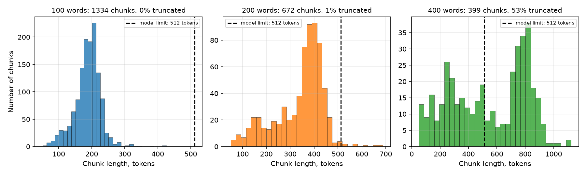
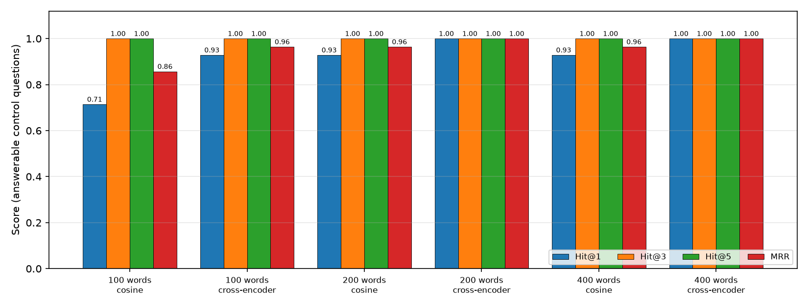
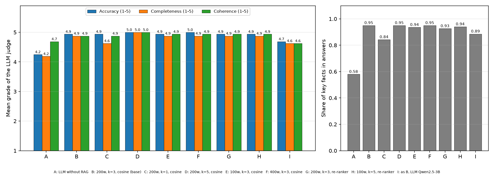
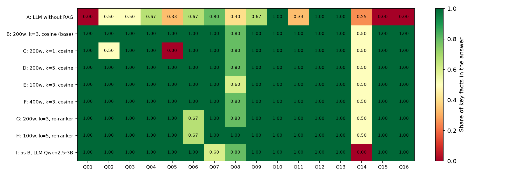
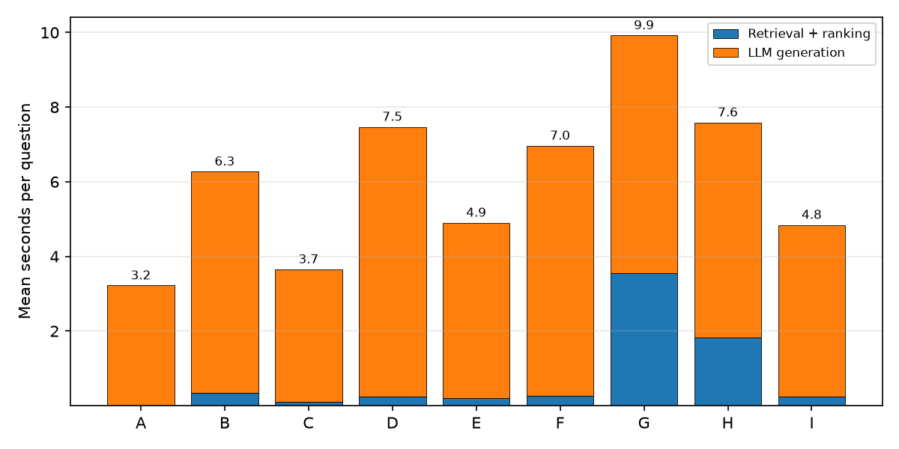

# ЛР №4 — локальна RAG-система за статтями Вікіпедії: конспект

## 1. Коротко

Ми побудували систему, яка відповідає українською на запитання про штучний інтелект і бере відповіді
з 40 статей української Вікіпедії (101 739 слів), а не з «пам'яті» мовної моделі. Статті очищено,
нарізано на 672 фрагменти по ~200 слів, кожен фрагмент перетворено на вектор із 384 чисел і збережено у
векторній базі ChromaDB. На запитання система знаходить 3 найближчі фрагменти й передає їх локальній
мовній моделі Gemma 3 4B. Модель працює на ноутбуці через Apple MLX, без API та ключів. Якість
перевірено на 16 контрольних запитаннях у 9 конфігураціях (144 відповіді). Без пошуку модель згадала
0.58 ключових фактів, з пошуком 0.95. На два запитання, відповіді на які в корпусі немає, модель без
пошуку вигадала відповідь в обох випадках, а всі вісім RAG-конфігурацій чесно відмовилися відповідати.
Слабкі місця: LLM-суддя ставить завищені оцінки, на складеному запитанні з двох тем (Q14) жодна
конфігурація не набрала більше 0.5 фактів, а нерелевантний фрагмент у контексті може «перейти» у відповідь.

## 2. Навіщо це взагалі

Велика мовна модель — це програма, яка дописує текст, слово за словом, спираючись на статистику
мільярдів прочитаних текстів. Знання «зашиті» в її числа (ваги) під час навчання. Звідси три
проблеми:

1. **Вона впевнено вигадує.** Без пошуку наша Gemma назвала «батьком генетичних алгоритмів» Джона
   Холта (правильно — Джон Голланд), а авторами LSTM — трьох неіснуючих людей. Тон відповіді при
   цьому такий самий упевнений, як і для правильної.
2. **Вона не знає того, чого не бачила:** ваших внутрішніх документів, свіжих подій.
3. **Не можна перевірити джерело.** Звідки взято твердження, невідомо.

Ідея RAG проста: перш ніж питати модель, **знайди** в документах кілька релевантних абзаців і
**поклади їх у запит** з інструкцією «відповідай лише за цим текстом і посилайся на номери». Тепер
модель не згадує, а переказує прочитане. Це як різниця між іспитом «з голови» та іспитом «з відкритою
книжкою, але тобі вже відкрили потрібні сторінки».

Без RAG маємо 0.58 ключових фактів і вигадані відповіді на запитання поза корпусом. Але RAG переносить
усю відповідальність на пошук: якщо «відкрили не ту сторінку», модель так само впевнено перекаже не те
(див. §4.8, 4-й крок діалогу).

## 3. Словник

Базові речі з ЛР3 (seed, validation/test, перенавчання, `@dataclass`, `ABC`, `with`) пояснено в
[GUIDE_LAB3.md](GUIDE_LAB3.md), §3 і §5. Нижче — лише нове.

| Термін | Пояснення | Аналогія |
|---|---|---|
| LLM, велика мовна модель (large language model) | Нейромережа, що за початком тексту передбачає наступний токен. Повторюючи це, генерує відповідь. У нас Gemma 3 4B (4 млрд чисел-ваг). | Дуже великий автокомпліт. |
| Ваги, параметри (weights) | Числа всередині нейромережі, які налаштовано навчанням. Саме вони — «модель» як файл. | Скомпільований `.class`: логіка є, але читати її людині марно. |
| Інференс (inference) | Використання вже навченої моделі: подали вхід, отримали вихід. Навчання ми не робимо взагалі. | Запуск готового JAR, а не його збирання. |
| Токен (token) | Шматок тексту, з яким працює модель: слово, частина слова чи розділовий знак. Українське слово ≈ 2 токени. Ліміти моделей рахують у токенах. | Лексема після лексера. |
| Токенізатор (tokenizer) | Перетворює текст на список номерів токенів і назад. Свій у кожної моделі, постачається разом з нею. | Лексер + словник `Map<String,Integer>`. |
| Вектор, вбудовування, ембединг (embedding) | Масив чисел фіксованої довжини (у нас 384), що кодує зміст тексту: схожі за змістом тексти мають близькі вектори. | `float[384]` — «координати змісту». |
| Модель вбудовувань, бі-енкодер (embedding model, bi-encoder) | Нейромережа, що перетворює один текст на один вектор. Запит і фрагмент кодуються **окремо**. Тексту не генерує. | `Function<String, float[]>`. |
| Косинусна подібність (cosine similarity) | Косинус кута між двома векторами: 1 — однаковий напрям (той самий зміст), 0 — не пов'язані. | — |
| Векторна база даних (vector database) | Сховище векторів із метаданими, яке швидко відповідає на запит «дай k векторів, найближчих до цього». У нас ChromaDB. | Вбудована БД на кшталт H2 у file-режимі, але з індексом за «близькістю», а не за ключем. |
| HNSW (Hierarchical Navigable Small World) | Індекс для наближеного пошуку найближчих сусідів: багаторівневий граф, у якому пошук іде від грубого рівня до точного. | Skip list, узагальнений із прямої на граф (див. §4.5). |
| ANN (approximate nearest neighbours) | Пошук «майже точно найближчих» за логарифмічний час замість перебору всіх. | — |
| Чанк (chunk) | Фрагмент статті (у нас ~200 слів), одиниця, яку векторизують, зберігають і знаходять. | Сторінка книжки. |
| Перекриття (overlap) | Кінець одного чанка повторюється на початку наступного, щоб факт на межі не розрізало. | — |
| top-k | Скільки найкращих чанків передаємо моделі (базово 3). | `LIMIT k` після `ORDER BY score DESC`. |
| Крос-енкодер, ре-ранжування (cross-encoder, re-ranking) | Модель, що читає пару «запит + фрагмент» **разом** і повертає оцінку релевантності 0..1. Точніша за бі-енкодер, але повільніша, тому її застосовують лише до 20 кандидатів. | Друга, ретельніша сортувальна стадія. |
| Промпт (prompt) | Увесь текст, поданий моделі: інструкція, історія, контекст, запитання. | Тіло HTTP-запиту до «сервісу» LLM. |
| Системний промпт (system prompt) | Інструкція з правилами поведінки, яку модель отримує перед повідомленнями користувача. | Конфігурація, а не дані. |
| Шаблон чату (chat template) | Jinja-шаблон, що перетворює список повідомлень `{role, content}` на рядок зі спецтокенами, у форматі, на якому модель навчалася. | Шаблон FreeMarker/Thymeleaf, що рендерить DTO в текст. |
| Instruct-модель (`-it`, `-Instruct`) | Модель, донавчена вести діалог і виконувати інструкції. «Сира» базова модель просто продовжує текст. | — |
| Температура (temperature) | Наскільки випадково модель обирає наступний токен. 0 — завжди найімовірніший (жадібне декодування), результат детермінований. | `new Random(42)` у ЛР3: відтворюваність. |
| Галюцинація (hallucination) | Упевнено подана неправдива інформація. | — |
| Квантизація (quantization) | Зберігання ваг меншою кількістю бітів (у нас 4 замість 16). Модель у ~4 рази менша й швидша, трохи менш точна. | Стиснення з втратами, як JPEG для ваг. |
| QAT (quantization-aware training) | Модель донавчено так, щоб вона «звикла» до округлення у 4 біти. Втрачає менше якості, ніж квантизована вже після навчання. | — |
| Hugging Face Hub | Публічний репозиторій моделей і датасетів. | Maven Central для моделей (див. §4.1). |
| safetensors | Формат файлу ваг: JSON-заголовок + сирі байти тензорів, без виконуваного коду. | Плоский бінарний формат замість Java-серіалізації (див. §4.1). |
| MLX | Фреймворк Apple для ML на чипах M1–M4, використовує уніфіковану пам'ять. | — |
| Уніфікована пам'ять (unified memory) | Одна фізична RAM, спільна для CPU і GPU: модель не копіюється «на відеокарту». | — |
| RAG (retrieval-augmented generation) | Генерація, доповнена пошуком: знайти фрагменти → покласти в промпт → згенерувати відповідь. | — |
| Переписування запитання (query condensing) | LLM перетворює уточнення «А хто його засновник?» на самодостатнє запитання для пошуку. | Розв'язання займенників перед `SELECT`. |
| Hit@k, MRR | Hit@k — частка запитань, у яких доказ є серед перших k чанків. MRR — середнє 1/(позиція першого релевантного чанка). | — |
| LLM-суддя (LLM-as-a-judge) | Мовна модель, яка ставить оцінки відповідям іншої (чи своєї) моделі за еталоном. | Автоматичний рецензент коду, якому не завжди можна вірити. |
| Покриття ключових фактів (key-fact coverage) | Частка регулярних виразів-фактів еталона (імена, дати, числа), знайдених у відповіді. Об'єктивна метрика. | Assertion-и у тесті. |

## 4. Як це зроблено — крок за кроком

`main_lab4.py` має три режими (`main_lab4.py:220-238`):

- `setup` — встановити моделі й перевірити, що вони працюють (§4.1);
- `full` (за замовчуванням) — усі кроки лабораторної, вивід дублюється в `artifacts/lab4/run_output.txt`
  (§4.2–4.12);
- `chat` — інтерактивний діалог (§4.13).

Номери кроків у банерах `Step N` збігаються з пунктами завдання. Усі параметри зібрано в
`src/config/lab4_config.py`, кожен із коментарем «чому так».

**Архітектура коду.** Кожен етап сховано за інтерфейсом: `IEmbedder` (`src/rag/embeddings.py:11-18`),
`IVectorStore` (`src/rag/vector_store.py:26-37`), `IReranker` (`src/rag/retriever.py:11-14`),
`ILanguageModel` (`src/rag/llm.py:17-20`). Конкретні реалізації отримуються через конструктор, а
збирає їх `RagSystemFactory` (`src/rag/factory.py:47-143`). Для Java-розробника це звичайний DI через
конструктор, а фабрика грає роль маленького Spring-контейнера. Важкі об'єкти (моделі, колекції) вона
створює ліниво й кешує, як singleton-біни з `@Lazy`. Наприклад, `embedder` — це `@property`, який при
першому зверненні завантажує модель (`factory.py:61-66`). Аналогія кульгає в одному: синхронізації
немає, бо програма однопотокова.

### 4.0. Перед імпортами: змінні середовища

`main_lab4.py:18-22` виставляє `TOKENIZERS_PARALLELISM`, `HF_HUB_DISABLE_PROGRESS_BARS` тощо **до**
`import`. У Python `import` виконує код модуля, і бібліотеки читають ці змінні саме тоді. У Java
найближче — `System.setProperty(...)` до першого звернення до класу зі `static`-ініціалізатором.
`os.environ.setdefault` не перезаписує значення, якщо ти вже задав його в терміналі.

### 4.1. Режим `setup`: як встановлюється й запускається локальна модель

Це те, про що ти окремо питав. Розберемо від «що таке модель як файли» до «як вона рахує на GPU».

#### Модель — це тека з файлами

Подивимося на реальну теку Gemma в кеші (`~/.cache/huggingface/hub/models--mlx-community--gemma-3-4b-it-qat-4bit/snapshots/3d9ef28.../`):

| Файл | Що в ньому |
|---|---|
| `model.safetensors` (2.99 млрд байт ≈ 2.79 ГіБ) | самі ваги |
| `model.safetensors.index.json` | який тензор у якому файлі (для великих моделей ваги ріжуть на кілька файлів) |
| `config.json` | архітектура: 34 шари, розмір 2560, і `"quantization": {"group_size": 64, "bits": 4}` |
| `tokenizer.json`, `tokenizer.model`, `tokenizer_config.json`, `special_tokens_map.json`, `added_tokens.json` | токенізатор |
| `chat_template.json` | шаблон чату (Jinja) |
| `generation_config.json` | параметри генерації за замовчуванням |

Код при цьому однаковий для всіх моделей. Архітектуру бібліотека читає з `config.json`, тож змінити
модель — це змінити рядок-ідентифікатор у `src/config/lab4_config.py:66`.

#### Hugging Face Hub і кеш ≈ Maven Central і `~/.m2`

Ідентифікатор `mlx-community/gemma-3-4b-it-qat-4bit` — це «організація/репозиторій», як
`groupId:artifactId`. Кожен репозиторій на Hub — git-репозиторій із великими файлами.

Встановлення — `src/rag/model_setup.py:33-45`:

```python
INFERENCE_FILE_PATTERNS = ("*.json", "*.safetensors", "*.model", "*.txt", "*.jinja")
...
local_path = Path(snapshot_download(model_id, allow_patterns=list(INFERENCE_FILE_PATTERNS)))
files = [path for path in local_path.rglob("*") if path.is_file()]
size_gb = sum(path.stat().st_size for path in files) / 1024 ** 3
```

`snapshot_download` (бібліотека `huggingface_hub`) робить те, що Maven при `resolve`: перевіряє
локальний кеш, докачує лише відсутні файли й повертає шлях. Тому в `setup_output.txt` «завантаження»
триває 0.1–0.5 с: моделі вже лежали в кеші, функція лише звірила їх. `allow_patterns` — фільтр, на
кшталт `<includes>`: деякі репозиторії містять ще й ONNX/OpenVINO-версії, які нам не потрібні.

Структура кешу:

```text
~/.cache/huggingface/hub/
  models--intfloat--multilingual-e5-small/
    refs/main                     -> хеш коміту, на який зараз вказує гілка main
    snapshots/614241f.../         -> «версія»: тека із симлінками на blobs
      model.safetensors -> ../../blobs/1a55775f...
    blobs/                        -> самі файли, названі за хешем вмісту
```

Тут аналогія з `~/.m2/repository` неточна у двох місцях:

1. **Дедуплікація.** Файли зберігаються за хешем вмісту, а в «версії» лежать лише симлінки. Тому
   однаковий файл зберігається один раз. Реальний приклад із твого кешу: `sentencepiece.bpe.model` у
   `multilingual-e5-small` і в `bge-reranker-v2-m3` вказує на той самий blob `cfc8146...`: обидві моделі
   походять від XLM-RoBERTa й мають спільний токенізатор. Maven так не вміє. Через симлінки код
   рахує розмір через `stat()`, який іде за посиланням (`model_setup.py:39-40`).
2. **Версія не зафіксована.** У коді немає `revision=...`, тож береться поточний `main`. Це як
   залежність `LATEST` у Maven: якщо автор оновить модель, наступне завантаження дасть інші ваги.
   Для відтворюваності варто було б передати `revision="<хеш>"`. Зараз хеші видно лише в
   `setup_output.txt`.

Розміри в таблиці — у ГіБ (ділення на `1024 ** 3`), хоча підписано «GB». Разом 7.1: E5 0.48,
крос-енкодер 2.14, Gemma 2.83, Qwen 1.63.

Попередження `You are sending unauthenticated requests to the HF Hub` у `setup_output.txt` не є
помилкою. Ці моделі відкриті й токен не потрібен, токен лише піднімає ліміт частоти запитів.

#### safetensors ≈ плоский бінарний формат, а не Java-серіалізація

Історично PyTorch зберігав ваги через `pickle` — це аналог `ObjectInputStream`: при читанні файл може
виконати довільний код, тобто має ту саму вразливість, що й десеріалізація в Java. `safetensors` — це
8 байт довжини, JSON-заголовок (`{"назва тензора": {dtype, shape, offsets}}`) і сирі байти. Читання
не виконує коду, а файл можна відобразити в пам'ять (`mmap`) і не копіювати. Тому модель
завантажується за ~3 с (`LLM loaded in 2.6 s` у `run_output.txt:113`).

#### Токенізатор

Модель не бачить літер, вона бачить номери токенів. Токенізатор ріже текст на підслова за словником.
У E5 у словнику 250 037 токенів (`config.json`: `vocab_size`), частих слів там багато, рідкісні
розкладаються на шматки. Реальні співвідношення з логів:

- контекст із 3 чанків: 590 слів → 1 404 токени Gemma (`run_output.txt:114`), ≈ 2.4 токени на слово;
- базові чанки: у середньому 159.8 слова → 340.1 токена E5 (`run_output.txt:94`), ≈ 2.1.

Звідси головне обмеження чанкінгу (§4.3): у E5 ліміт 512 токенів, а все, що довше, мовчки
обрізається.

#### Шаблон чату

Instruct-моделі вчили на діалогах у конкретному форматі. Ми передаємо список `ChatMessage(role, content)`
(`src/rag/llm.py:10-14`), а `apply_chat_template` рендерить його в рядок (`llm.py:45-47`):

```python
prompt = self._tokenizer.apply_chat_template(
    [{"role": message.role, "content": message.content} for message in messages],
    add_generation_prompt=True, tokenize=False)
```

Для Gemma шаблон (з `chat_template.json`) дає такий рядок:

```text
<bos><start_of_turn>user
{системний промпт}

{перше повідомлення користувача}<end_of_turn>
<start_of_turn>model
{відповідь}<end_of_turn>
<start_of_turn>user
...<end_of_turn>
<start_of_turn>model
```

Цікава деталь: **у Gemma немає ролі `system`**. Шаблон приклеює системний промпт на початок першого
повідомлення користувача, а роль `assistant` перейменовує на `model`. У Qwen свої токени
(`<|im_start|>system` ...). Наш код про це не знає, і завдяки шаблону той самий `generate` працює з
обома моделями. `add_generation_prompt=True` дописує в кінець `<start_of_turn>model\n`, тобто
«тепер твоя черга». Шаблон Gemma також вимагає, щоб `user` і `assistant` чергувалися, інакше кидає
виняток. Тому `_build_messages` додає історію саме парами (`src/rag/pipeline.py:80-82`).

#### Квантизація 4 біти і QAT

Ваги навченої Gemma зберігаються як 16-бітні числа (bfloat16). 4 млрд × 2 байти ≈ 8 ГБ, а з таким
обсягом на ноутбуці з 16 ГБ спільної пам'яті ще й крос-енкодер, ОС і браузер не вмістилися б.

Квантизація MLX працює групами по 64 ваги (`group_size: 64`). На пальцях, для однієї групи:

- мінімальна вага в групі −0.12, максимальна 0.18;
- 4 біти дають 16 рівнів (0..15), тож крок `scale = (0.18 − (−0.12)) / 15 = 0.02`, а зсув
  `bias = −0.12`;
- вага 0.05 зберігається як рівень `round((0.05 + 0.12) / 0.02) = round(8.5) = 8`, тобто 4 біти;
- при обчисленні відновлюється `8 · 0.02 − 0.12 = 0.04`: похибка 0.01.

На групу зберігаються 64 × 4 біти + `scale` і `bias` (по 16 біт). У середньому це ≈ 4.5 біта на вагу
(мій розрахунок, у логах цього немає). Частина шарів (наприклад, вбудовування токенів) може лишатися
точнішою, тому файл важить 2.79 ГіБ, а не рівно 2.

Навіщо стискати, крім місця. Щоб згенерувати **кожен** токен, модель мусить прочитати з пам'яті всі
ваги. Тому швидкість генерації обмежена передусім пропускною здатністю пам'яті, а не обчисленнями:
учетверо менші ваги — помітно швидша генерація.

**QAT.** Якщо просто округлити готові ваги, модель трохи «тупішає». Google донавчила Gemma, вже
імітуючи округлення в 4 біти, і ваги підлаштувалися під нього. Тому `qat-4bit` втрачає менше якості,
ніж звичайний 4-бітний варіант. Ми цього не вимірювали: це твердження Google, і в лабораторній
порівняння з 16-бітною версією не робилося.

#### MLX і уніфікована пам'ять

На звичайному ПК з NVIDIA модель копіюють із RAM у пам'ять відеокарти. В Apple Silicon CPU і GPU
мають спільну пам'ять, тож копіювати нічого не треба: GPU читає ті самі байти. MLX — фреймворк Apple,
побудований саме під це. `setup_output.txt` показує `default device: Device(gpu, 0)` і
`Unified memory available to MLX: 16 GB` (`model_setup.py:48-56`).

Запуск — два виклики `mlx_lm` (`llm.py:35-36`, `48-49`):

```python
self._model, self._tokenizer = load(model_name)        # файли з кешу HF (або докачати)
self._sampler = make_sampler(temp=temperature)          # temp=0.0 -> завжди найімовірніший токен
...
return generate(self._model, self._tokenizer, prompt=prompt, max_tokens=max_tokens,
                sampler=self._sampler, verbose=False).strip()
```

`load` сам викликає завантаження з Hub, якщо моделі немає в кеші, тож режим `setup` — це не
обов'язковий крок, а зручна явна перевірка. `generate` у циклі: прогнати промпт через мережу →
отримати ймовірності наступного токена → `sampler` обирає токен → дописати → повторити, доки модель не
видасть токен кінця або не вичерпає `max_tokens` (350 для відповідей, `lab4_config.py:70`).

Де що виконується. Gemma/Qwen працюють через MLX на GPU. E5 і крос-енкодер працюють через
`sentence-transformers` → PyTorch, і PyTorch на Mac за замовчуванням теж обирає GPU через бекенд
MPS. Я перевірив: `sentence_transformers.util.get_device_name()` у твоєму `.venv` повертає `mps`.
**У звіті (табл. 3 і абзац про час) написано «CPU (PyTorch)» — найімовірніше, це неточність.** Код
явно `device` не задає.

#### Три типи моделей — не плутай

| | Модель вбудовувань (E5) | Крос-енкодер (bge-reranker) | LLM (Gemma) |
|---|---|---|---|
| Вхід | один текст | пара (запит, фрагмент) | промпт |
| Вихід | вектор 384 числа | одне число 0..1 | текст |
| Коли рахується | чанки — один раз при індексації, запит — щоразу | щоразу, на кожного з 20 кандидатів | щоразу |
| Швидкість | мілісекунди | ~0.1–0.2 с на кандидата у нашому прогоні (3.55 с на 20) | секунди |
| Java-аналогія | `float[] embed(String)` | `double score(String q, String doc)` | `String complete(String)` |

Модель вбудовувань і крос-енкодер — «енкодери». Вони лише читають текст і не вміють генерувати.
LLM — «декодер», який дописує текст.

**Smoke test** (`model_setup.py:59-76`) завантажує E5 і Gemma й робить по одному виклику. Результат:
`query vector: 384 numbers, L2 norm 1.000`, тобто вектор нормалізовано (див. §4.4), і
`LLM loaded in 3.3 s; test reply in 1.3 s`. Відповідь обрізана посеред слова «взаємопов'язані», бо
smoke test обмежує її 40 токенами.

### 4.2. Крок 2 — корпус

- **Що:** 40 статей (`lab4_config.py:20-32`) через MediaWiki API, кожна кешується в
  `data/lab4/corpus/<назва>.json` (`src/rag/corpus.py:45-58`).
- **Навіщо кеш:** наступні запуски працюють офлайн і завжди з тією самою ревізією тексту (номер
  ревізії збережено). Без кешу Вікіпедію могли б відредагувати між прогонами.
- **Як:** `prop=extracts&explaintext=1` повертає вже чистий текст, у якому заголовки мають вигляд
  `== Назва ==`. На HTTP 429 (забагато запитів) — повтор із наростаючою паузою (`corpus.py:66-71`).
  `Document(**json.loads(...))` (`corpus.py:55`) розпаковує словник у конструктор, як у ЛР3.
- **Що вийшло:** 40 документів, 101 739 слів. Від 7 981 («Глибоке навчання») до 282 («Векторна база
  даних»).

### 4.3. Крок 3 — очищення і чанкінг

**Очищення** (`src/rag/preprocessing.py:58-62`, `64-88`):

1. Знак наголосу U+0301: «Шту́чний» → «Штучний». Для комп'ютера це різні рядки, і запит без наголосу
   гірше збігався б із текстом.
2. Службові розділи («Примітки», «Посилання»...) викидаються цілком (`lab4_config.py:34-37`). Це
   списки посилань без знань, які до того ж засмічують пошук.
3. Залишки LaTeX і рядки, де літер менше половини (`_is_informative`, `:90-96`).

`split_sections` використовує вкладену функцію `flush` (`:68-71`), яка читає змінні `heading`,
`lines`, `skipping` зовнішньої функції. На відміну від лямбди в Java, вони не мусять бути
effectively final: замикання бачить **поточне** значення змінної на момент виклику, тому після
`heading, lines = title, []` наступний `flush()` працює вже з новим розділом.

**Результат:** 93 564 слова з 101 739, тобто 8.0 % видалено як шум.

**Чанкінг** (`WordChunker._split_section`, `:128-151`). Ідея: жадібно додавати речення, доки не
перевищимо 200 слів. Тоді чанк закрито, а новий починаємо з кількох останніх речень попереднього
(до 40 слів):

```python
for sentence in self._sentences(text, size):
    sentence_words = len(sentence.split())
    if current and current_words + sentence_words > size:
        chunks.append(current)
        current = self._overlap_tail(current, min(overlap, size - sentence_words))
        current_words = sum(len(s.split()) for s in current)
        fresh_words = 0
    current.append(sentence)
    ...
```

На пальцях: розділ із речень по 30 слів. Чанк 1 = речення 1–6 (180 слів), сьоме вже не влазить
(210 > 200). Чанк 2 починається з речення 6 (30 слів ≤ 40 — це перекриття), далі 7, 8... Якщо
речення 6 довше за 40 слів, а цілими реченнями набирається менше половини бюджету, перекриття береться
пословно (`_overlap_tail`, `:164-181`). `min(overlap, size - sentence_words)` гарантує, що перекриття
плюс нове речення влізуть у 200. Хвіст розділу коротший за 20 слів приєднується до попереднього чанка.
Чанки не перетинають межі розділів `==`.

**Навіщо перекриття:** факт «LSTM запропонували 1997 року Хохрайтер і Шмідгубер», розрізаний межею,
інакше не потрапив би цілим у жоден чанк.

**Чому 200 слів, хоча методичка радить 500–1000.** Через ліміт E5 у 512 токенів. Це видно на
гістограмі:



Як читати: три панелі — три розміри чанків, пунктир — ліміт 512 токенів. При 100 словах усе далеко
ліворуч від ліміту. При 200 словах пік на 350–450 токенах і лише 1 % чанків за межею. При 400 словах
розподіл має два горби, і правий (700–900 токенів) повністю за межею: 52.9 % чанків модель обріже,
тобто їхня друга половина ніяк не вплине на вектор. Лівий горб утворюють короткі розділи, яким
просто не вистачило тексту на 400 слів.

| Розмір / перекриття | Чанків | Сер. слів | Фактичне перекриття | Сер. токенів | Обрізано |
|---|---|---|---|---|---|
| 100 / 20 | 1 334 | 84.3 | 17.6 | 187.3 | 0 % |
| **200 / 40** | **672** | **159.8** | **33.3** | **340.1** | **1.0 %** |
| 400 / 80 | 399 | 258.9 | 68.6 | 541.7 | 52.9 % |

Середній чанк менший за ліміт, бо чанки не рвуть речень і розділів. Фактичне перекриття (33.3 з 40
слів) менше заданого, бо перевага надається цілим реченням. Його виміряно функцією `measure_overlap`
(`:201-217`): для сусідніх чанків вона шукає найдовший збіг «кінець одного = початок іншого».

Приклад у лозі (`run_output.txt:74-79`): чанк `Штучний інтелект#1` закінчується реченням «Немає і
точного критерію... гіпотеза Ньюелла-Саймона.», і з того ж речення починається `#2`.

### 4.4. Крок 4 — вбудовування (E5)

- **Що:** `E5Embedder` (`src/rag/embeddings.py:21-47`) перетворює текст на вектор із 384 чисел.
- **Навіщо:** щоб шукати за змістом, а не за збігом слів. Запит «Хто придумав LSTM?» і фрагмент
  «...запропонована Зеппом Хохрайтером...» майже не мають спільних слів, але мають близькі вектори.

**Вектор і косинус на пальцях.** Уяви вектори з двох чисел: запит q = (0.6, 0.8), чанк a = (0.8, 0.6),
чанк b = (0.8, −0.6). Обидва чанки мають довжину 1, бо 0.6² + 0.8² = 1. Косинусна подібність
одиничних векторів — це просто скалярний добуток (сума попарних добутків):

- cos(q, a) = 0.6·0.8 + 0.8·0.6 = 0.96 — майже той самий напрям, тобто близький зміст;
- cos(q, b) = 0.6·0.8 + 0.8·(−0.6) = 0 — не пов'язані.

У нас 384 виміри замість двох, але арифметика та сама. Тому вектори одразу нормалізують
(`normalize_embeddings=True`): після цього косинус = скалярний добуток, і smoke test показує
`L2 norm 1.000`.

```python
def embed_passages(self, texts: Sequence[str]) -> np.ndarray:
    return self._model.encode([f"passage: {text}" for text in texts], batch_size=EMBEDDING_BATCH_SIZE,
                              normalize_embeddings=True, show_progress_bar=False)

def embed_query(self, text: str) -> np.ndarray:
    return self._model.encode(f"query: {text}", normalize_embeddings=True, show_progress_bar=False)
```

**Префікси `query:` / `passage:`.** E5 навчали саме з ними: модель «знає», що коротке запитання
треба зіставляти з довгим абзацом. Без префіксів якість пошуку падає (так стверджують автори моделі,
у лабораторній ми цього не міряли).

**Що саме векторизується:** `text_for_embedding` (`preprocessing.py:40-44`) = «Назва статті. Розділ.
Текст». Без назви чанк «Він переміг Каспарова 1997 року» не знав би, що «він» — це Deep Blue.

**Чому E5-small:** багатомовна (українська є), навчена саме для пошуку, мала (0.48 ГіБ). Суто
англомовні моделі на кшталт `all-MiniLM-L6-v2` з українською працюють погано. `bge-m3` якісніша й має
ліміт 8192 токени, але значно більша. Ціна вибору — ліміт 512 токенів, який і визначив розмір чанка.

**Чесно про шкалу.** Косинуси E5 стиснуті у вузький діапазон: у демо (крок 6) п'ять чанків мають
0.880–0.893, а нерелевантний фрагмент про RNN у кроці 10 отримав 0.867. Абсолютне значення майже нічого
не каже, важить лише порядок. Тому поріг «відкидати чанки з косинусом < X» тут підібрати важко.

### 4.5. Крок 5 — векторна база ChromaDB

- **Що:** `ChromaVectorStore` (`src/rag/vector_store.py:40-92`). `PersistentClient` — вбудована база у
  файлах `data/lab4/chroma_db/` без окремого сервера (як H2 у file-режимі, всередині Chroma
  використовує SQLite). На кожен розмір чанка — окрема колекція (`chunks_200w_40o`, `lab4_config.py:51-54`).
- **Як:** колекція створюється з `metadata={"hnsw:space": "cosine"}` (`:53-54`, `:68-69`). Зберігаються
  id (`Назва#номер`), вектор, текст і метадані (назва, розділ, URL), пакетами по 500 (`:71-79`).

**HNSW на пальцях.** Перебрати 672 вектори — дрібниця, але на мільйонах векторів це вже повільно.
HNSW будує граф: кожен вектор з'єднано з кількома найближчими. Таких графів кілька рівнів: на
верхньому мало вузлів і довгі «стрибки», на нижньому всі вузли й короткі зв'язки. Пошук починається
згори, жадібно йде до сусіда, ближчого до запиту, а коли ближчого немає, спускається на рівень нижче.
Це той самий принцип, що й у skip list (`ConcurrentSkipListMap`): верхні рівні дають швидкі грубі
переходи, нижні — точне місце. Але в skip list порядок лінійний, а тут «близькість» багатовимірна.
Тому результат **наближений**: зрідка справжній найближчий сусід може бути пропущений. Для 672
векторів це практично не помітно.

Chroma повертає **відстань** = 1 − cos, а код перетворює її назад на подібність
(`vector_store.py:90-91`): `score=1.0 - float(distance)`.

**Відбиток вмісту** (`src/rag/factory.py:90-131`). Щоб не векторизувати корпус при кожному запуску,
колекцію беруть із диска, але лише якщо SHA-256 від «назви моделі + всіх id і текстів чанків» збігся
з тим, що збережено в метаданих колекції:

```python
reused = store.fingerprint == fingerprint and store.count() == len(chunks)
if not reused:
    store.reset(fingerprint)
    embeddings = self.embedder.embed_passages([chunk.text_for_embedding for chunk in chunks])
    store.add(chunks, embeddings)
```

Змінив правила чанкінгу → тексти інші → хеш інший → індекс перебудується сам. У Java аналогічно
робиться інвалідація кешу за ETag. **Обмеження:** у хеш не входить код векторизації (префікси
`passage:`, нормалізація). Якщо зміниш `embeddings.py`, старий індекс буде використано мовчки —
тоді видали `data/lab4/chroma_db/` вручну.

У фінальному прогоні всі три індекси взято з диска за 0.1 с (`run_output.txt:87-89`).

### 4.6. Крок 6 — пошук top-k

`Retriever.retrieve` (`src/rag/retriever.py:57-62`):

```python
fetch_k = max(self._config.fetch_k, self._config.top_k) if self._config.use_reranker else self._config.top_k
candidates = self._store.search(self._embedder.embed_query(query), top_k=fetch_k)
return self._ranker.rerank(query, candidates)[:self._config.top_k]
```

Перший рядок — тернарний оператор Python: `X if умова else Y` = `умова ? X : Y`. Логіка двоетапна:
без крос-енкодера беремо одразу k, а з ним беремо 20 кандидатів, переоцінюємо й обрізаємо до k.
`[:k]` — зріз «перші k» (`subList(0, k)`).

**Що вийшло** (`run_output.txt:101-106`), запит «Хто і коли запропонував тест Тюрінга?»:

| # | Косинус | Чанк |
|---|---|---|
| 1 | 0.893 | Тест Тюрінга#9 — «Китайська кімната», аргумент Серля |
| 2 | 0.891 | Тест Тюрінга#14 — розмова суддів із програмами |
| 3 | 0.890 | Тест Тюрінга#0 — вступ: «створений 1950 року...» |
| 4 | 0.888 | Алан Тюрінг#15 — «запропонований Аланом Тюрінгом у 1950 році в статті...» |
| 5 | 0.880 | Тест Тюрінга#17 — варіанти тесту |

Усі п'ять стосуються теми, але найкорисніший фрагмент (#4, з назвою статті) лише четвертий, а різниця
між першим і п'ятим — 0.013. Бі-енкодер добре знаходить тему, але погано розрізняє «згадує» і
«відповідає». Це мотивує крок 10.

### 4.7. Кроки 7–8 — LLM і RAG-пайплайн

**Вибір LLM** (`lab4_config.py:64-68`). Gemma 3 4B Instruct QAT 4-bit — основна. Qwen2.5 3B Instruct
4-bit — альтернативна для порівняння (конфігурація I). Обидві мусили вміститися в 16 ГБ разом із
крос-енкодером. За звітом, у пілотному запуску Qwen гірше писала українською й вигадала відповідь поза
корпусом, тому основною обрано Gemma. Цей пілот в артефактах не збережено, у фінальному прогоні
порівняння — це конфігурація I (§4.11).

**Пайплайн** (`src/rag/pipeline.py:48-63`):

```python
def ask(self, question: str) -> RagAnswer:
    history = self._memory.recent_turns
    standalone = self._condense(question, history) if history else question
    retrieved = tuple(self._retriever.retrieve(standalone)) if self._retriever else ()
    answer = self._llm.generate(self._build_messages(question, retrieved, history), self._max_answer_tokens)
    sources = tuple(dict.fromkeys(item.chunk.document_title for item in retrieved))  # unique, order kept
    self._memory.add(DialogueTurn(...))
```

(Рядки з таймерами я тут пропустив.) Порядок: переписати запитання з урахуванням історії → знайти
чанки → зібрати промпт → згенерувати → зберегти в історію. `retriever=None` вимикає пошук, і це
базова лінія A «LLM без RAG». Так ми бачимо, що саме додає пошук: замість `if (mode == NO_RAG)` по
всьому коду маємо Null Object на рівні конструктора.

**Контекст** збирає `format_context` (`pipeline.py:95-103`): чанки нумеруються `[1] Стаття «...», розділ
«...»:`. **Системний промпт** (`src/rag/prompts.py:5-13`): використовуй лише контекст; якщо відповіді
немає, напиши дослівно «У наданих документах немає відповіді на це запитання.»; 2–5 речень; посилайся
на `[n]`. Фіксована фраза відмови потрібна, щоб відмову можна було розпізнати автоматично (§4.11).

**Що вийшло** (`run_output.txt:114-135`). З RAG: «...Аланом Тюрінг у 1950 році у філософському
журналі «Mind» [1]». Контекст — 3 чанки, 590 слів, 1 404 токени, генерація 6.4 с. Але є і зайве
речення про GPT-4.5 з фрагмента [2], яке не стосується запитання. Без RAG: Тюрінг і 1950 рік правильні,
але назва статті «Комп'ютерна гра з людиною» вигадана. Генерація 2.6 с, бо промпт значно коротший.

### 4.8. Крок 9 — історія діалогу

`ConversationMemory` (`src/rag/memory.py:19-57`) зберігає всі обміни (`DialogueTurn`: запитання,
переписане запитання, відповідь, джерела) і після кожного обміну перезаписує JSON-файл (`:53-57`). Це
та сама серіалізація record-ів через Jackson, лише руками: `asdict(turn)` → `json.dumps`. При створенні
історія читається з файлу (`:30-32`). У промпт іде лише вікно з 3 останніх обмінів (`recent_turns`,
`:39-43`; `lab4_config.py:98`), щоб промпт не ріс безмежно.

Історія використовується двічі:

1. **Переписування** (`pipeline.py:65-74`, промпт `prompts.py:24-30`). У запитанні «Хто вважається
   його засновником?» немає слів, за якими пошук знайде потрібне. Тому LLM окремим викликом (до 80
   токенів) переписує його в самодостатню форму, і шукаємо саме за нею. З відповіді береться перший
   рядок, бо мала модель іноді додає пояснення.
2. **У промпті генерації** попередні обміни йдуть як пари повідомлень `user`/`assistant`. Номери
   посилань `[1]` зі старих відповідей видаляються (`strip_citations`, `:90-93`), бо вони стосуються
   старого контексту і плутали б нумерацію нового.

**Що вийшло** (`run_output.txt:142-195`, `dialogue_history.json`):

| Запитання | Переписано як | Результат |
|---|---|---|
| Що таке генетичний алгоритм? | (перше, не переписується) | правильно, Голланд [1] |
| Хто вважається його засновником? | «...засновником генетичних алгоритмів, **як зазначено в історії діалогу**?» | правильно (Голланд), але відповідь повторює визначення з першого кроку |
| А які генетичні оператори в ньому застосовують? | «Які генетичні оператори застосовують у генетичному алгоритмі?» | правильно: схрещення і мутація [3] |
| Які критерії зупинки він може мати? | «Які критерії зупинки можуть використовуватись у генетичному алгоритмі?» | **галюцинація**, див. нижче |

- Хвіст «як зазначено в історії діалогу» промпт прямо забороняє, але модель на 4 млрд параметрів
  інструкцію не виконала. На пошук це не вплинуло.
- **4-й крок — галюцинація від нерелевантного контексту.** Переписування спрацювало ідеально. Пошук
  повернув [1] `Генетичний алгоритм#3` (0.889), [2] `Рекурентна нейронна мережа#19` (0.888),
  [3] `Генетичний алгоритм#0`. Чанк RNN описує навчання нейромереж **генетичним алгоритмом** і
  містить «Поширеною схемою зупинки є: 1) коли нейронна мережа засвоїла певний відсоток тренувальних
  даних...». Тобто пошук не був абсурдним: у чанку є і «генетичний алгоритм», і «критерій зупинки».
  Модель переказала саме його й подала як критерії ГА взагалі. А правильна відповідь («знаходження
  глобального... рішення; вичерпання числа поколінь; вичерпання часу») є в чанку [1]: я перевірив, що
  `Генетичний алгоритм#3` містить «вичерпання числа поколінь». Модель її проігнорувала. Висновок:
  LLM довіряє будь-якому наданому фрагменту, і якість відповіді обмежена не лише тим, чи знайдено
  правильний чанк, а й тим, чи немає поруч «правдоподібно-хибного».

Після діалогу історію з 4 обмінів збережено й успішно відновлено з диска (`run_output.txt:194-195`).

### 4.9. Крок 10 — ранжування: косинус проти крос-енкодера

Обидва способи — реалізації `IReranker` (`retriever.py:17-45`), тобто патерн Strategy, як оператори
в ЛР3. `CosineRanker` просто сортує за вже наявною оцінкою. `CrossEncoderReranker` переоцінює кожну
пару:

```python
scores = self._model.predict([(query, item.chunk.text_for_embedding) for item in candidates],
                             show_progress_bar=False)
rescored = [RetrievedChunk(chunk=item.chunk, score=float(score)) for item, score in zip(candidates, scores)]
return sorted(rescored, key=lambda item: item.score, reverse=True)
```

**Чому крос-енкодер точніший.** Бі-енкодер стискає запит в один вектор і фрагмент в інший окремо:
усе, що він «зрозумів» про фрагмент, мусить уміститися в 384 числа ще до того, як він побачить
запит. Крос-енкодер читає обидва тексти разом, і кожне слово запиту «бачить» кожне слово фрагмента.
Ціна в тому, що для кожного кандидата потрібен окремий прогін великої моделі (568 млн параметрів), і
заздалегідь нічого не порахуєш. Звідси двоетапна схема: дешевий пошук 20 кандидатів → дорогий
переранг лише їх. Пари довші за 512 токенів обрізаються (`lab4_config.py:76`).

**Що вийшло** (`run_output.txt:201-216`), запит «Які методики допомагають уникати перенавчання моделі?»:

| # | Косинус | | Крос-енкодер | |
|---|---|---|---|---|
| 1 | 0.897 | Перенавчання#2 | 0.999 | Перенавчання#2 |
| 2 | 0.871 | Перенавчання#0 | 0.997 | Перенавчання#1 |
| 3 | 0.869 | Перенавчання#8 (про недонавчання) | 0.956 | Згорткова нейронна мережа#22 (штучні дані проти перенавчання) |
| 4 | 0.867 | Глибоке навчання#26 (про RNN — не по темі) | 0.767 | Глибоке навчання#26 |
| 5 | 0.866 | Перенавчання#1 | 0.685 | Згорткова нейронна мережа#19 (регуляризація) |

Косинуси лежать у смузі 0.866–0.897, і нерелевантний RNN-фрагмент майже не відрізняється від
релевантних. Крос-енкодер розводить оцінки ширше і піднімає два фрагменти зі статті про згорткові
мережі, яких у косинусному top-5 не було, — про штучне розширення даних і регуляризацію. Обидва
відповідають на запитання. Фрагмент про RNN лишився на 4-му місці, але з помітно нижчою оцінкою.

### 4.10. Крок 11a — якість пошуку (без LLM)

**Контрольні запитання** (`data/lab4/eval_questions.json`). 16 запитань: 14 мають відповідь у корпусі,
Q15 (Mistral AI) і Q16 (Нобелівська премія 2024) — ні. Для кожного вручну задано еталон і регулярні
вирази двох типів:

- `evidence` — як виглядає фрагмент із доказом (наприклад, `"Голланд.{0,250}Адаптаці"`);
- `key_facts` — що має бути у відповіді (`"Голланд"`, `"Адаптаці\\w+ [ву] природних"`).

Для Q15/Q16 замість фактів задано `fabrication_markers` — ознаки вигадки (імена лауреатів, «7B»).

**Метрики** (`src/rag/evaluation.py:55-81`). Для кожного запитання знаходимо позицію першого чанка,
де спрацював хоча б один `evidence`-регекс. Далі Hit@k = «ця позиція ≤ k», а reciprocal rank = 1/позиція
(0, якщо доказу немає). MRR — середнє по запитаннях. Приклад: позиції 1, 2, 1, 3 → RR = 1, 0.5, 1,
0.33 → MRR = 0.71. Evidence recall — частка `evidence`-регексів, знайдених хоч десь у top-5 (для
запитань із двома доказами важить, чи знайдено обидва).

`RetrievalGridExperiment` (`src/rag/experiments.py:30-54`) прогоняє 3 розміри × 2 способи ранжування,
бере top-5 один раз, а Hit@1/3 читає з позиції. LLM тут не потрібна, тому сітка дешева.



| Чанк | Ранжування | Hit@1 | Hit@3 | Hit@5 | MRR | Evidence recall@5 |
|---|---|---|---|---|---|---|
| 100 | косинус | 0.714 | 1 | 1 | 0.857 | 0.964 |
| 100 | крос-енкодер | 0.929 | 1 | 1 | 0.964 | 0.964 |
| 200 | косинус | 0.929 | 1 | 1 | 0.964 | 0.964 |
| 200 | крос-енкодер | 1 | 1 | 1 | 1 | 0.964 |
| 400 | косинус | 0.929 | 1 | 1 | 0.964 | 0.964 |
| 400 | крос-енкодер | 1 | 1 | 1 | 1 | 0.964 |

Як читати: групи стовпців — комбінації «розмір × ранжування», кольори — метрики. Помаранчевий і
зелений (Hit@3, Hit@5) скрізь 1.00. Відрізняються лише синій (Hit@1) і червоний (MRR).

- 14 запитань → один «промах» змінює Hit@1 на 1/14 = 0.071. Тобто 0.714 / 0.929 / 1.0 = 10 / 13 / 14
  запитань.
- **Насичення.** Hit@3 = Hit@5 = 1.0 у всіх шести рядках: набір запитань для пошуку «легкий», бо майже
  кожне містить унікальну назву (Deep Blue, BERT, LSTM). Метрики не можуть показати різницю там, де
  всі вже на стелі. Тому висновок «крос-енкодер покращує» спирається лише на Hit@1/MRR і на 1–3
  запитання. Чесно: це тенденція, а не доведена перевага.
- Evidence recall 0.964 = 13.5/14 скрізь однаковий. «Половинку» втрачає Q14 (GAN + нечітка логіка): у
  top-5 потрапляють лише фрагменти про GAN.

### 4.11. Крок 11b — якість відповідей у 9 конфігураціях

**Конфігурації** (`lab4_config.py:115-131`): «один фактор за раз» відносно базової B (200 слів, k=3,
косинус, Gemma). A — без RAG; C/D — k=1/5; E/F — чанки 100/400; G — крос-енкодер; H — 100 слів + k=5 +
крос-енкодер; I — Qwen замість Gemma. Кожне запитання ставиться з порожньою історією
(`experiments.py:70-71`), щоб запитання не впливали одне на одне.

**Дві системи оцінювання:**

1. **Об'єктивна** — `fact_coverage` (`evaluation.py:94-107`): частка `key_facts`-регексів, що
   спрацювали у відповіді. Для Q15/Q16: 1.0, якщо є фраза відмови і немає маркерів вигадки, інакше 0.
   `is_refusal` / `is_partial_refusal` (`:84-91`): фраза відмови у відповіді до 15 слів — це повна
   відмова, у довшій — часткова (на щось відповіла, від решти відмовилася).
2. **LLM-суддя** — `LlmJudge` (`evaluation.py:119-143`, промпт `prompts.py:34-46`): та сама Gemma
   отримує запитання, еталон і відповідь і видає JSON `{"accuracy":..,"completeness":..,"coherence":..}`
   з оцінками 1–5. `parse` дістає числа регексом, тож ```` ```json ```` навколо не заважає (тест
   `tests/test_lab4_rag.py:251-254`).

**Що вийшло** (`run_output.txt:401-411`):

| Конфігурація | Точн. | Повн. | Узгодж. | Факти | Докази в контексті | Хибні / часткові відмови | Без відповіді | Пошук, с | Генерація, с |
|---|---|---|---|---|---|---|---|---|---|
| A: без RAG | 4.25 | 4.19 | 4.69 | **0.58** | 0 | 0 / 0 | **0/2** | 0 | 3.22 |
| B: 200w, k=3 (база) | 4.94 | 4.88 | 4.88 | 0.95 | 0.96 | 0 / 0 | 2/2 | 0.34 | 5.93 |
| C: k=1 | 4.94 | 4.62 | 4.88 | 0.84 | 0.79 | 1 / 2 | 2/2 | 0.10 | 3.55 |
| D: k=5 | 5.00 | 5.00 | 5.00 | 0.95 | 0.96 | 0 / 0 | 2/2 | 0.25 | 7.22 |
| E: 100w | 4.94 | 4.88 | 4.94 | 0.94 | 0.93 | 0 / 0 | 2/2 | 0.21 | 4.69 |
| F: 400w | 5.00 | 4.88 | 4.94 | 0.95 | 0.96 | 0 / 0 | 2/2 | 0.27 | 6.70 |
| G: крос-енкодер | 4.94 | 4.88 | 4.94 | 0.93 | 0.96 | 0 / 0 | 2/2 | 3.55 | 6.37 |
| H: 100w, k=5, крос-енк. | 4.94 | 4.88 | 4.94 | 0.94 | 0.96 | 0 / 0 | 2/2 | 1.84 | 5.75 |
| I: Qwen2.5 3B | 4.69 | 4.62 | 4.62 | 0.89 | 0.96 | 1 / 0 | 2/2 | 0.23 | 4.61 |

Оцінки судді рахуються по всіх 16 запитаннях, факти й докази — лише по 14 з відповіддю.



Ліворуч — оцінки судді (вісь Y починається з 1, тож різниця 4.2 проти 4.9 візуально перебільшена).
Праворуч — покриття фактів. Головне: A різко нижче за всі інші, а B–I майже однакові.



Рядки — конфігурації, стовпці — запитання, колір — частка фактів. Що тут видно:

- **Рядок A червоно-жовтий:** вигадані імена (Q01 «Джон Холт», Q05 «Себастьян Гудман, Юнь Чен та
  Ромен Тао», Q14 «Джим Корнеліус»), «200 позицій за секунду» замість 200 млн (Q02, 0.50). Q15/Q16 = 0:
  модель відповіла «з пам'яті» («Mistral 7B... 7 мільярдів параметрів»; премію нібито отримали
  «Йен Лекун, Джеффері Хінтон та Шорі Стенлі Чен», хоча насправді — Гопфілд і Хінтон).
- **C/Q05 = 0.00:** при k=1 єдиним знайденим чанком був `Штучна нейронна мережа#26` без відповіді, і
  модель чесно відмовилася. Це хибна відмова: замало контексту. Часткові відмови C — це Q13 (спершу
  «немає відповіді», а потім усе ж відповіла) і Q14.
- **Стовпець Q14 жовтий скрізь (0.50), а в I — 0.00** (Qwen повністю відмовилася, ще й з помилкою
  «У наданих документів»).
- **Q08 = 0.80 майже скрізь:** це частково артефакт регексів — відповідь «модель запам'ятовує
  тренувальні дані» правильна, але не збігається з шаблоном «шум|випадкова похибка».



Час визначає генерація: що довший контекст, то довше (C 3.55 с → B 5.93 → D 7.22). Крос-енкодер
додає 1.8–3.6 с пошуку. G вийшла найповільнішою (9.9 с разом). **Деталь:** середній пошук B (0.34 с)
завищено першим запитанням: у `eval_answers.json` його пошук тривав 1.65 с, а решта — 0.05–0.45 с.
У G перше запитання тривало 20.0 с. Схоже на «прогрів» GPU, але в коді це не вимірюється, тож це моя
гіпотеза.

**Висновки, які тримаються на даних:**

1. RAG проти без-RAG: 0.58 → 0.95 фактів, 0/2 → 2/2 на запитаннях поза корпусом. Це великий ефект,
   він видний на кожному стовпці теплової карти.
2. k=1 замало (0.84, хибна відмова). k=5 за фактами не кращий за k=3 (обидва 0.95), але повільніший.
3. Розмір чанка й крос-енкодер на фактах у відповідях майже не позначилися (0.93–0.95). Причина
   в тому, що потрібний чанк і так у top-3 (Hit@3 = 1.0). Крос-енкодер міняє порядок усередині трійки,
   а LLM читає всю трійку.
4. Qwen гірша за Gemma (0.89 проти 0.95), але різниця майже вся з одного Q14.

### 4.12. Крок 12 — графіки і файли

`RagVisualizer` (`src/rag/plots.py`) малює 5 графіків, показаних вище. `matplotlib.use("Agg")`
(`plots.py:8`) вмикає рендеринг у файл без вікна, як headless-режим AWT. `SummaryWriter`
(`src/rag/reporting.py:84-106`) пише `metrics_summary.md` і `eval_answers.json`: усі 144 відповіді
разом із сирим виводом судді, тож кожну оцінку можна перевірити руками. Саме з цього файлу взято
приклади в §4.11 і §4.14.

### 4.13. Режим `chat`

`run_chat` (`main_lab4.py:184-208`) — цикл `input()` з командами `/history`, `/clear`, `/exit`. Історія
зберігається в `artifacts/lab4/chat_history.json` і відновлюється при наступному запуску.
`try/except (EOFError, KeyboardInterrupt)` (`:193-196`) — це `catch (EOFException | InterruptedException e)`:
вихід по Ctrl+D / Ctrl+C. Якщо ввід подано з файлу (`not sys.stdin.isatty()`), запитання повторюється
у вивід, щоб транскрипт читався.

У `chat_session.txt` уточнення «А скільки параметрів має її великий варіант?» переписано в «Скільки
параметрів має BERT LARGE?», і відповідь правильна: BERT-BASE має 110 млн параметрів, BERT-LARGE —
340 млн.

### 4.14. Чесно про слабкі місця

1. **Поблажливий LLM-суддя.** Промпт прямо каже: «будь-яка вигадана відповідь [на запитання без
   відповіді] отримує accuracy 1». А з `eval_answers.json`:
   - A/Q15 (Mistral 7B з пам'яті) — 5/5/5; A/Q16 (вигадані лауреати) — 5/5/5;
   - A/Q01 («Джон Холт», вигадана книга «Genesis...») — 4/5/5;
   - D/Q14 (нечітку логіку приписано Ґудфелоу 2014 року) — 5/5/5;
   - C/Q05 (хибна відмова, 0 фактів) — 5/5/5;
   - зате I/Q14 (відмова Qwen) — 1/1/1, включно з coherence 1 для граматично зв'язного речення.

   Причини: суддя — та сама мала модель, що генерує відповіді; вона оцінює і власні відповіді, і
   відповіді Qwen (`SummaryWriter` прямо пише «judge: the same model»). Тому середні 4.9–5.0 майже не
   розрізняють конфігурацій, а основна метрика роботи — покриття фактів. Виправлення — сильніший
   незалежний суддя або оцінка людиною.
2. **Галюцинація від нерелевантного контексту** (4-й крок діалогу, §4.8). Правильний чанк був першим,
   але модель переказала другий, «правдоподібно-хибний». Захист — поріг релевантності (але косинуси
   стиснуті, §4.4), крос-енкодер з відсіканням за оцінкою або сильніша LLM.
3. **Складене запитання Q14** («хто і коли запровадив GAN, а хто — нечітку логіку»). Один вектор
   запиту про дві теми «тяжіє» до однієї, тож у контекст потрапляють лише чанки про GAN (evidence recall
   0.5 скрізь). У H у top-5 потрапив `Нечітка логіка#3`, але без «Лотфі Заде в 1965» і з оцінкою
   крос-енкодера 0.065. Далі гірше: маючи лише GAN-контекст, модель у D, F і H **приписала нечіткій
   логіці** авторів чи дати змагального навчання (наприклад, H: «Нечітка логіка з'явилася у 1991 році,
   коли Юрген Шмідхубер опублікував змагальні нейронні мережі»; D: нечітку логіку «було вперше
   використано в 2014 році, коли Ян Ґудфелоу...»). G написала беззмістовне речення про нечітку логіку,
   B і E просто промовчали про другу половину. Чесно відмовилися від другої половини лише C (часткова
   відмова) і I (повна відмова). Типове рішення — розкласти запитання на два
   підзапити й шукати для кожного окремо.
4. **Насичення метрик пошуку на малому наборі** (§4.10): Hit@3/5 = 1.0 скрізь, крок метрики — 0.071.
   Для чесного порівняння ранжувань потрібні складніші запитання (без назв статей у тексті запитання)
   і їх має бути більше.
5. **Регекси-факти** іноді не зараховують правильну відповідь іншими словами (Q08). Hit@k зараховує
   чанк, якщо він містить хоча б один доказ, а для доказів-імен («Хохрайтер») це поблажливо.

## 5. Python очима Java-розробника

Те, що вже є в [GUIDE_LAB3.md §5](GUIDE_LAB3.md#5-python-очима-java-розробника) (`@dataclass`,
`@property`, `ABC`, comprehension, `with`, `**dict`, `lambda`), тут не повторюю.

| У Java ти б написав | У Python тут написано | Де |
|---|---|---|
| `String` або `null` (`@Nullable String`) | `str \| None` в анотації типу | `src/config/lab4_config.py:110`, `src/rag/pipeline.py:36` |
| `stream().filter(...).findFirst().get()` | `next(setup for setup in config.setups if setup.is_base)` | `main_lab4.py:43` |
| `...findFirst().orElse(null)` | `next((... for ...), None)` — другий аргумент як `orElse` | `src/rag/evaluation.py:77-78` |
| `System.setProperty` до завантаження класу | `os.environ.setdefault(...)` до `import` | `main_lab4.py:19-22` |
| `static`-ініціалізатор важкого класу | локальний `import` усередині методу: бібліотека вантажиться лише при першому виклику | `src/rag/embeddings.py:30`, `src/rag/corpus.py:61` |
| `new LinkedHashSet<>(list)` (унікальні, порядок збережено) | `dict.fromkeys(iterable)` | `src/rag/pipeline.py:60` |
| `list.subList(size - n, size)` | від'ємний зріз `self._turns[-n:]` | `src/rag/memory.py:43` |
| `new Record(map.get("a"), ..., List.copyOf(...))` | `DialogueTurn(**{**turn, "sources": tuple(turn["sources"])})` — злиття словників із підміною одного поля | `src/rag/memory.py:32` |
| `Files.deleteIfExists(path)` | `path.unlink(missing_ok=True)` | `main_lab4.py:106` |
| `path.resolve("x.json")` | оператор `/`: `artifacts / "dialogue_history.json"` | `main_lab4.py:105` |
| `String.format("%-28s", id)` | f-рядок зі специфікатором `{item.chunk.chunk_id:<28}` | `main_lab4.py:49` |
| `for (int i = 1; ...)` з лічильником | `enumerate(results, start=1)` | `main_lab4.py:48` |
| `Pattern.compile(...)` | `re.compile(r"...")`; `r""` — «сирий» рядок без екранування `\`; `rf""` — сирий f-рядок | `src/rag/preprocessing.py:11-13`, `src/rag/evaluation.py:140` |
| `list.stream().filter(b -> b).count()` | `sum(bool ...)`: `True` рахується як 1 | `src/rag/evaluation.py:79`, `src/rag/experiments.py:45` |
| пари сусідів `for i: (a[i], a[i+1])` | `zip(chunks, chunks[1:])` | `src/rag/preprocessing.py:204` |
| `catch (A \| B e)` | `except (EOFError, KeyboardInterrupt):` | `main_lab4.py:195` |
| поле, виключене з `equals` | `field(default="", compare=False)` | `src/rag/evaluation.py:116` |
| `Collectors.groupingBy` | `frame.groupby("setup", sort=False)` у pandas | `src/rag/experiments.py:98` |
| `@Lazy` singleton-бін | `@property` з перевіркою `is None` і кешем у полі | `src/rag/factory.py:61-66` |
| `Map<String, Store>` як кеш | `self._stores: Dict[str, ChromaVectorStore] = {}` + `if tag in self._stores` | `src/rag/factory.py:57`, `:92-93` |
| Mockito `when(llm.generate(any())).thenReturn(a, b, c)` + `ArgumentCaptor` | `ScriptedLanguageModel(["a", "b", "c"])` і список `calls`; як і в Mockito, останнє значення повторюється | `src/rag/llm.py:52-61`, `tests/test_lab4_rag.py:179-187` |
| in-memory H2 замість реальної БД у тестах | рукописні фейки `KeywordEmbedder` (3 «ключові слова» = 3 виміри) і `InMemoryStore` (`@` — матричне множення = косинуси) | `tests/test_lab4_rag.py:31-61` |
| `@TempDir Path tmp` у JUnit 5 | фікстура pytest `tmp_path` — просто ім'я параметра тесту | `tests/test_lab4_rag.py:157` |

Про тести. 22 тести (`tests/test_lab4_rag.py`) проходять за 0.06 с, бо не вантажать жодної моделі:
усе ходить через інтерфейси, а замість E5/Chroma/Gemma підставлено фейки. Саме для цього інтерфейси й
потрібні. Приклад: `test_follow_up_question_is_rewritten_and_the_rewritten_form_is_used_for_retrieval`
перевіряє, що пошук іде за переписаним запитанням, а не за оригіналом, і для цього не потрібна жодна
нейромережа.

## 6. Запусти й поекспериментуй

```bash
cd /Users/ross/Documents/ai_labs
.venv/bin/python main_lab4.py setup                      # моделі в кеш + smoke test, ~15 с якщо вже в кеші
.venv/bin/python main_lab4.py chat                       # діалог; /history, /clear, /exit
.venv/bin/python main_lab4.py                            # повний прогін, ~22 хв (оцінювання 144 відповідей — 19.4 хв)
.venv/bin/python -m pytest tests/test_lab4_rag.py -q     # 22 тести, < 1 с
```

**Увага.** Повний прогін перезаписує `artifacts/lab4/`, на який посилається звіт. Спершу зроби
`cp -r artifacts/lab4 /tmp/lab4_backup`. Режим `chat` дописує в `artifacts/lab4/chat_history.json`.
Для швидких експериментів закоментуй більшість конфігурацій у `default_setups()`
(`src/config/lab4_config.py:120-131`), залиш, наприклад, A і B: оцінювання займе ~4 хв замість 19.

Швидкий експеримент із пошуком без LLM (кілька секунд):

```bash
.venv/bin/python -c "
from src.config.lab4_config import Lab4Config, RetrievalConfig
from src.rag.corpus import WikipediaCorpusLoader
from src.rag.factory import RagSystemFactory
c = Lab4Config(); f = RagSystemFactory(c, WikipediaCorpusLoader(c.corpus, c.corpus_dir).load())
for r in f.retriever(c.chunking, RetrievalConfig(top_k=5)).retrieve('Хто ввів нечітку логіку?'):
    print(round(r.score, 3), r.chunk.chunk_id)"
```

1. **Вимкни історію:** `max_turns_in_prompt` 3 → 0 (`lab4_config.py:98`) і в `chat` спитай «Що таке
   генетичний алгоритм?», потім «Хто вважається його засновником?». Очікуй, що друге запитання не
   буде переписане (`_condense` викликається лише за непорожньої історії, `pipeline.py:50`): пошук
   піде за словами «його засновником», знайде щось випадкове, і модель або відмовиться, або назве
   засновника чогось іншого.
2. **Розбий Q14 на два запити** у швидкому скрипті вище: «Хто запровадив генеративні змагальні
   мережі?» і «Хто ввів нечітку логіку?». Очікуй, що другий запит знайде чанки статті «Нечітка
   логіка», яких не було в top-5 складеного запитання. Так ти на практиці побачиш, чому декомпозиція
   запиту — типове рішення проблеми §4.14 п. 3.
3. **Чанки «як у методичці»:** додай `ChunkingConfig(chunk_size_words=600, overlap_words=120)` до
   `retrieval_grid_chunkings` (`lab4_config.py:174-176`). Очікуй, що в логах з'явиться новий індекс, у
   якого «Truncated by embedder» більший за 52.9 % (у 400-слівного вже стільки), а на гістограмі
   `chunk_lengths.png` — четверта панель, де більшість чанків праворуч від 512. Hit@1 з косинусом може
   впасти, бо друга половина кожного чанка не впливає на вектор. Але на 14 «легких» запитаннях можна
   й не побачити різниці (насичення).
4. **Температура:** `temperature` 0.0 → 0.8 (`lab4_config.py:78`), залиш конфігурації A і B. Очікуй,
   що два прогони дадуть різні формулювання й трохи різні оцінки. Особливо зміниться A: без контексту
   модель «фантазує» різноманітніше (інші вигадані імена). Саме тому для порівняння конфігурацій
   узято 0: інакше різниця між B і D могла б бути просто шумом.
5. **Інша LLM як основна:** `llm_model` → `mlx-community/Qwen2.5-3B-Instruct-4bit` (`lab4_config.py:66`).
   Зміниться і генератор, і **суддя**: `LlmJudge` (`main_lab4.py:134`) отримує ту саму `llm`, створену
   як `factory.llm()` без аргументу (`main_lab4.py:92`).
   Тож порівнювати оцінки судді з поточним прогоном некоректно, порівнюй лише покриття фактів.

Якщо змінюєш код векторизації (`embeddings.py`), видали `data/lab4/chroma_db/`: відбиток вмісту
цих змін не помітить (§4.5).

## 7. Що може спитати викладач

**1. Чим RAG кращий за просто «спитати ChatGPT»?** Відповідь спирається на конкретні документи з
посиланнями `[n]`, які можна перевірити. Корпус можна оновити без перенавчання моделі. На наших даних:
0.58 → 0.95 ключових фактів, а на запитання поза корпусом без RAG модель вигадала відповіді (0/2), з
RAG чесно відмовилася (2/2).

**2. Чому чанк 200 слів, а не 500–1000, як у завданні?** Модель вбудовувань читає максимум 512 токенів,
українське слово ≈ 2 токени. Вже при 400 словах 52.9 % чанків обрізаються, тобто їхня друга половина
не впливає на вектор і її не можна знайти. Від 200 слів обрізається лише 1 %. Довгі чанки мали б сенс
із моделлю на 8192 токени (bge-m3), але вона значно більша.

**3. Що таке косинусна подібність і чому саме вона?** Косинус кута між векторами, тобто подібність
напрямку незалежно від довжини. Вектори нормалізовано до довжини 1, тому косинус = скалярний добуток.
E5 навчали саме з цією мірою, тож інша міра (наприклад, евклідова відстань без нормалізації) не мала б
сенсу.

**4. Навіщо крос-енкодер, якщо якість відповідей з ним не зросла?** Він покращив порядок (Hit@1
0.929 → 1.0 для 200 слів), але потрібний чанк і без нього вже був у top-3, а LLM читає всю трійку.
Тому на цьому наборі він коштує +3.6 с без виграшу у відповідях. Корисним він був би, якби потрібний
чанк опинявся за межами top-k. Незручна частина: наш набір цього просто не перевіряє.

**5. Чи можна довіряти оцінкам LLM-судді?** Ні, ми це показали самі: вигадані лауреати Нобелівської
премії отримали 5/5/5, а «Джон Холт» — 4/5/5. Суддя — та сама 4B-модель. Тому основна метрика —
об'єктивне покриття фактів регулярними виразами, складеними до запуску. Оцінки судді — допоміжні, з
сирим виводом у `eval_answers.json`.

**6. Як система працює з уточнювальними запитаннями?** Історія зберігається в JSON. Перед пошуком LLM
переписує запитання в самодостатнє («в ньому» → «у генетичному алгоритмі»), і пошук іде за
переписаним. У промпт іде вікно з 3 останніх обмінів.

**7. Звідки взялася неправильна відповідь про критерії зупинки?** Пошук другим повернув чанк про
навчання нейромереж генетичним алгоритмом, де є «схема зупинки» для нейромереж. Модель переказала
його, хоча правильні критерії були в першому чанку. Це не помилка переписування, а слабкість малої
LLM, яка довіряє будь-якому контексту.

**8. Чому Gemma, а не щось більше? Що таке 4-bit QAT?** Обмеження — 16 ГБ спільної пам'яті ноутбука.
У 16 бітах Gemma 4B займала б ~8 ГБ, у 4 бітах — 2.8 ГБ. Квантизація зберігає кожну вагу як один із 16
рівнів у групі з 64 ваг плюс масштаб і зсув групи. QAT означає, що модель донавчено з урахуванням
цього округлення, тому вона втрачає менше якості. Окремо ми цю втрату не вимірювали.

**9. Як модель потрапила на комп'ютер і де вона лежить?** `snapshot_download` із Hugging Face Hub у
`~/.cache/huggingface/hub/` (як Maven у `~/.m2`). Файли: ваги `model.safetensors`, токенізатор,
`config.json`, шаблон чату. Ключі не потрібні. Запуск — `mlx_lm.load`, обчислення на GPU M1 Pro через
MLX.

**10. Чому результати відтворювані?** Корпус кешовано з номерами ревізій, індекс прив'язаний до
SHA-256 вмісту, temperature = 0. Застереження: версії моделей не зафіксовано (`revision` не задано),
тож через рік `setup` може завантажити оновлені ваги.

## 8. Що почитати далі

1. **Lewis P. et al. «Retrieval-Augmented Generation for Knowledge-Intensive NLP Tasks», NeurIPS 2020.**
   Оригінальна стаття про RAG. Розділ 2: як поєднують пошук і генерацію, і чому це зменшує галюцинації.
2. **Sentence-Transformers docs, «Retrieve & Re-Rank»** (https://sbert.net/examples/sentence_transformer/applications/retrieve_rerank/README.html).
   Бі-енкодер проти крос-енкодера з картинками — теорія до §4.9.
3. **Hugging Face Hub docs, «Understand caching»** (https://huggingface.co/docs/huggingface_hub/guides/manage-cache).
   Структура `blobs/snapshots/refs`, як чистити кеш (`hf cache`), як зафіксувати `revision`.
4. **Malkov Y., Yashunin D. «Efficient and robust approximate nearest neighbor search using Hierarchical
   Navigable Small World graphs», 2016 (arXiv:1603.09320).** Розділи 1–3: звідки аналогія зі skip
   list і чому пошук логарифмічний.
5. **Zheng L. et al. «Judging LLM-as-a-Judge with MT-Bench and Chatbot Arena», NeurIPS 2023.**
   Розділ 3: систематичні упередження суддів (self-enhancement — схильність хвалити власні відповіді,
   поблажливість), тобто наукове пояснення §4.14 п. 1.
